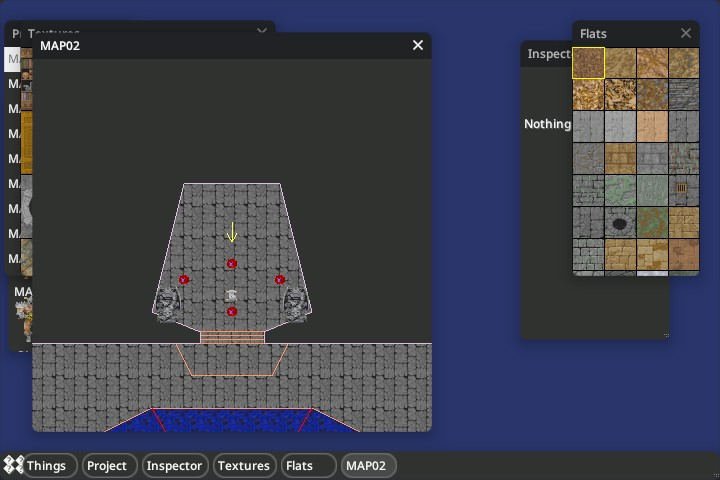
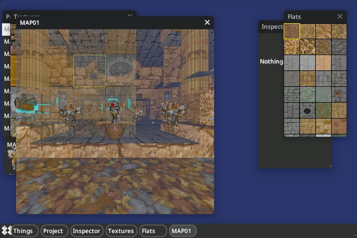

# Doom Editor

Doom-ED is now a native Orion application. It builds against the current split
Orion libraries and a cglm 0.9.6 submodule, without a separate Doom-ED
checkout or nested UI dependency. Imported from `corepunch/doom-ed` commit
`0be92cd560120719a085a92854c6bcfffe70e679`. The root GPL-3.0 license applies;
cglm's MIT license is in `third_party/cglm/LICENSE`.

## Build and run

From the Orion repository root:

```sh
git submodule update --init --recursive
make doom-ed
build/bin/doom-ed /path/to/hexen.wad
build/bin/doom-ed /path/to/hexen.wad --map MAP02 --3d
make doom-ed-test
```

`make apps` also builds the editor. Game tables use separate translation
units; `build.mk` contains source and dependency rules. The editor uses the
Hexen game-data profile, as the original source did. This port preserves the
original behavior; it does not add WAD saving or other game-data profiles.

Click a map in Project to open it. The editor retains vertex/sector editing,
thing and texture palettes, property inspectors, 2D rendering and 3D preview.
Tab switches between editor and 3D view; the 3D view uses WASD and mouse capture.
Commercial WADs are excluded from Git. Local copies from the old checkout are
preserved in ignored `local/wads/`, with checksums in `reference/wads.sha256`.
Their upstream repository was `Akbar30Bill/DOOM_wads`, commit
`9b384dc68add3eb2f5eb7754654cafeeaea5103b`.




## Verification

```sh
build/bin/doom-ed --check-wad /path/to/hexen.wad
build/bin/doom-ed /path/to/hexen.wad --offscreen --screenshot /tmp/editor.jpg
build/bin/doom-ed /path/to/hexen.wad --offscreen --3d --screenshot /tmp/preview.jpg
```

The test target covers the actual WAD reader, valid and malformed map imports
through the built executable, production triangulation, and the original seven
suites. Several original suites contain copied functions; they remain as
historical coverage alongside tests of the real importer.

The WAD reader validates directory/lump bounds, record sizes and geometry
references. Backend GPU calls live in Orion's renderer; scene code uses its
`R_Gpu*` API. Routine diagnostics require `-DDOOM_ED_DEBUG=1`.

## Removing the old repository

The application source builds entirely from a standalone `orion-ui` checkout.
The original migration was made inside `~/Developer/mapview/ui`, whose `.git`
file referenced the parent's `.git/modules/ui`. Do not delete that parent until
all of the following have been verified on the machine holding those files:

1. Clone Orion **outside** `mapview` with `git clone --recurse-submodules
   https://github.com/corepunch/orion-ui.git ~/Developer/orion-ui` after the PR
   has merged. Do not use `git worktree`, `--shared`, or `--reference` here.
2. Preserve a separate backup of the entire old `mapview` directory, including
   hidden files, Git metadata, ignored resources and untracked maps. Record
   `git status --short --untracked-files=all` in both the parent and nested UI,
   and preserve any unpushed commits before retiring either repository.
3. Copy local WADs and local data from both old checkouts into the independent
   copy, preserving their relative paths. The conventional WAD destination is
   `apps/doom-ed/local/wads/`. Check copied files byte-for-byte (`cmp`) and use
   `reference/wads.sha256` for known reference WADs. Keep personal maps and
   other files too, even when they are absent from that reference manifest.
4. Confirm `git rev-parse --absolute-git-dir` is inside the new checkout and
   `git rev-parse --git-common-dir` resolves there too. Confirm no
   `objects/info/alternates` file references the old repository. Recursively
   check the initialized submodules as well.
5. From the new root run `make doom-ed doom-ed-test`, then `--check-wad` on
   the preserved Hexen IWAD. Launch the editor and verify map selection,
   vertex/sector editing, palettes, property inspectors and Tab/3D WASD/mouse
   navigation. Capture both views using the commands above.
6. Repeat launch and build with the old directory temporarily renamed and
   restore its name afterwards. Only retire it once the independent copy,
   verified resources and backup have all been confirmed.

A successful CI run verifies a fresh checkout and synthetic WAD imports; it
does not confirm preservation of files that exist only on your Mac. Retiring
the Doom-ED GitHub repository does not require deleting the local directory.
