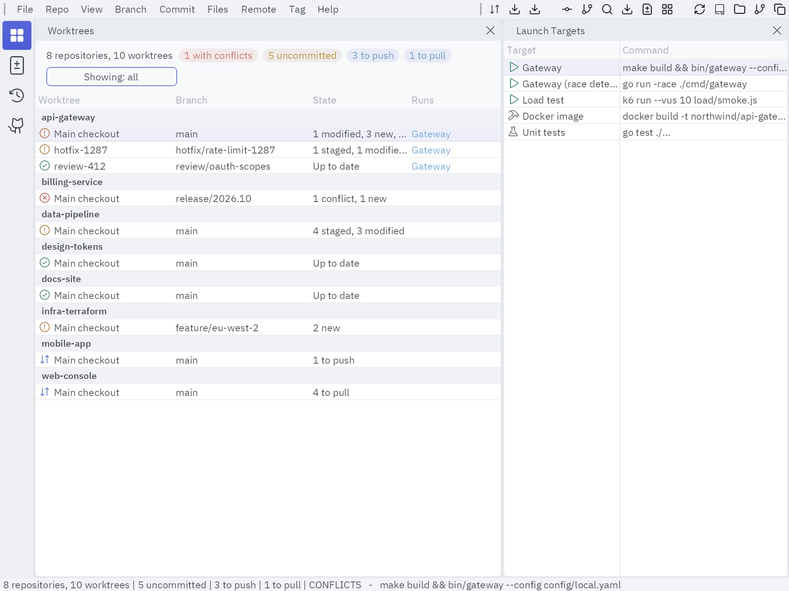
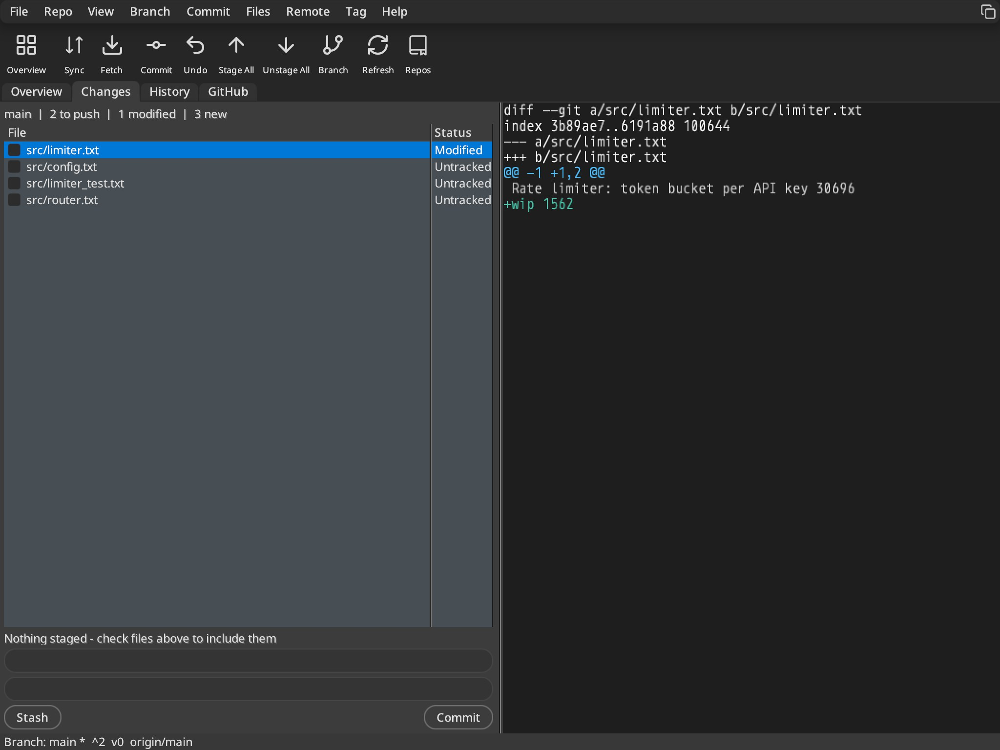

# Git Client

A SmartGit-style repository viewer built with the Orion UI framework.

## Menu tree as the application map

`gitclient.orion` treats the menu tree as the complete map of user-facing Git
capabilities. Each menu item declares one action and may declare its default
keyboard shortcut with `shortcut="..."`. Toolbars and context menus reference
those actions with fully qualified `command="group.action"` values; they never
create separate command IDs.

If a new user operation cannot be represented by an existing menu item, add the
menu item first, then expose it on other surfaces as needed. This gives menus,
toolbar buttons, context menus, keyboard shortcuts, and tests one shared action
identity.

## Two modes: Overview and Focus

**Overview** (Ctrl+0) lists every checkout of every repository in the workspace, grouped by
repository: the main checkout first, then each linked worktree, wherever git put it. Each row shows
the branch, the state in words ("3 modified, 1 new", "2 to push", "Up to date") and the target that
runs by default. The row icon gives the verdict at a glance: a red cross for conflicts, an amber
warning for uncommitted changes, blue arrows for commits to push or pull, a green check when in sync.
The right pane lists the selected checkout's [launch targets](#launch-targets-launchxml); the status
bar shows the selected target's full command.

Double-click a target, click its icon, or press Run to start it. It runs in the checkout as
`/bin/sh -c command` inside the Terminal app's `TerminalView` (the `terminal_components` plugin),
in a PTY, so colours and progress lines look as they do in a shell. While it runs, its icon is a
stop sign and Run reads Stop. Click either to end the target's process group. A second click kills it.
Output stays out of the way: the Terminal button shows or hides a pane below the targets with
one tab per target that ran. A target that fails, rather than being stopped, opens that pane by itself.
Running the target again reuses its tab. Targets use their parameters' default values. Windows has
no PTY yet, so targets do not run there.

Drop a git folder onto the window to add its repository. File → Save Workspace writes a `.gitworkspace`
file of main-worktree roots; pass that file to reopen every repository at once. File → Remove from
Workspace (also on the row's context menu) drops the selected row's repository.

| Input | Action |
|---|---|
| Arrow keys | move between checkouts |
| Double-click / Enter | open the checkout in Focus mode (Changes if dirty, otherwise History) |
| Ctrl+0 | toggle Overview and the last Focus page |
| Ctrl+O | open a workspace file |
| Ctrl+S | save the workspace |
| Ctrl+Shift+R | fetch every repository in the background |
| All / Needs attention | show every checkout, or only those with changes, conflicts or commits to sync |

Opening a checkout switches pages at once. Changes, History, branches, tags, worktrees and the
branch/ahead/behind status are read on worker threads (`git_repo_snapshot_async`,
`git_sync_status_async`) and applied on the UI thread when `evRepoLoaded` / `evSyncStatusLoaded`
arrive; the status bar says "Loading <name>..." meanwhile. One load per kind runs at a time, a
refresh requested during it runs afterwards, and results for a repository that is no longer open are
dropped (`repo_generation`). Tests set `sync_loads` or call `gc_refresh_all_sync()` to read inline.

**Focus** is the classic single-repository view (Changes, History, GitHub). It opens with a summary
line (branch, to push/pull, staged/modified/new counts), tells you what Commit will do
("Commit 3 staged files" or "Nothing staged"), and has an Overview button on every page. The worktree
combo under the menu switches checkouts; View → Worktrees opens the same switcher.

The History sidebar is the branch desk: current / default / local / remote-only rows, last activity,
and toolbar actions that used to live only in dialogs — **Prune**, **Delete Merged**, and **Worktrees**.
View → All Commits loads `--all`; View → Reflog loads `git log -g`. Selecting a branch reloads that
branch's log instead of leaving you stuck on HEAD.

The page is two TableViews over the transient tables of the `workspace` database declared in
`gitclient.orion` (`db_schema_xml`, no adaptor code): `checkouts`, grouped by `project`, and `targets`,
a detail list that follows the selected checkout. `view_overview.c` fills them from
`git_workspace_checkouts` in `git_backend.c` (one `git_summary_t` per checkout) and from each checkout's
`launch.xml`. A saved workspace, several folder arguments, or `--overview` opens it:

```bash
apps/gitclient/share/demo/make_workspace.sh /tmp/ws
build/bin/gitclient /tmp/ws/workspace.gitworkspace
build/bin/gitclient $(cat /tmp/ws/paths.txt)
build/bin/gitclient /tmp/ws/work/api-gateway
```




## Launch targets (launch.xml)

A `launch.xml` at a repository's root says how to start that checkout. It is committed with the
code, so every worktree and branch shows its own targets: a level added on a branch appears only in
that worktree. Agents keep it current: when a change adds or renames a way to run the project, the
same change updates `launch.xml`.

```xml
<launch project="x-com">
    <target name="City" default="true" run="swift run XComCity" />
    <target name="Preset" run="swift run -c release XComCity">
        <env name="XCOM_AUTOSTART" value="${preset}" />
        <param name="preset" choices="preset1 preset2 preset3 demo" />
    </target>
    <target name="Map" dir="viewer" build="make" run="../build/ufo-viewer --map ${map}">
        <param name="map" default="tactical/scenes/special/tutorial.scene" />
    </target>
    <target name="Tests" kind="test" run="swift test" />
</launch>
```

| Element / attribute | Meaning |
|---|---|
| `<launch project=>` | Root element; `project` is informational. |
| `<target name= run=>` | A way to start the checkout. Names are unique within the file. |
| `build=` | Runs first; `run` starts only when it succeeds. |
| `dir=` | Directory, relative to the checkout, both commands run in. |
| `kind=` | `run` (default), `build` or `test`; the list marks each with its own icon. |
| `default="true"` | The target the Overview row shows under Runs (at most one). Without it, the first `run` target. |
| `<param name= choices= default=>` | A value substituted for `${name}` in `build`, `run` and env values. `default` falls back to the first of the space-separated `choices`. Values are shell-quoted. |
| `<env name= value=>` | An environment variable set for `run`. |

A target has at most 4 params and 4 env variables; a file at most 32 targets. A malformed file is
rejected as a whole: the reason goes to stderr with its line number and the Runs column says
"launch.xml has errors". `gc_launch.c` reads the file and builds each target's shell command
(`gc_launch_command`); this repository's own [launch.xml](../../launch.xml) is an example.

## Rearranging views

Each activity Page directly owns its [docking layout](../../docs/page-docking.md).
The initial split tree, orientations, and ratios remain declared in
`gitclient.orion`:

- Overview keeps the checkouts and their summary on the left, launch targets on the right.
- Changes keeps its files and commit form on the left, with Diff on the right.
- History keeps Branches, Tags, Stash, Worktrees, Commits, Files, and Diff in
  their existing positions. The original Stash pane still hides when empty.
- GitHub keeps Issues above Pull Requests.

Drag a view's tab onto another pane to group the views, onto its TabBar to choose
an insertion position, or near an edge to split. The snap overlay previews the
result. Empty source panes collapse, and Escape cancels a drag. Each activity
page keeps its own layout while switching pages. Layout changes last for the
current app session; `.gitworkspace` continues to store repository paths.

Moving a view preserves its actual controls, database bindings, selections,
context menus, diff state, and commit draft. The Changes file list and commit
form move together. The View menu also provides Focus Next Pane (Ctrl+Alt+Tab),
Next View Tab (Ctrl+Tab), Move View to Next Pane (Ctrl+Shift+M), and directional
split commands (right: Ctrl+Shift+E, below: Ctrl+Shift+O). On macOS the primary
modifier is Command. Orion automatically supplies Split and Close at the right
of each pane's title bar. Alt changes Split Right to Split Down. These actions
target their own pane even when another has focus. Splitting separates the
current tab from its group; with one tab, Split Right/Down creates an empty
group for docking other views. Close hides the current view without discarding
its state or bindings. View → Show Closed Views restores it; Ctrl+Shift+W also
closes the active view. No per-app pane toolbar declaration is needed.

## Architecture

The application follows a **database-driven** pattern where the model layer defines data structures and the UI auto-populates from the database. Views contain minimal code — almost no manual population loops, no array management, no hardcoded column setup.

```
Git repo (.git/) ──git CLI──► git_backend.c ──► database_t (in-memory cache)
                                                       │
                                              ┌────────┼────────┐
                                              ▼        ▼        ▼
                                          branches  commits   files
                                          table     table     table
                                              │        │        │
                                              └────────┼────────┘
                                                       ▼
                                              TableViews (auto-populated)
```

### Key principle: the UI doesn't know about git

Views are bound to database columns in `gitclient.orion`. When you call `send_message(win, tvRefresh, 0, NULL)`, the tableview fetches records from the database and renders them automatically. No iteration, no column setup, no manual population.

## Files

| File | Purpose |
|------|---------|
| `gitclient.orion` | Declarative schema, capability map, shortcuts, toolbars, default pane trees and forms |
| `view_panes.c` | Routes view-navigation and docking commands to Page |
| `datasource/gitclient_db.c` | Database procedure — in-memory tables populated from git |
| `datasource/changes_database_proc.c` | Changes-tab adaptor — working-tree files from git status |
| `datasource/github_database_proc.c` | GitHub adaptor — issues and PRs from the gh CLI |
| `controller.c` | Business logic — `gc_load_from_git()`, stage, commit, branch |
| `git_backend.c` | Git CLI wrapper (popen-based) |
| `view_main.c` | Main window proc — event routing only |
| `view_diff.c` | VGA diff viewer (custom rendering) |
| `view_menubar.c` | Command dispatch |
| `dialogs/dlg_*.c` | Dialogs using generated forms |

## How it works

### 1. Schema in `.orion`

```xml
<databases>
  <database name="db" class="gitclient_db">
    <table name="commits">
      <field name="hash" type="string" length="41"/>
      <field name="author" type="string" length="64"/>
      <field name="date" type="string" length="20"/>
      <field name="subject" type="string" length="256"/>
    </table>
  </database>
</databases>
```

The compiler generates `db_commit_t`, `ID_DB_COMMITS`, `commits_fields[]`, etc.

### 2. Form binding in `.orion`

```xml
<form name="main_window" width="800" height="480"
      role="host" active-page="history_page" flags="statusbar">
  <ActivityBar name="activity">
    <Page form="history_page" command="view.history" />
  </ActivityBar>
</form>

<form name="history_page" title="History" width="800" height="440" role="page"
      icon="gc-nav-history" checked-icon="gc-nav-history-fill" focus="log">
  <TableView name="log" source="db.commits">
    <Column field="subject" title="Subject" width="0" />
    <Column field="author" title="Author" width="110" />
    <Column field="date" title="Date" width="90" />
  </TableView>
</form>
```

No C code is needed for column setup. The tableview reads field IDs from the
form definition. This abbreviated example shows one destination; the app declares
Overview, Changes, History, and GitHub, with Changes selected initially.
`page_host_init` connects runtime page procedures to these declarations.
Orion owns page creation, docking, visibility, rail selection, and focus restoration;
`evPageChanged` triggers Git Client's refresh and status logic. The existing
page layouts stay in their forms. See [PageHost and Page](../../docs/page-host.md).

### 3. Populate from git

```c
void gc_load_from_git(void) {
    // Clear tables
    send_db_message(gc->db, dbDelete, ID_DB_COMMITS, (void*)(intptr_t)0);

    // Fetch from git and insert
    git_commit_t raw[500];
    int count = git_get_log(gc->repo, raw, 500);
    for (int i = 0; i < count; i++) {
        db_commit_t rec = {0};
        strncpy(rec.subject, raw[i].subject, sizeof(rec.subject) - 1);
        send_db_message(gc->db, dbInsert, ID_DB_COMMITS, &rec);
    }
}
```

### 4. Refresh

```c
void gc_refresh_all(void) {
    gc_load_from_git();  // populate DB from git
    send_message(gc->log_win, tvRefresh, 0, NULL);  // tableview auto-updates
}
```

That's it. No array bounds checking, no max count limits, no manual iteration.

## Database as query layer

The database is **not persisted** — git is the source of truth. The database is a structured cache that views query uniformly:

```c
// Fetch all commits
result_node_t *commits = send_db_message(gc->db, dbFetch,
    MAKEDWORD(ID_DB_COMMITS, 0), (void*)(intptr_t)0);

// Find specific record
db_branch_t *branch = send_db_message(gc->db, dbFind,
    MAKEDWORD(ID_DB_BRANCHES, ID_DB_BRANCHES_NAME), (void*)"main");

// Free result lists
free_result_list(commits);
```

## Dialogs

Dialogs use generated forms. The view file is just an event handler:

```c
bool gc_show_commit_dialog(window_t *parent, bool amend) {
    commit_dlg_state_t st = { .amend_requested = amend };
    show_dialog_from_form(&gc_commit_dialog_form, "Commit", parent,
                          commit_dlg_proc, &st);
    return st.result;
}
```

The form definition (`gc_commit_dialog_form`) is generated from the `.orion` file — controls, layout, button IDs, all declarative.

## Building

```sh
make build/bin/gitclient
```

The build system:
1. Runs `orionc` to generate `build/generated/apps/gitclient/gitclient.h` from `gitclient.orion`
2. Compiles the GitClient sources in `apps/gitclient/` into one executable

## Adding a new data source

1. Add table to `gitclient.orion`:
   ```xml
   <table name="tags">
     <field name="name" type="string" length="128"/>
     <field name="hash" type="string" length="41"/>
   </table>
   ```

2. Add fetch logic to `controller.c`:
   ```c
   git_tag_t raw[128];
   int count = git_get_tags(gc->repo, raw, 128);
   for (int i = 0; i < count; i++) {
       db_tag_t rec = {0};
       strncpy(rec.name, raw[i].name, sizeof(rec.name) - 1);
       send_db_message(gc->db, dbInsert, ID_DB_TAGS, &rec);
   }
   ```

3. Add a `<TableView source="db.tags">` to a form.

No view code to write. The tableview auto-populates.
