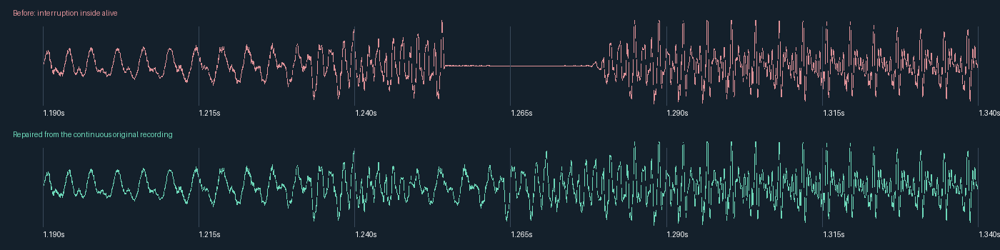

# Vocal revision — 15 October 2026

Replaced **Turn It Up Crew**, **Yeah Keep Moving**, and **Rock This Place** with
complete, continuous four-line rap verses at 140 BPM. Their existing names, IDs,
filenames and four-bar lengths remain compatible with saved projects. Added four
compact male calls (Come On, Let's Go, Hey Yo, Move Now) and two female wordless
scats (Ba Da Bap, Doo Yah). Each new call/scat has 0.475–0.88 seconds of voice in a
one-bar slot; the remaining time is release/tail silence.

| Rap | Previous voice activity | Replacement voice activity |
| --- | ---: | ---: |
| Turn It Up Crew | 39.2% | 90.2% |
| Yeah Keep Moving | 74.5% | 90.6% |
| Rock This Place | 67.4% | 89.6% |

Activity is a diagnostic, measured with a 5 ms RMS window and a threshold of the
larger of 0.005 amplitude or 2.5% of the clip's maximum RMS. It is not a listening
score. The replacement transcripts contain full verses rather than repeated
short chants. Natural pauses within lines remain.

## The glitch in “alive”

The waveform showed a roughly 25 ms residual interruption inside **alive**, near
1.25 seconds. The original isolated recording is continuous there. The old
alignment master contains 30.59 ms of exact zero padding immediately before the
next landmark; the previous 8 ms seam repair did not span the entire dropout.



The same pass covered all 55 existing vocals. It found and repaired **30 residual
padding dropouts in 23 files**, using authentic original isolated-source waveform
handles, with a 12 ms cosine crossfade into the repair and a 4 ms exit. No silence
was invented or interpolated across the missing syllables. Outside these small
patch regions, the lossless masters are unchanged. Another 35 candidate seams
were reviewed and needed no new patch; three rap replacements supersede their
old seams. The seven full-slot before contact sheets, five repair-detail sheets,
and eight final audit sheets were visually reviewed.

## Production and verification

New performances were generated with Runway, isolated with Mel-Band RoFormer on
MPS (native FP16, segment 128, overlap 2), and edited as complete rap lines or
complete one-shots. Pitch-preserving FFmpeg `atempo` operates on continuous
phrases. Its filter is flushed after the genuine release, so no interior padding
can split a word. A 35 ms attack head is retained with an 8 ms overlap into the
stretched body. All new exports use a −2 dBFS peak target and a 25 ms release fade.

The first Turn It Up Crew take was rejected for a corrupted sustained vowel.
Its retry was used. The first Yeah Keep Moving take was selected over the slower
retry. Both selected takes were delivered at half-time by the generator; complete
lines were fitted at pitch-preserving rates below 2.0, without individual-word
stretching. Rock This Place required only small timing changes.

All **61 delivered vocals** pass the current Groove MP3 decoder: exact original
bar lengths, mono 44.1 kHz, finite audible PCM, no clipping, first signal within
5 ms at −55 dBFS, and quiet endpoints. All 105 checked attack templates in repaired
files retain their placement (minimum correlation 0.999864). All 18 new line/call
attack templates match within 2 ms (minimum correlation 0.999906). Template matches
verify the retained source landmarks, not every perceived syllable attack.

The app and test executable build. All **22 Groove tests pass**, and all 61 build
resource hashes match the installed samples. The six added clips brought the
library to 518 entries, so capacity increased from 512 to 1024; a compile-time
capacity check now prevents another silent array overrun. New entries are appended
after existing definitions to preserve IDs.

**Limits:** listening was unavailable. PCM plots, source comparisons and
unprompted ASR were reviewed; they cannot certify exact voice identity or total
absence of quiet separation artifacts. ASR hears the final word of Rock This Place
as “pounds” in the source and “bounce” in the export; that lexical distinction is
not independently confirmed. A running Groove session caches PCM and must be
relaunched to load the revised resources.

## Evidence and reproduction

- [Generation plan](generation-plan.json), [retry prompts](retry-plan.json), and
  [sanitized manifest](manifest.json): full prompts, task IDs, requested versus
  delivered content, source/delivery hashes, processing and advisory transcripts.
- [Edit plan](edit-plan.json): independently reviewed source regions and final
  line timing. Individual syllables retain natural phrasing.
- [Repair plan](repair-plan.json), [repair evidence](repair-repairs.json), and
  [repair verification](repair-verification.json).
- [New export checks](verification-new.json), [new attack checks](new-attack-verification.json),
  and [all 61 decoded checks](verification-all.json).

Raw generations, both separation stems, model files, pre-edit backups and PCM24
masters remain ignored under `tools/groove_audio/work/vocal-revision-2026-10-15/`.
Signed output URLs stay there and are excluded from the durable manifest.

From the repository root, using the audio environment in `tools/groove_audio/README.md`:

```sh
python tools/groove_audio/repair_vocal_dropouts.py \
  --plan apps/groove/docs/vocal-revision-2026-10-15/repair-plan.json \
  --out-dir tools/groove_audio/work/vocal-revision-reproduction-repairs
python tools/groove_audio/process_vocal_phrases.py \
  --plan apps/groove/docs/vocal-revision-2026-10-15/edit-plan.json \
  --out-dir tools/groove_audio/work/vocal-revision-reproduction-phrases
```

Both commands require the preserved local sources, use a fresh staging directory,
and leave app assets untouched.
