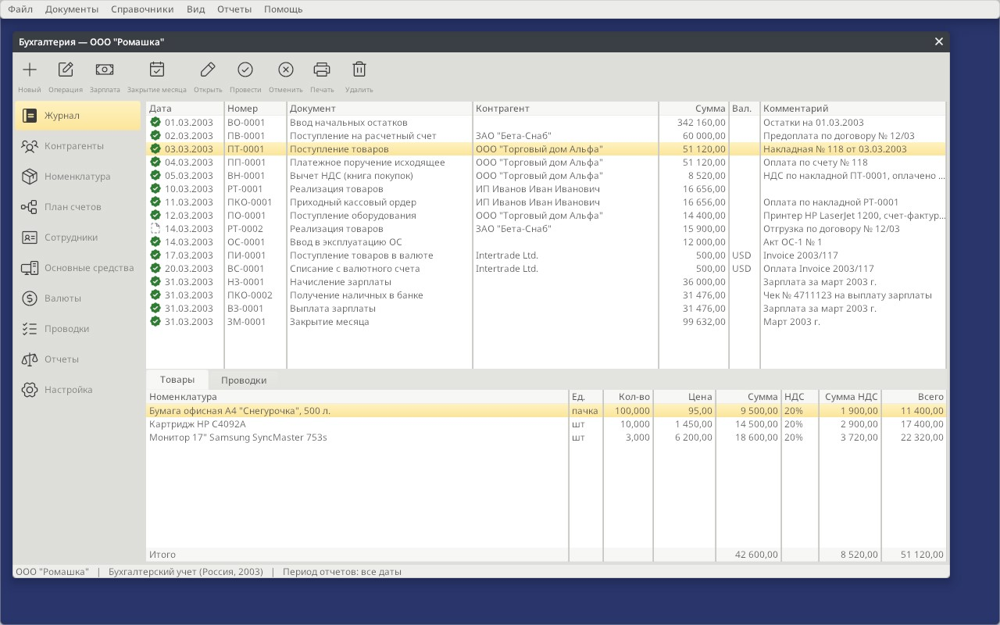
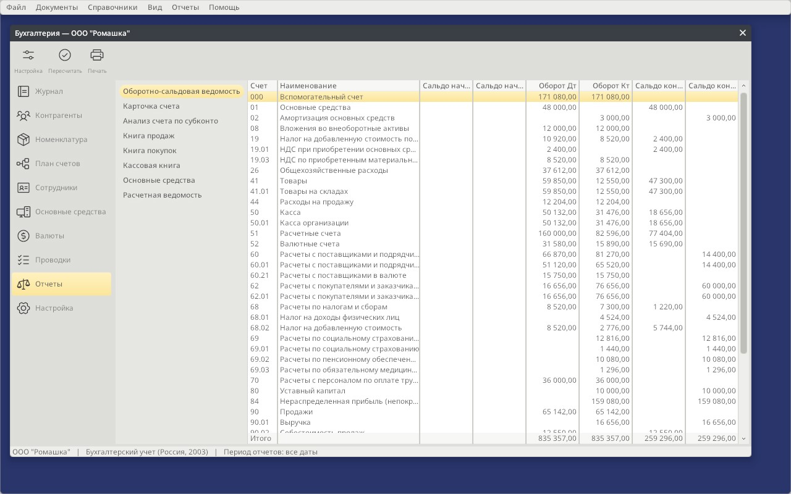
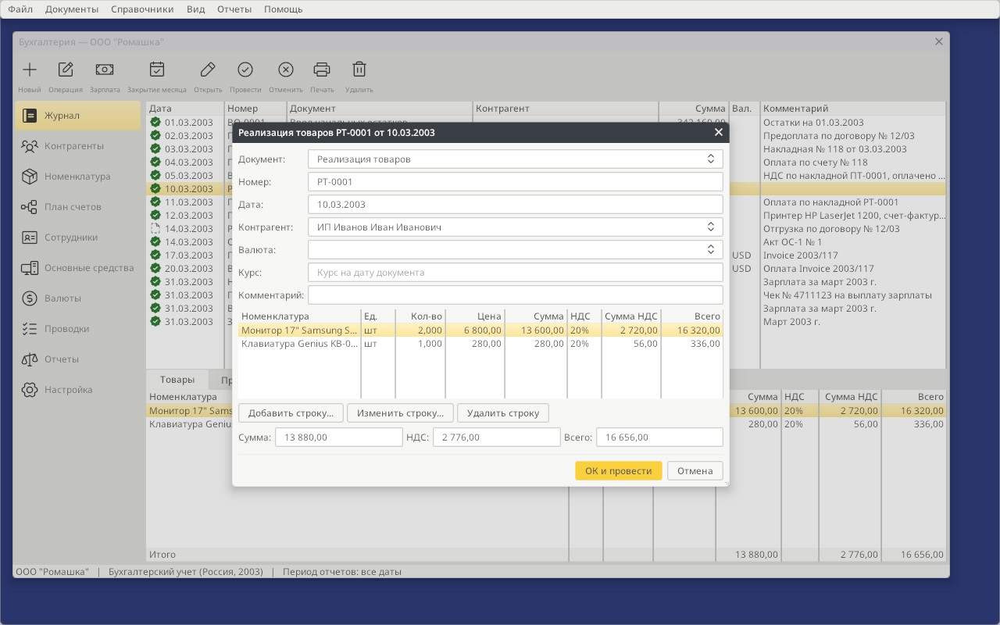

# Ledger



Double-entry bookkeeping in the spirit of the early-2000s desktop accounting
suites (1C:Accounting 7.7, its German contemporaries), kept current for the
rules of 2026. Four country configurations ship: **Russia 2026** and
**Germany 2026 (SKR 03)** for keeping books today, and Russia 2003 and
Germany 2003 as historical references. Each is usable in Russian, German and
English. [COMPLIANCE.md](COMPLIANCE.md) records the legal basis of the 2026
configurations and the yearly process of refreshing them.

```bash
make build/bin/ledger share
build/bin/ledger                       # last selected configuration (ru-2026)
build/bin/ledger --config de-2026 --lang de --data /tmp/books
python3 -I apps/ledger/tools/check_configuration.py --all apps/ledger/share/configurations
```

## Demo data

Launch the Russian or German demo:

```sh
make run-ledger-ru
make run-ledger-de
```

Each target builds Ledger and its shared assets and opens a fresh temporary
infobase with the configuration's 2003 demo: purchases, sales, payments,
and their document lines. The Russian demo uses ООО "Ромашка" with 32 documents,
8 counterparties and 10 products; the German demo uses Musterfirma GmbH with
18 documents, 6 counterparties and 8 products. March covers opening balances,
payroll, fixed assets and month-end work; April adds equipment and office-supply
purchases, paid sales, and draft orders. The target prints the data directory,
which remains available after closing Ledger so you can reopen your edits with
`--data`.

## Features

| Area | What Ledger does |
|---|---|
| Documents | Journal of typed documents with numbering by prefix, lines, totals with VAT, post / unpost / delete; posting rules come from the configuration |
| Goods | Receipts and sales by item; a sale writes the goods off at average cost (Dt 90.02 Kt 41.01) |
| Manual operations | `Documents > New Manual Operation` (Ctrl+M): entries typed by the accountant; opening balances are an operation of that kind |
| Analytics | Each account has an analytics kind (counterparties, items, employees, fixed assets); every entry keeps the debit and the credit object separately |
| Payroll | Employees with salary, allowance and expense account; accrual with withheld income tax and employer contributions from the configuration's payroll taxes: flat rates with monthly or annual caps, progressive scales (cumulative as НДФЛ or annualized as Lohnsteuer), allowances with an income limit, all effective-dated by document date; payout of what is owed; payroll statement |
| Fixed assets | Asset register; putting assets into service; straight-line depreciation in month-end closing |
| Currencies | Currencies and exchange rates; documents in a currency post at the day's rate and keep both amounts; currency accounts are revalued at month end |
| Month-end closing | `Documents > Close Month...` (Ctrl+E) runs the configuration's closing rules: depreciation, revaluation, closing expense accounts and the month's result |
| Reports | For a period set in `Reports > Settings...` (Ctrl+R): trial balance (opening, turnovers, closing, roll-up to parent accounts), account card, analysis by analytics object, sales and purchase VAT books per document and rate, tax summary per rate (the VAT return's lines), journal of the period, cash book, fixed assets, payroll statement |
| Print forms | HTML templates with amounts in words. ru-2026: счет-фактура and УПД per Decree 1137, invoice for payment, КО-1/КО-2/КО-4, payment order 0401060 (762-П), расчетная ведомость Т-51, books of sales and purchases, VAT summary for the return, trial balance, journal. de-2026: Rechnung per § 14 UStG, Quittung, Lohnjournal, Kassenbuch, Summen- und Saldenliste, UStVA Kennzahlen, Buchungsjournal and a **DATEV Buchungsstapel** CSV export. The 2003 configurations keep their TORG-12, KO forms, T-49, Rechnung and Lohnjournal |
| Legal basis | `Setup > Legal Basis` lists the acts each configuration implements with the date they took effect and where to re-check them |
| Storage | One XML infobase per configuration, saved on `File > Save` or on exit |
| Import from 1C | Catalogs and opening balances from a 1C:Enterprise 8 exchange file (EnterpriseData), see below |

`Reports > Recalculate` (F5) reposts every document in date order and rebuilds
the reports; `Reports > Print Report Forms` writes the cash book.

## Look and feel

Clippy appears by default in the bottom-right corner, with a speech bubble for
commands such as `show debtors` or `покажи должников`. Click the character to
collapse or reopen the bubble; **File > Assistant** (Ctrl+Shift+A) restores it
after hiding. Dialogue context and unfinished input survive collapsing.
Use `--no-assistant` to start without him, or `--assistant` to focus his input
immediately. See the [assistant guide](share/addons/assistant/README.md).

Ledger is built for people who keep books in 1C all day, so its layout is the
one they expect: a section panel, a journal over the document's lines, and a
default button that posts. Its look is Porcelain (`THEME_ledger=porcelain`, the
default here): cool white surfaces, white tables and fields, and indigo for the
current row, the current section and the default button (`OK and Post`).
Porcelain follows the system appearance: when macOS or Windows switches to dark
mode, Ledger switches to Porcelain Dark, and back. `--appearance light|dark`
pins one.

- **Section panel.** Every section has an icon and a caption (`labels="right"`
  on the ActivityBar, `label=` on each page). The panel runs from the window's
  top to its status bar in its own colour. `View > Show or Hide Sidebar`
  (Ctrl+B) or the button at its top collapses it to an icon rail.
- **Title row.** One row holds back and forward (Alt+Left, Alt+Right), the
  page's title over the organization's name, the page's buttons and the window
  controls, as Finder and Mail do. The host's toolbar declares the sidebar
  toggle, a `<sidebar-separator />`, back, forward and `<title />`; the active
  page adds its buttons (`flags="toolbar,titletoolbar"`). Tooltips name each
  command.
- **Status icons.** Posted documents show a green seal and drafts a dashed
  sheet. Catalogs, the chart of accounts and the entry journal have their
  own row icons, and an asset not yet in service shows a clock (`<RowIcon>`).
- **Totals.** Document lines, entries and every report end in a pinned
  `Totals` row (`total="sum"`). The trial balance totals count top-level
  accounts only, so debit and credit agree (`totals-skip="subaccount"`).
- **Document captions.** A document dialog is titled like the document,
  e.g. «Реализация товаров РТ-0001 от 10.03.2003».



## Platform and configuration

Ledger separates the **platform** from the **configuration**, the way 1C:Enterprise
separates its engine from a country's typical configuration.

| Layer | Where | What it holds |
|---|---|---|
| Platform | `ledger.orion`, `*.c` | Schemas, screens, menus, posting engine, print engine |
| Configuration | `share/configurations/<code>/` | Chart of accounts with analytics kinds, units, tax rates (with optional automatic accounts), document types with posting rules, effective-dated payroll taxes and tax scales, closing rules, print forms, the regulations behind them |
| Infobase | `<settings>/ledger/<code>/infobase.xml` | The organization's counterparties, items, documents, entries and totals |

The platform never names an account, a tax rate or a national form. A document
type in the configuration says which accounts it debits and credits, whether
amounts include tax, and which print forms it has. Supporting another country
means adding a configuration directory, not changing code.

`File > Select Configuration...` lists `share/configurations/index.xml`; each
configuration opens its own infobase on the next start. A new infobase starts
from the configuration's `demo.xml` and is posted on first open.

## Languages

The interface is written in English and translated by string catalogs
([docs/localization.md](../../docs/localization.md)). Three layers stack:

1. the framework's catalog (`share/locale/` → message boxes, file picker);
2. Ledger's own, `share/locale/ru.xml` — every menu, form, column and message;
3. the configuration's, `configurations/<code>/locale/` — national terms. The
   platform says "Tax ID" and "Tax"; `ru-2003` turns them into "ИНН" and "НДС"
   in Russian and "INN" and "VAT" in English.

The language is the one chosen in `File > Language...`, otherwise the
configuration's (`ru` for `ru-2026`), otherwise the system's (`LANG`).
`--lang ru|de|en|qps-ploc` overrides it for one run; `qps-ploc` is the
pseudo-locale for checking layouts. Numbers and dates follow the catalog:
`16 656,00` and `10.03.2003` in Russian.



After changing texts in `ledger.orion`, refresh the catalog and translate the
new entries:

```bash
build/bin/orionc --input apps/ledger/ledger.orion --strings apps/ledger/share/locale/ru.xml
```

## Import from 1C

`File > Import from 1C (EnterpriseData)...` reads the exchange file that
1C:Enterprise 8 writes in the EnterpriseData format (Администрирование →
Синхронизация данных → Выгрузка данных в файл, or the «Выгрузка загрузка
EnterpriseData» processor). Catalogs come from any configuration that speaks
the format. Opening balances come from those that send them in it: Trade
Management 11, Integrated Automation, ERP and Small Business. Accounting 3.0
exchanges catalogs only. Ledger takes:

| 1C object | Ledger |
|---|---|
| Справочник.Контрагенты | Counterparties: name, INN, KPP, legal address and phone |
| Справочник.Номенклатура | Items: name, code; unit by its OKEI code, VAT rate by value |
| Справочник.ФизическиеЛица, Сотрудники | Employees: full name, INN; the expense account of the others |
| Справочник.ОсновныеСредства | Fixed assets: name, inventory number; accounts and life of the others |
| Справочник.Валюты | Currencies by ISO code; the national one is left out |
| Документ.Остатки… | One posted «Ввод начальных остатков» operation against the opening account (000) |

The balance documents name what they hold, not an account:
ОстаткиРасчетовСПоставщикамиДолги, ОстаткиСобственныхТМЦ,
ОстаткиБезналичныхДенежныхСредств and so on. The configuration's
`balance_rules` give each one its account and side, plus a currency account
for rows in a foreign currency. In ru-2003 these are 50.01, 51/52, 62.01,
62.02, 60.01/60.21, 60.02, 71, 41.01 and 66. A row's `СуммаРегл` is the entry
amount and its `Сумма` the currency amount. Rows of goods may carry only a
`Количество`, as Trade Management sends them without cost.

A row's counterparty, item or employee becomes the entry's analytics. It is
read from the row or from its `ДанныеНоменклатуры` / `ДанныеВзаиморасчетов`,
and added to its catalog if new. Records already kept are matched by INN,
code or name. Balances with the same exchange-body SHA-256 identifier are not entered twice,
even if the file is renamed or the UI language changes. Different exchanges
for the same date are imported separately; overlapping exports are additive,
so use disjoint exports rather than snapshots of the same balances. The
identifier is stored on the opening document, independently of its comment.
Older imports without an identifier cannot be recognized automatically. A
matching legacy date/type/comment is refused explicitly; check existing opening
balances before importing legacy files, especially if their comments were edited
or created in another UI language. The
whole file is one change: a file that fails leaves the infobase as it was.
A summary lists what was added and the balance documents the configuration
has no account for.

### Real EnterpriseData export for validation

The original large validation file is inside a public RAR archive, not a
standalone XML download:

- Repository: [Nekitosha-IT/ostatki](https://github.com/Nekitosha-IT/ostatki).
- Archive: [Остатки- 15-10-2026.rar](https://github.com/Nekitosha-IT/ostatki/blob/main/%D0%9E%D1%81%D1%82%D0%B0%D1%82%D0%BA%D0%B8-%2015-10-2026.rar), about 352 KB.
- Contents: `Остатки.xml`, about 26 MB unpacked; EnterpriseData 1.24 from
  1C:Trade Management, created 2026-10-14.
- Verified archive SHA-256:
  `7ce45bdce2d45b24e5212f083b52f6abab7bfb3c7cac1a449994b009961e1076`
  (351,848 bytes compressed; XML: 26,577,727 bytes).

From the repository root, download and unpack outside the checkout:

```sh
mkdir -p /tmp/orion-ledger-1c-validation
curl -fL 'https://github.com/Nekitosha-IT/ostatki/raw/main/%D0%9E%D1%81%D1%82%D0%B0%D1%82%D0%BA%D0%B8-%2015-10-2026.rar' \
  -o /tmp/orion-ledger-1c-validation/opening-balances.rar
bsdtar -xf /tmp/orion-ledger-1c-validation/opening-balances.rar \
  -C /tmp/orion-ledger-1c-validation
```

`7z x` or `unrar x` can replace `bsdtar -xf`. Import
`/tmp/orion-ledger-1c-validation/Остатки.xml` through
`File > Import from 1C (EnterpriseData)...` in a disposable ru-2003 infobase.
Do not commit the archive, XML or resulting infobase: the public export
contains a real company's data.

The original validation recorded 10,153 entries, 5,747 items and 67
counterparties, with supplier debts totalling 31,265,821.36. These are prior
reference results, not a claim that a later revision has been checked.
Catalog counts depend on the starting infobase; record that baseline when
comparing results. Goods rows in this export carry quantities without cost.
Check posting accounts, analytics and totals against the XML, then repeat
import and verify that no opening entries are added. Use
`apps/ledger/tests/enterprisedata_sample.xml` for the small synthetic fixture
and automated regression tests.

## Local automation recipes and nodes

[Local Lua automation](AUTOMATION.md) adds 12 ready-made recipes, 16 typed node
operations, tag/task search, change previews and transactional catalog writes.
Business logic is Lua. API signatures, registration/argument guards and reference
are generated from XML; record metadata comes from `ledger.orion`. A headless
`ledger-run` host defaults to read-only execution. See the
[generated catalog](docs/automation-catalog.md), [API reference](docs/lua-api.md)
and [roadmap](ROADMAP.md) for 1C/online work planned separately.

## Scripting rules and plugins (`rules.lua`)

Tables cover the rules that have a shape the platform knows: rates, caps,
scales, accounts, forms. Rules of another shape go into the configuration's
**`rules.lua`**, the way a 1C configuration carries its modules, so a change
in the law is a change to the configuration directory, never to C:

| Hook | Declared by | The function receives |
|---|---|---|
| Posting of a document type (1C: ОбработкаПроведения) | `doc_types … script="post_writeoff"` | `ctx.document`, `ctx.type`, `ctx.rate`; writes entries with `ledger.entry{}` |
| A payroll tax or contribution | `payroll_taxes … script="soli"` | the above plus `ctx.tax`, `ctx.line`, `ctx.employee`, `ctx.ytd` (the year's pay before this document), `ctx.accruals`, `ctx.withheld`, `ctx.taxes[code]` (rows computed before); returns the amount |
| A month-end closing step | `closing_rules kind="script" script="…"` | the posting context plus `ctx.rule` |
| An event subscription (plugins) | `ledger.on("post", fn)` | `fn(ctx)` after every posting |

The `ledger` module offers `find(db, table, id)`, `fetch(db, table[, field, value])`,
`field(db, table, id, "counterparty.name")`, `account(code)`,
`entry{debit=, credit=, amount=, quantity=, item=, counterparty=, employee=, asset=, currency=, currency_amount=, content=}`
(accounts by code or id), `turnover(account[, subconto[, currency]])` with
the same semantics as the C engine (everything posted before this document
plus its own entries so far), `rate(currency_id, date)`, `round2(x)` and
`log(text)`. Records arrive as plain tables of their fields; scripts read the
databases and write entries, nothing else, so a faulty script cannot corrupt
the infobase. A failing hook is logged with `[ledger] script …` and the
document is not posted (a failing tax row is skipped).

Loading order, one Lua state per configuration: `<configuration>/rules.lua`,
then shared `stdplugs/*.lua`, then `<configuration>/plugins/*.lua`, then `<infobase dir>/plugins/*.lua` (the
organization's own plugins), each directory in name order. Shipped examples:

- `ru-2026/rules.lua`: `post_writeoff` (списание товаров at average cost,
  ФСБУ 5/2019) and `contributions_sme` (the reduced tariff for SMEs in
  priority industries, 15 % above 1.5 МРОТ); `plugins/10-cash-limit.lua`
  warns when a cash settlement exceeds 100 000 ₽ (указание № 5348-У).
- `de-2026/rules.lua`: `soli` (Solidaritätszuschlag with Freigrenze and
  Milderungszone, active) and `pv_an_kinderlos` (the childless surcharge in
  the Pflegeversicherung, opt-in); `plugins/10-kleinbetrag.lua` flags
  Kleinbetragsrechnungen (§ 33 UStDV).

`check_configuration.py` verifies that every `script=` names a function the
scripts define; `test_configuration_integrity` does the same with the real
Lua state.

## Add-ons (external processings)

**File → Open Add-on** runs an add-on, the way 1C opens an external processing
(`.epf`): a `.orion` form and a Lua script beside it, with no C and no
rebuild ([Lua Add-ons](../../docs/scripting.md)). Add-ons read and write the
infobase through `orion.model`, so `ledger_ib` numbers and recalculates what
they create, and they see a `ledger` module for what only Ledger knows:

| Call | Returns |
|---|---|
| `ledger.configuration` | the open configuration's code (`"ru-2026"`) |
| `ledger.account(code or id)` | `{id, code, name, analytics}` or `nil` |
| `ledger.movements(account, {from, to, subconto})` | each side of a posted entry on the account and its subaccounts, by date: `{date, document, number, account, corr, subconto, debit, credit, content}` |
| `ledger.turnover(account, {from, to, subconto})` | `{debit, credit, balance}` |
| `ledger.period()` | the report period's first and last date |
| `ledger.post(id)`, `ledger.unpost(id)` | `true`, or `nil` and a message |

This module is declared in `ledger_addons.cgen`; its Lua bindings are
generated by `tools/cgen.c`. It is not the `ledger` global of `rules.lua` and
plugins ([API reference](docs/lua-api.md)): add-ons run sandboxed, in a state
of their own.

`share/addons/penalties` is the first add-on: **penalties on overdue
receivables**. Payments settle a customer's oldest debt first; what is still
unpaid a payment term after its document is overdue, and the penalty is a
percentage of it per day. **Post Penalties** writes one manual operation with
an entry per overdue debt (ru: Дт 76 Кт 91.01 by counterparty; de: Soll 1400
Haben 2650, Sonstige Zinsen und ähnliche Erträge) and refuses a second run
on the same date. Its texts are in `share/addons/penalties/locale/`.

## Adding a configuration

1. Copy `share/configurations/ru-2026` to `share/configurations/<code>`.
2. Edit `configuration.xml`: `settings` (currency names for amounts in
   words, the national currency's ISO code, cash, payroll and opening-balance
   accounts), `subconto_kinds`, `accounts`, `units`, `vat_rates` (a rate
   may name its own revenue, expense and tax accounts, used by document
   types with `auto_accounts="1"`), `doc_types` (posting rules reference
   account ids; `form` picks the dialog and the posting), `payroll_taxes`
   with `valid_from`/`valid_to`, caps and scales, `tax_scales` for
   progressive taxes, `closing_rules`, `balance_rules` (1C import),
   `print_forms` and `regulations`.
3. Write the print templates in `print/` (HTML or CSV, see below) and a
   `demo.xml` infobase, or leave the demo empty.
4. Add a `<configuration>` row to `index.xml`.
5. Set `language` in `settings` and, if the country has its own terms, add
   `locale/<language>.xml` catalogs that rename the platform's neutral ones.
6. Run `python3 -I apps/ledger/tools/check_configuration.py share/configurations/<code>`
   and add the configuration to `test_configuration_integrity` coverage by
   listing it in `index.xml`; see [COMPLIANCE.md](COMPLIANCE.md) for the
   yearly refresh.

Print templates are HTML files filled from the document:

| Tag | Value |
|---|---|
| `{{number}}`, `{{total}}`, `{{counterparty.name}}` | Document fields and join paths |
| `{{doc_type.debit.code}}` | Joins across databases (infobase → configuration) |
| `{{org.tax_id}}`, `{{cfg.currency}}` | Organization details, configuration settings |
| `{{#lines}} {{n}} {{item.unit.code}} {{/lines}}` | One block per document line; any table works: `{{#payroll_lines}}` |
| `{{#cash_book}} ... {{/cash_book}}`, `{{period.date_from}}` | Report forms (`print_forms.report`) repeat a report's rows |
| `{{#vat_book book=1}}`, `{{#vat_summary book=1 vat_rate.rate=19}}` | Only the rows whose fields (or join paths) read the values |
| `{{date\|dmy}}`, `{{date\|ymd}}`, `{{date\|ddmm}}` | A date as DD.MM.YYYY, YYYYMMDD or DDMM (exports) |
| `{{amount\|comma}}`, `{{amount\|dot}}` | A number as 1234,50 or 1234.50 without grouping (exports) |
| `{{total\|words}}` | Amount in words in the configuration's language |
| `{{counterparty.name\|dat}}` | A person's name in a case: `gen`, `dat`, `acc`, `ins`, `pre` ("Выдать Петрову Петру Петровичу"); organizations stay as they are |

A template's extension picks the escaping: `.html` escapes markup, `.csv`
doubles quotes inside quoted fields (the DATEV export), anything else writes
values as they are. `Documents > Print Forms` writes every form of the
document's type to `<infobase dir>/print/` for printing from a browser;
`Reports > Print Report Forms` writes the report forms and exports.

## How it is built

Almost everything is declared in `ledger.orion`:

- Three schema databases — `cfg` (configuration), `catalog` (installed
  configurations) and `ib` (infobase, class `ledger_ib`). `cfg` holds the
  rules as data, including their validity dates and scales, so a change in
  the law is a new row, not a new build. The schema-driven class needs no
  adaptor code: CRUD, filtering, persistence and join paths such as
  `item.unit.name` come from the generated schema. Relations may cross
  databases (`relation="cfg.accounts.id"`).
- A page host with ten pages; master–detail tables (documents → lines and
  entries, currencies → rates) are linked by `relation=` alone.
- Entry analytics are polymorphic relations: `relation="ib.{debit.subconto_kind.table}.id"`
  names the catalog through the account, so `debit_subconto.name` shows a
  counterparty, an item, an employee or an asset.
- Database dialogs for documents, lines, operations, entries, payroll,
  assets put into service, month-end closing, counterparties, items,
  employees, fixed assets, currencies, rates, the organization and report
  settings. Numeric and date fields bind
  through typed DDX; ComboBoxes bind by id, and a ComboBox may filter its
  source (`filter-field="manual" filter-value="0"`).
- Reports are `transient` tables: the posting engine fills them, the
  `.orion` declares their columns, they are never saved. The two VAT books are
  one table shown by two TableViews with different static filters; the tax
  summary and the journal are the same rows regrouped for the return and for
  export.

- Records live like EOF enterprise objects: `default=` values, `on-delete`
  rules (a document takes its lines and entries along; a counterparty in use
  cannot be deleted), document dialogs that are editing contexts (Cancel
  undoes the new document and its lines), and detail tables with `form=` and
  declarative Add / Edit / Delete buttons.
- The `ledger_ib` datasource (`ledger_ib.c`) subclasses `db_schema_xml`:
  it numbers documents and recalculates them whenever they or their lines
  change, so no dialog has to.

The C code holds what declarations cannot express: posting rules and report
building (`posting.c`), the datasource rules (`ledger_ib.c`), the print engine
(`print.c`), the Lua rule engine (`ledger_script.c`), and command routing
plus the payroll Fill button (`controller.c`).
Configuration data drives all of it: taxes, closing steps, analytics kinds
and print forms are rows, not code. The payroll engine reads the
`payroll_taxes` rows in force on the document date: a flat rate with a monthly
or annual cap and a rate above it, a cumulative scale over the year's pay so
far, or an annualized scale on twelve monthly bases, with allowances and
their income limit, so one engine computes НДФЛ and Lohnsteuer alike.

## Russia, 2026

`ru-2026` keeps books under the rules in force in 2026 (verified October
2026; the legal basis of every figure is in [COMPLIANCE.md](COMPLIANCE.md)):

- Chart of accounts per Order No. 94n with the subaccounts of today's 1C
  configurations: 19.04, 44.01, 68.90 (единый налоговый счет), 69.09
  (страховые взносы по единому тарифу), 69.11, 90.07–90.09, 99.01–99.02.
- VAT 22 % from 1 January 2026 (Federal Law No. 425-FZ of 28.11.2025), 10 %,
  0 %, «Без НДС»; 20 % stays for documents dated before 2026; 5 % and 7 % for
  УСН payers. Books of sales and purchases per Decree No. 1137 list one row
  per document and rate, and the tax summary gives the lines of раздел 3.
- Payroll: НДФЛ on the progressive scale 13/15/18/20/22 % computed on the
  year's income so far, rounded to roubles, with the standard child deduction
  until income passes 450 000 ₽; insurance contributions 30 % up to the
  annual base of 2 979 000 ₽ and 15.1 % above it (Government Decree No. 1705
  of 31.10.2025); injury insurance 0.2 %. The 2025 base (2 759 000 ₽) is a
  closed row, so 2025 documents repost correctly.
- Forms: счет-фактура and УПД with the 2024 column set, КО-1/КО-2/КО-4 per
  Bank of Russia Instruction 3210-U, payment order 0401060 per Regulation
  762-P (with an ЕНП payment type), расчетная ведомость Т-51, оборотно-
  сальдовая ведомость and журнал операций.
- Fixed assets per ФСБУ 6/2020 (straight-line from the next month); goods at
  average cost per ФСБУ 5/2019.

## Germany, 2026

`de-2026` follows SKR 03 as DATEV publishes it for 2026:

- Automatic accounts per rate: a 19 % line posts to 8400/1776 (3400/1576 on
  purchases), a 7 % line to 8300/1771 (3300/1571); a service invoice keeps
  its own expense account (4210 Miete).
- Umsatzsteuer 19 % / 7 % with the Umsatzsteuer-Voranmeldung Kennzahlen 81,
  86 and 66 from the tax summary; Rechnung with the § 14 Abs. 4 UStG
  Pflichtangaben and the GmbH footer (§ 35a GmbHG).
- Payroll 2026: KV 7.3 % + 1.45 % Zusatzbeitrag, PV 1.8 %, RV 9.3 %, AV
  1.3 % for each side, capped at the Beitragsbemessungsgrenzen 5 812.50 €
  and 8 450 € per month; Insolvenzgeldumlage 0.15 %; Lohnsteuer (Steuerklasse
  I) from the § 32a EStG tariff 2026 on twelve monthly bases after the
  Vorsorgepauschale and the Pauschbeträge. The 2025 rows and the 2025 tariff
  stay in force for 2025 documents.
- AfA linear and monatsgenau (§ 7 Abs. 1 EStG); Kassenbuch per § 146 AO;
  Summen- und Saldenliste, Buchungsjournal and a DATEV Buchungsstapel export
  (EXTF 700) for the Steuerberater.

## First configuration: Russia, 2003

`ru-2003` follows the rules in force in 2003:

- Chart of accounts per Order of the Ministry of Finance of 31.10.2000 No. 94n,
  with the subaccounts typical desktop configurations of the time used
  (19.03, 41.01, 60.01, 62.01, 68.02, 90.01–90.09, ...).
- VAT 20% (Tax Code art. 164; reduced to 18% from 01.01.2004 by Federal Law
  No. 117-FZ of 07.07.2003), plus 10%, 0% and "without VAT".
- Print forms: goods waybill TORG-12 (Goskomstat Resolution No. 132 of
  25.12.1998), VAT invoice (Government Resolution No. 914 of 02.12.2000, with
  the 2002 column set), cash receipt and payment orders KO-1/KO-2 (Goskomstat
  Resolution No. 88 of 18.08.1998), payment order 0401060 (Bank of Russia
  Regulation No. 2-P of 03.10.2002) and a free-form invoice for payment.

- Payroll: personal income tax 13 % after the standard 400-rouble deduction
  (Tax Code art. 218, 224), unified social tax 35.6 % — 28 % federal budget
  and pension, 4 % social insurance, 3.6 % medical insurance (art. 241 in the
  2003 wording). Payroll statement T-49 (Goskomstat Resolution No. 26 of
  06.04.2001), cash book KO-4 (Resolution No. 88).
- Fixed assets depreciate straight-line from the month after they are put
  into service (PBU 6/01, para. 21).
- Month-end closing: depreciation, exchange differences to 91.01 / 91.02,
  26 to 90.08 and 44 to 90.07, the result of 90 and 91 to 99.

Simplifications: advances received are kept on 62.01 rather than 62.02; the
400-rouble deduction is not capped by income since the start of the year;
the unified social tax uses its base rate without the regressive scale.
Opening balances are entered against the auxiliary account 000, as typical
configurations did.

## Second configuration: Germany, 2003

`de-2003` shows that the platform carries no Russian assumptions:

- A subset of DATEV's SKR 03 chart of accounts (1000 Kasse, 1200 Bank, 1400
  receivables, 1600 payables, 1575/1775 input and output tax, 3400 purchases,
  8400 revenue, 9000 opening balances).
- Umsatzsteuer 16 % and 7 % (§ 12 UStG as of 2003; 19 % from 01.01.2007).
- Document types Eingangsrechnung, Ausgangsrechnung, Kasseneinnahme /
  -ausgabe, Überweisung, Zahlungseingang and the manual Umbuchung and
  Eröffnungsbuchungen.
- Print forms Rechnung with the invoice details required by § 14 UStG, and
  Quittung.
- Its catalogs rename the platform's terms: "Tax ID" becomes "Steuernummer",
  the KPP field becomes "USt-IdNr." and BIK becomes "BLZ".

- Payroll: Lohnabrechnung 4120 an 1740 with employee and employer social
  insurance (about 42 % in 2003, half each) and Lohnsteuer; Lohnzahlung from
  the bank; Lohnjournal.
- AfA straight-line from the month of acquisition (§ 7 Abs. 1 EStG), booked
  directly against the asset account; Kassenbuch; exchange differences to
  2660 / 2150.

Simplifications: one revenue account per document type (8400), so 7 % sales
are posted with the 16 % revenue account but the correct tax amount.
Lohnsteuer is a flat rate above the monthly basic allowance instead of the
official tax tables, and the solidarity surcharge and church tax are left
out. Anlagenzugang posts the net cost; input tax on assets is an Umbuchung.

## Application icon

Ledger uses the approved A6 identity: an ivory folded **L** on crimson.
`share/icon.png` is the opaque, square 1024×1024 master for every platform;
`share/icon.ico` and `share/icon.icns` are matching native desktop assets.
The source and generation prompt are recorded in `share/icon-prompt.txt`.

- macOS: `make mac-deploy APP=ledger` generates the bundle icon from the master.
- Windows: the normal Ledger executable build embeds `icon.ico` using windres.
- Linux: `make install` installs the Ledger desktop launcher and hicolor icon.
- iPad/iPhone: the SDK bundler accepts `--app ledger` and generates its asset
  catalog from the same master. `make ipad APP=ledger` targets iPad; the bundler
  also supports `--family iphone`. Building/signing requires the Apple SDK.

The master has no baked-in rounded corners so native icon masks can be applied.
