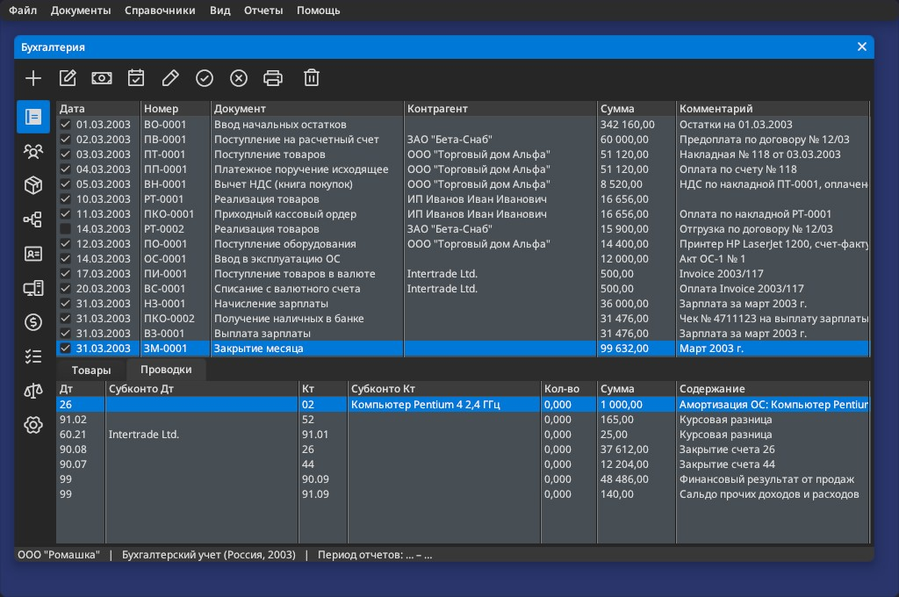
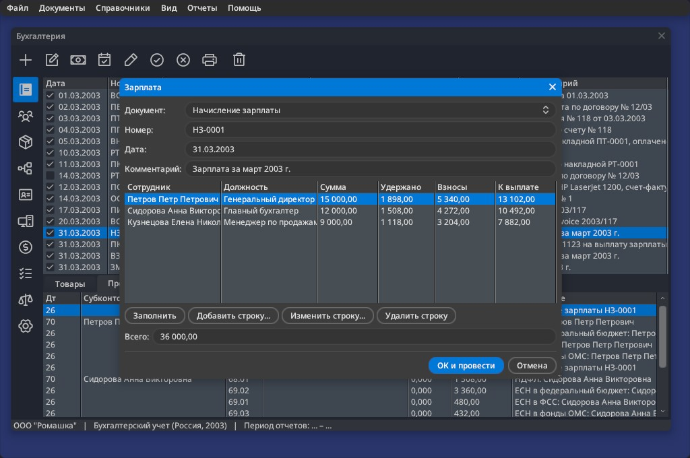
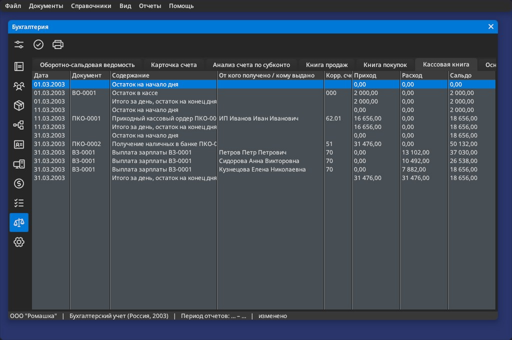

# Ledger


Double-entry bookkeeping in the spirit of the early-2000s desktop accounting
suites (1C:Accounting 7.7, its German contemporaries). Two country
configurations ship: Russia 2003 and Germany 2003 (SKR 03), each usable in
Russian, German and English.

```bash
make build/bin/ledger share
build/bin/ledger                       # last selected configuration (ru-2003)
build/bin/ledger --config de-2003 --lang de --data /tmp/books
```

## Features

| Area | What Ledger does |
|---|---|
| Documents | Journal of typed documents with numbering by prefix, lines, totals with VAT, post / unpost / delete; posting rules come from the configuration |
| Goods | Receipts and sales by item; a sale writes the goods off at average cost (Dt 90.02 Kt 41.01) |
| Manual operations | `Documents > New Manual Operation` (Ctrl+M): entries typed by the accountant; opening balances are an operation of that kind |
| Analytics | Each account has an analytics kind (counterparties, items, employees, fixed assets); every entry keeps the debit and the credit object separately |
| Payroll | Employees with salary, tax allowance and expense account; accrual with withheld income tax and employer contributions from the configuration's payroll taxes; payout of what is owed; payroll statement |
| Fixed assets | Asset register; putting assets into service; straight-line depreciation in month-end closing |
| Currencies | Currencies and exchange rates; documents in a currency post at the day's rate and keep both amounts; currency accounts are revalued at month end |
| Month-end closing | `Documents > Close Month...` (Ctrl+E) runs the configuration's closing rules: depreciation, revaluation, closing expense accounts and the month's result |
| Reports | For a period set in `Reports > Settings...` (Ctrl+R): trial balance (opening, turnovers, closing, roll-up to parent accounts), account card, analysis by analytics object, sales and purchase VAT books, cash book, fixed assets, payroll statement |
| Print forms | HTML templates with amounts in words: TORG-12, VAT invoice, invoice for payment, KO-1/KO-2, payment order, payroll statement T-49 and cash book KO-4 (ru-2003); Rechnung, Quittung, Lohnjournal and Kassenbuch (de-2003) |
| Storage | One XML infobase per configuration, saved on `File > Save` or on exit |

`Reports > Recalculate` (F5) reposts every document in date order and rebuilds
the reports; `Reports > Print Report Forms` writes the cash book.







## Platform and configuration

Ledger separates the **platform** from the **configuration**, the way 1C:Enterprise
separates its engine from a country's typical configuration.

| Layer | Where | What it holds |
|---|---|---|
| Platform | `ledger.orion`, `*.c` | Schemas, screens, menus, posting engine, print engine |
| Configuration | `share/configurations/<code>/` | Chart of accounts with analytics kinds, units, tax rates, document types with posting rules, payroll taxes, closing rules, print forms |
| Infobase | `<settings>/ledger/<code>/infobase.xml` | The organization's counterparties, items, documents, entries and totals |

The platform never names an account, a tax rate or a national form. A document
type in the configuration says which accounts it debits and credits, whether
amounts include tax, and which print forms it has. Supporting another country
means adding a configuration directory, not changing code.

`File > Select Configuration...` lists `share/configurations/index.xml`; each
configuration opens its own infobase on the next start. A new infobase starts
from the configuration's `demo.xml` and is posted on first open.

## Languages

The interface is written in English and translated by string catalogs
([docs/localization.md](../../docs/localization.md)). Three layers stack:

1. the framework's catalog (`share/locale/` → message boxes, file picker);
2. Ledger's own, `share/locale/ru.xml` — every menu, form, column and message;
3. the configuration's, `configurations/<code>/locale/` — national terms. The
   platform says "Tax ID" and "Tax"; `ru-2003` turns them into "ИНН" and "НДС"
   in Russian and "INN" and "VAT" in English.

The language is the one chosen in `File > Language...`, otherwise the
configuration's (`ru` for `ru-2003`), otherwise the system's (`LANG`).
`--lang ru|de|en|qps-ploc` overrides it for one run; `qps-ploc` is the
pseudo-locale for checking layouts. Numbers and dates follow the catalog:
`16 656,00` and `10.03.2003` in Russian.


After changing texts in `ledger.orion`, refresh the catalog and translate the
new entries:

```bash
build/bin/orionc --input apps/ledger/ledger.orion --strings apps/ledger/share/locale/ru.xml
```

## Adding a configuration

1. Copy `share/configurations/ru-2003` to `share/configurations/<code>`.
2. Edit `configuration.xml`: `settings` (currency names for amounts in
   words, cash and payroll accounts), `subconto_kinds`, `accounts`, `units`,
   `vat_rates`, `doc_types` (posting rules reference account ids; `form`
   picks the dialog and the posting), `payroll_taxes`, `closing_rules` and
   `print_forms`.
3. Write the print templates in `print/` (HTML, see below) and a `demo.xml`
   infobase, or leave the demo empty.
4. Add a `<configuration>` row to `index.xml`.
5. Set `language` in `settings` and, if the country has its own terms, add
   `locale/<language>.xml` catalogs that rename the platform's neutral ones.

Print templates are HTML files filled from the document:

| Tag | Value |
|---|---|
| `{{number}}`, `{{total}}`, `{{counterparty.name}}` | Document fields and join paths |
| `{{doc_type.debit.code}}` | Joins across databases (infobase → configuration) |
| `{{org.tax_id}}`, `{{cfg.currency}}` | Organization details, configuration settings |
| `{{#lines}} {{n}} {{item.unit.code}} {{/lines}}` | One block per document line; any table works: `{{#payroll_lines}}` |
| `{{#cash_book}} ... {{/cash_book}}`, `{{period.date_from}}` | Report forms (`print_forms.report`) repeat a report's rows |
| `{{date\|dmy}}` | ISO date as DD.MM.YYYY |
| `{{total\|words}}` | Amount in words in the configuration's language |

`Documents > Print Forms` writes every form of the document's type to
`<infobase dir>/print/` for printing from a browser.

## How it is built

Almost everything is declared in `ledger.orion`:

- Three schema databases — `cfg` (configuration), `catalog` (installed
  configurations) and `ib` (infobase, class `ledger_ib`). The schema-driven class needs no
  adaptor code: CRUD, filtering, persistence and join paths such as
  `item.unit.name` come from the generated schema. Relations may cross
  databases (`relation="cfg.accounts.id"`).
- A page host with ten pages; master–detail tables (documents → lines and
  entries, currencies → rates) are linked by `relation=` alone.
- Entry analytics are polymorphic relations: `relation="ib.{debit.subconto_kind.table}.id"`
  names the catalog through the account, so `debit_subconto.name` shows a
  counterparty, an item, an employee or an asset.
- Database dialogs for documents, lines, operations, entries, payroll,
  assets put into service, month-end closing, counterparties, items,
  employees, fixed assets, currencies, rates, the organization and report
  settings. Numeric and date fields bind
  through typed DDX; ComboBoxes bind by id, and a ComboBox may filter its
  source (`filter-field="manual" filter-value="0"`).
- Reports are `transient` tables: the posting engine fills them, the
  `.orion` declares their columns, they are never saved. The two VAT books are
  one table shown by two TableViews with different static filters.

- Records live like EOF enterprise objects: `default=` values, `on-delete`
  rules (a document takes its lines and entries along; a counterparty in use
  cannot be deleted), document dialogs that are editing contexts (Cancel
  undoes the new document and its lines), and detail tables with `form=` and
  declarative Add / Edit / Delete buttons.
- The `ledger_ib` datasource (`ledger_ib.c`) subclasses `db_schema_xml`:
  it numbers documents and recalculates them whenever they or their lines
  change, so no dialog has to.

The C code holds what declarations cannot express: posting rules and report
building (`posting.c`), the datasource rules (`ledger_ib.c`), the print engine
(`print.c`), and command routing plus the payroll Fill button (`controller.c`).
Configuration data drives all of it: taxes, closing steps, analytics kinds
and print forms are rows, not code.

## First configuration: Russia, 2003

`ru-2003` follows the rules in force in 2003:

- Chart of accounts per Order of the Ministry of Finance of 31.10.2000 No. 94n,
  with the subaccounts typical desktop configurations of the time used
  (19.03, 41.01, 60.01, 62.01, 68.02, 90.01–90.09, ...).
- VAT 20% (Tax Code art. 164; reduced to 18% from 01.01.2004 by Federal Law
  No. 117-FZ of 07.07.2003), plus 10%, 0% and "without VAT".
- Print forms: goods waybill TORG-12 (Goskomstat Resolution No. 132 of
  25.12.1998), VAT invoice (Government Resolution No. 914 of 02.12.2000, with
  the 2002 column set), cash receipt and payment orders KO-1/KO-2 (Goskomstat
  Resolution No. 88 of 18.08.1998), payment order 0401060 (Bank of Russia
  Regulation No. 2-P of 03.10.2002) and a free-form invoice for payment.

- Payroll: personal income tax 13 % after the standard 400-rouble deduction
  (Tax Code art. 218, 224), unified social tax 35.6 % — 28 % federal budget
  and pension, 4 % social insurance, 3.6 % medical insurance (art. 241 in the
  2003 wording). Payroll statement T-49 (Goskomstat Resolution No. 26 of
  06.04.2001), cash book KO-4 (Resolution No. 88).
- Fixed assets depreciate straight-line from the month after they are put
  into service (PBU 6/01, para. 21).
- Month-end closing: depreciation, exchange differences to 91.01 / 91.02,
  26 to 90.08 and 44 to 90.07, the result of 90 and 91 to 99.

Simplifications: advances received are kept on 62.01 rather than 62.02; the
400-rouble deduction is not capped by income since the start of the year;
the unified social tax uses its base rate without the regressive scale.
Opening balances are entered against the auxiliary account 000, as typical
configurations did.

## Second configuration: Germany, 2003

`de-2003` shows that the platform carries no Russian assumptions:

- A subset of DATEV's SKR 03 chart of accounts (1000 Kasse, 1200 Bank, 1400
  receivables, 1600 payables, 1575/1775 input and output tax, 3400 purchases,
  8400 revenue, 9000 opening balances).
- Umsatzsteuer 16 % and 7 % (§ 12 UStG as of 2003; 19 % from 01.01.2007).
- Document types Eingangsrechnung, Ausgangsrechnung, Kasseneinnahme /
  -ausgabe, Überweisung, Zahlungseingang and the manual Umbuchung and
  Eröffnungsbuchungen.
- Print forms Rechnung with the invoice details required by § 14 UStG, and
  Quittung.
- Its catalogs rename the platform's terms: "Tax ID" becomes "Steuernummer",
  the KPP field becomes "USt-IdNr." and BIK becomes "BLZ".

- Payroll: Lohnabrechnung 4120 an 1740 with employee and employer social
  insurance (about 42 % in 2003, half each) and Lohnsteuer; Lohnzahlung from
  the bank; Lohnjournal.
- AfA straight-line from the month of acquisition (§ 7 Abs. 1 EStG), booked
  directly against the asset account; Kassenbuch; exchange differences to
  2660 / 2150.

Simplifications: one revenue account per document type (8400), so 7 % sales
are posted with the 16 % revenue account but the correct tax amount.
Lohnsteuer is a flat rate above the monthly basic allowance instead of the
official tax tables, and the solidarity surcharge and church tax are left
out. Anlagenzugang posts the net cost; input tax on assets is an Umbuchung.
