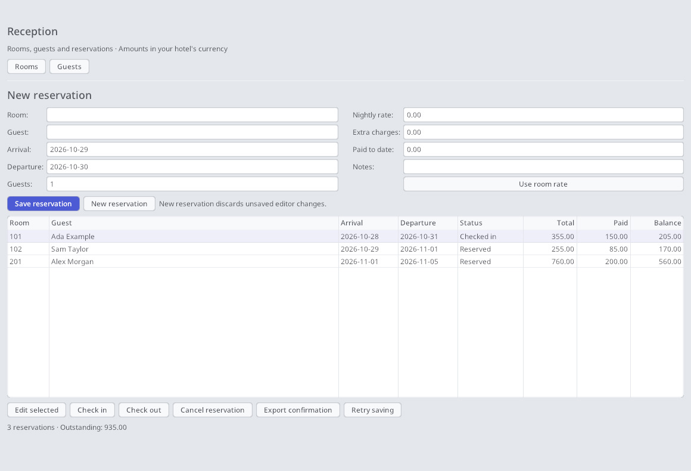

# Orion Lodge

A small hotel's reception desk, built with Orion controls and portable Lua
plugins. Lodge means a place to stay; it sits alongside Ledger as a focused
business application.



[Dark appearance](../../docs/lodge/images/reception-dark.jpg)

## Run

```sh
make share build/bin/lodge
build/bin/lodge
# Or keep a separate hotel database in an existing writable directory:
build/bin/lodge --data /path/to/hotel --lang en
# The same app through the generic launcher:
build/bin/orion-run --app apps/lodge/share/application.orion --data /path/to/hotel
```

Without `--data`, Lodge uses `<settings>/lodge/hotel.xml`. New databases start
empty. For a demo, copy `share/samples/demo.xml` to `hotel.xml` inside a new,
separate data directory, then launch with `--data` pointing there. Open **Hotel
setup** and choose Germany/EUR or Russia/RUB before recording reservations or
payments. For an existing hotel this explicitly adopts the existing amounts as
the selected currency without converting them; the choice cannot be changed.
Back up and verify those amounts first. Add rooms and guests, select them in the reservation editor, choose
dates and use **Use room rate**, then **Save reservation**. Select a reservation
in the table and use **Edit selected** to change dates, room or extras.
Select a reservation and choose **Payment or refund** to record an amount.
If saving fails, retry the same operation and amount in that window; close it
to start a different request.
**New reservation** discards editor inputs; saved reservations are retained.

Room-night availability uses half-open dates: a departure on 31 October permits
the next arrival on 31 October. Non-cancelled reservations occupy their dates;
capacity and overlapping bookings are checked before changes are written.
A reservation goes from Reserved to Checked in to Checked out, or from Reserved
to Cancelled. Check-out requires a zero balance; cancelled and checked-out
reservations cannot be edited, but payments and refunds can still be recorded.
Use **Housekeeping** to mark rooms clean, dirty, or
needing inspection. Check-in requires a clean room; check-out marks it dirty.
An adjacent reservation cannot check in, or transfer into a room, while another
guest is still checked in there, even if the scheduled dates do not overlap.
New rooms and rooms migrated from older databases need inspection. Amounts use the
configured EUR or RUB currency with two decimal places; amounts with fractional
cents are rejected rather than silently rounded. Currency conversion is not
provided. Country selection does not configure tax or make confirmations into
statutory invoices. The nightly
rate is copied into the booking, so editing a room's rate later would not
change existing bookings.
See [country readiness](../../docs/lodge/country-readiness.md) for the official
sources and the remaining German and Russian tax-document work.

**Group reservation** creates two room reservations together at the rooms'
current base rates. If either room is unavailable or invalid, neither reservation
is saved. The service API can create a group of up to 100 rooms. Group members
are edited and paid individually; there is no group folio or group-wide change.
**Export group statement** writes a printable `group-statement.html` listing
each member and its total, paid amount and balance. Its totals include cancelled
reservations, following the individual balances; reconcile refunds separately.
The statement is an operational summary, not a tax invoice or group payment.

**Close day** previews today's net recorded payments, outstanding balance and
overdue arrivals or departures. It separately shows the number of cancelled
reservations with payments still held and their total paid after refunds. Check
each reservation against the hotel's cancellation policy; this amount does not
decide whether a refund is due. Resolve the overdue stays before closing. After
closing, reservation, nightly-price and payment changes are blocked until the
next calendar day in the host process's time zone; housekeeping remains available. Close records are
immutable and there is no reopening workflow. This is an operational snapshot,
not a tax close or statutory report. Old payment events lack a reliable posting
date and are excluded from daily payment totals; their opening balances remain
included in reservation balances. Close-day history preserves the figures
recorded at each close, including the amount and count for paid cancellations.
For closes created before this information was recorded, those columns show
Unknown rather than a fabricated zero.

The **Nightly prices** action lets staff override the copied base rate for an
individual night, inspect the applied price, or restore the base rate. Rates
are stored in minor units and changes are recorded in reservation history.
A stay cannot be shortened past an override until that override is removed;
closed reservations do not accept price changes. The total adds the price of
each night and extra charges. New reservation changes produce a history snapshot and
changes to paid produce signed minor-unit payment events. These records cannot
be edited or deleted through the running application. An upgraded database
records each existing paid amount as an imported opening balance, not as a
reconstruction of historical payments. Balance subtracts the sum of payment
events. The Lua `Hotel.payment(id, amount_minor, request_key)` operation saves
one signed payment or refund and recognizes retries with the same key; key
reuse for a different request is refused. Reception uses a distinct key for each
payment window and keeps it for retries. **Export confirmation** writes an escaped, printable
`confirmation.html` in the data directory (replacing the previous export).
See the [database migration guide](../../docs/lodge/migration-v2.md) before
opening an existing hotel database.
Open it in a browser to print. It includes the current reservation status and hotel currency; it is a booking confirmation, not a tax invoice.
Reservation actions save immediately; catalog edits save when closing a window. A save failure rolls the action back and stays visible;
**Retry saving** retries any pending database save; closing is blocked if the final save fails.
The model rejects direct changes to the paid field; record payments and refunds
through the payment action so each new event has a retry key. Migrated opening
balances retain their historical treatment.

## Architecture

- `share/schema.orion`: persistent records, defaults, delete rules and computed fields.
- `share/application.orion`: application object graph, DisplayGroup, reception and catalog forms.
- Orion’s shared application host owns the VM, databases, windows and output. No app C host or bindings.
- `share/model.lua`: validates native and Lua writes and supplies computed values.
- `share/reception.lua`: page actions, rendering and user feedback.
- `share/hotel.lua`: hotel-specific availability, capacity and state transitions.
- Shared `calendar`, `money`, `intervals`, `records` and `template` plugins:
  [authoring and usage](../../docs/plugins.md).

This first version provides a reservation list, rather than a timeline. It
supports adding, editing and deleting rooms and guests through codeless forms. Housekeeping
tracks room readiness but does not assign staff or schedule work.
Category-level inventory, group folios, tax rules,
online distribution, access control and concurrent reception
terminals are follow-up work. Use a single process per hotel XML file. The Lua
plugins are portable; desktop builds use the repository's normal Linux, macOS
and Windows targets. Lodge is not yet added to the iOS packaging allowlist.

## Validation

```sh
make share build/bin/test_plugin_test build/bin/test_lodge_test
build/bin/test_plugin_test
build/bin/test_lodge_test
```

Tests exercise the real datasource and Lua sandbox, rejection of overlapping
and invalid bookings, adjacent stays, capacity, cancellation, settlement,
closed reservations, XML save/reopen, and creation of the reception UI.

## External developers

See the [developer SDK](../../docs/developer-sdk.md) for application/plugin
scaffolding, dependency checks and source packaging, and the
[platform readiness plan](../../docs/business-platform-readiness.md) for
production acceptance criteria shared by Ledger and Lodge.

### Shared company

Start the shared-company launch target, or run `lodge --remote`, with
`ORION_SERVER_URL` and `ORION_SERVER_TOKEN` in the host environment. The
server URL must use HTTPS or literal loopback HTTP. The native client keeps
the token out of Lua and command-line arguments. The POSIX transport supports
this mode; unsupported platforms refuse to connect.

After a payment or refund succeeds, start a new payment or refund explicitly
before recording another. This prevents repeated clicks from creating a second
payment. This also applies after restoring a pending payment on restart. An uncertain request must be retried using the
pending request, rather than entered again as a new payment.

The shared view supports creating and editing rooms and guests, all three cleaning states (clean,
dirty and inspection needed), creating and editing reservations, check-in,
payments, refunds, checkout, printable booking confirmations, two-room group reservations, group statements, nightly prices and
day preview or closing, subject to the authenticated role. Data displayed in this view is a transient projection; the server is the
authority. A pending request is saved in a private OS-user profile before it
is sent. After an uncertain result or restart, retry that same request before
starting new work. A stale revision requires an explicit refresh. The profile
contains business data, so protect the operating-system account and its
backups. `ORION_REMOTE_PROFILE` may point to an existing owner-only `0700`
directory when an isolated profile is needed. Only trusted application scripts
and plugins should be loaded: native outbox operations are not a sandbox
boundary against malicious Lua code.

To exercise the connected Lodge form with a disposable company and profile,
build `build/bin/orion-service` and `build/bin/test_lodge_remote_ui_test`, then
run `python3 tools/server/test_lodge_remote_ui.py`. The test uses a loopback
listener and does not touch a real company.

Run `python3 apps/lodge/tests/test_shared_company.py` with `orion-service`
built to exercise competing reservations and payments in both country
configurations, including replay after a lost response and server restart. It also checks that a
failed group reservation leaves no partial group or bookings, and that a successful
group request remains idempotent after restart. These checks do not replace the
full two-client shift and failure-recovery acceptance scenario.
