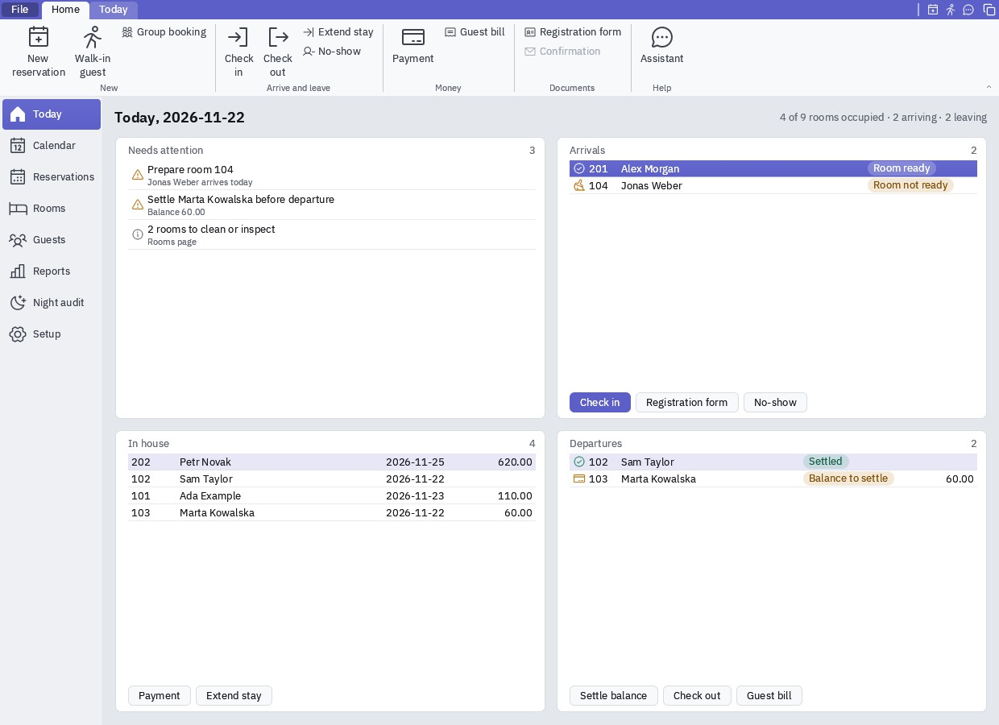
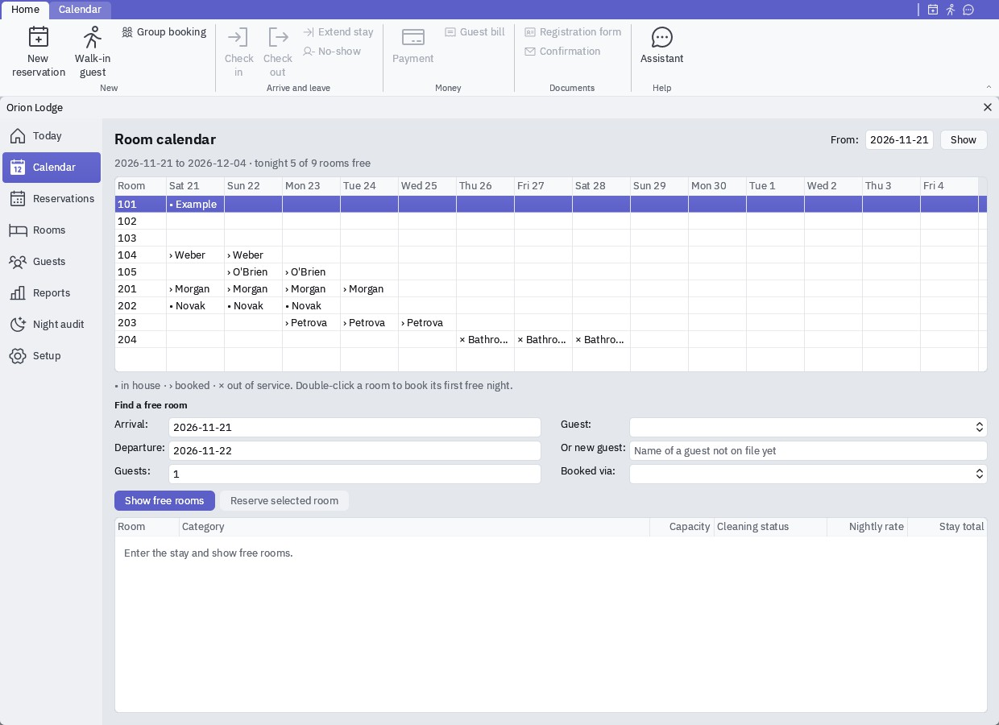
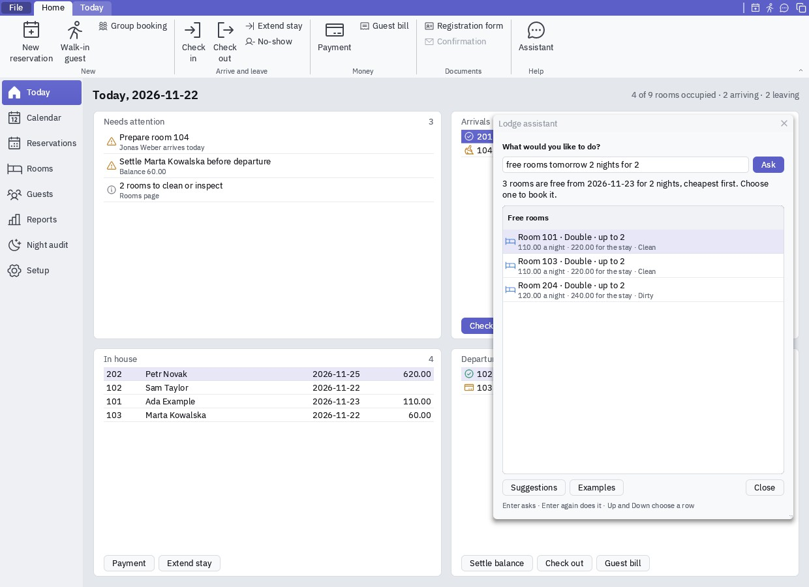
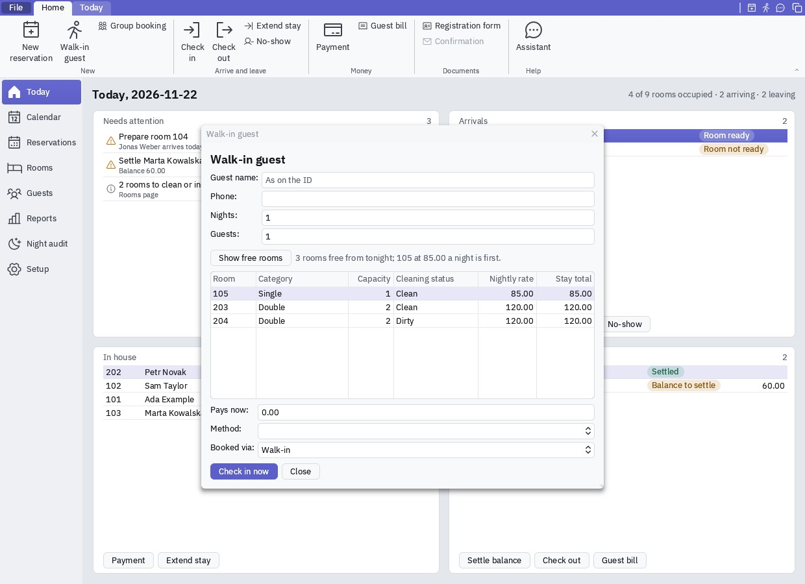
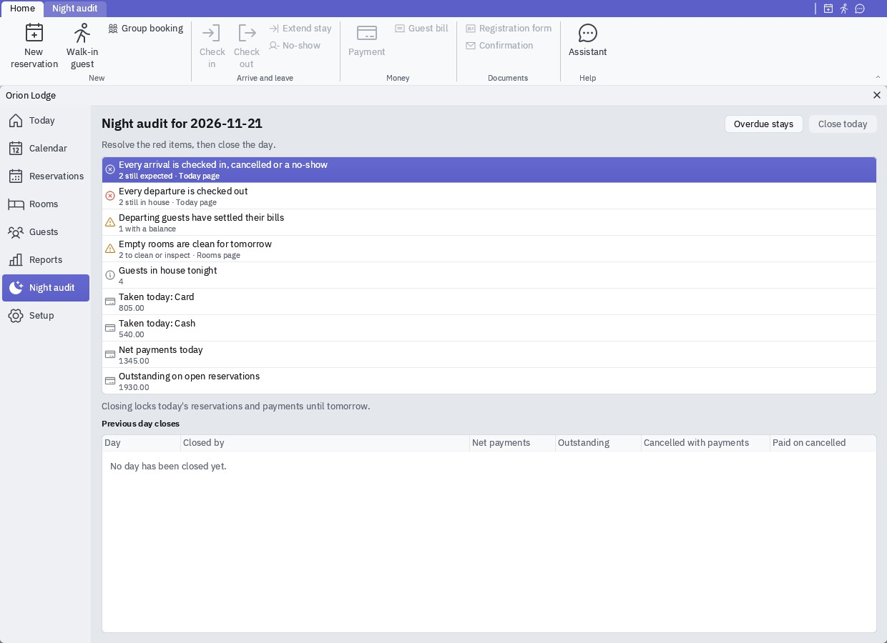

# Orion Lodge

The front desk of a small hotel, guesthouse or inn: reservations, arrivals
and departures, the room calendar, housekeeping, payments, the night audit and
reports, in one window with a ribbon, in English, German and Russian. Lodge
runs locally on the hotel's own computer and keeps the hotel's data in a file
it owns; nothing depends on an Internet connection. It is built from Orion
controls and Lua, with no app-specific C.



| | |
|---|---|
|  |  |
|  |  |

## Pages

The sidebar switches pages; the ribbon holds the commands.

- **Today**: what needs attention (a row opens the page that settles it),
  today's arrivals and departures with status badges, and the guests in house.
  Double-click an arrival to check in, a departure to check out, a guest in
  house to take a payment; mark no-shows, extend stays, print the
  registration form (*Meldeschein*), the guest bill or the front desk list.
- **Calendar**: who sleeps where over two weeks (rooms by night, with dates),
  week by week; double-click a room to book its first free night. Below it,
  free rooms for dates and a guest count, cheapest first, with the stay total;
  reserve one for a guest on file or a new one.
- **Reservations**: the booking editor and list with totals, payments and
  balances; payments, nightly prices, groups, cancellations, confirmations;
  **Find** (F3) steps through bookings by guest, room, phone or number.
- **Rooms**: the room catalog, cleaning status, the day's cleaning list and
  out-of-service dates (repairs), which leave the room out of availability.
- **Guests**: contact and identity details for registration, and stay counts.
- **Reports**: occupancy, guest-nights, room revenue, ADR, RevPAR, payments by
  method and bookings by source for any period up to a year; printable, and
  every record exportable as CSV.
- **Night audit**: a checklist of what the day still needs and today's money
  by method; **Close today** once nothing red is left.
- **Setup**: the hotel's name, address and times for documents; country and
  currency; booking sources and payment methods; the sample hotel; data export.

## Ribbon, shortcuts and the assistant

**Home** holds the desk's everyday commands — New reservation (Ctrl+N),
Walk-in guest (Ctrl+Shift+N), Check in (Ctrl+I), Check out (Ctrl+O), Extend
stay (Ctrl+E), No-show, Payment (Ctrl+M), Guest bill (Ctrl+B), documents and
the Assistant (Ctrl+K) — and acts on the page that shows; each page's own
commands are its contextual tab. Commands a page cannot run are greyed out.
See [ribbon design](../../docs/lodge/ribbon-design.md).

The **assistant** takes requests in your own words — "check in Morgan",
"free rooms friday 2 nights for 2", "Taylor paid 50 cash", "who owes",
"mark 104 clean", "occupancy this month" — in English, German or Russian.
Enter shows the answer, Enter again carries out a single action; rows open or
do what they say. With nothing typed it lists what today still needs. See
[the assistant](../../docs/lodge/assistant.md).

Printable documents are written to the data directory as HTML, headed with
the hotel's details from Setup: `registration.html`, `bill.html`,
`confirmation.html`, `cleaning-list.html`, `front-desk-list.html`,
`period-report.html`. They are operational documents, not tax invoices.
**Export data as CSV** writes `lodge-reservations.csv`, `lodge-guests.csv` and
`lodge-payments.csv` with stable English column names for spreadsheets and
accounting.

## Design reports

- [Personas](../../docs/lodge/personas.md) and [user stories](../../docs/lodge/user-stories.md), with what is done and what is next
- [What small hotels complain about](../../docs/lodge/research-hotel-software-complaints.md): the research behind the design
- [UX audit and redesign report](../../docs/lodge/ux-audit.md), before and after
- [Ribbon design](../../docs/lodge/ribbon-design.md) and [the assistant](../../docs/lodge/assistant.md)
- [What a small hotel needs](../../docs/lodge/small-hotel-needs.md) and [country readiness](../../docs/lodge/country-readiness.md)

## Run

```sh
make share build/bin/lodge
build/bin/lodge
# Or keep a separate hotel database in an existing writable directory:
build/bin/lodge --data /path/to/hotel --lang en
# The same app through the generic launcher:
build/bin/orion-run --app apps/lodge/share/application.orion --data /path/to/hotel
```

Without `--data`, Lodge uses `<settings>/lodge/hotel.xml`. New databases start
empty apart from default booking sources and payment methods. To try Lodge, open **Setup**, choose
Germany/EUR or Russia/RUB, then **Add sample hotel**: nine rooms, eight guests
and stays dated around today. (`share/samples/demo.xml` is an older fixed demo
around 14 November 2026, kept for migration tests.) Choose the country and
currency before recording reservations or payments. For an existing hotel this explicitly adopts the existing amounts as
the selected currency without converting them; the choice cannot be changed.
Back up and verify those amounts first. Add rooms, then in the reservation editor choose a room and a guest — or type
a new guest's name in **Or new guest** — choose dates and use **Use room rate**,
then **Save reservation** (Ctrl+S). Select a reservation
in the table and use **Edit selected** to change dates, room or extras.
Select a reservation and choose **Payment or refund** to record an amount.
If saving fails, retry the same operation and amount in that window; close it
to start a different request.
**New reservation** (Ctrl+N) discards editor inputs; saved reservations are retained.
A guest without a booking is handled in **Walk-in guest** (Ctrl+Shift+N): name,
nights, a free room (ready rooms first) and what they pay now; **Check in now**
creates the guest, the stay, the check-in and the payment together or not at all.
**Extend stay** (Ctrl+E) and **Shorten stay** move the departure by one night;
**No-show** cancels a reserved arrival from its arrival day, notes it and frees
the room, leaving payments for a separate refund.

Room-night availability uses half-open dates: a departure on 31 October permits
the next arrival on 31 October. Non-cancelled reservations occupy their dates;
capacity and overlapping bookings are checked before changes are written.
A reservation goes from Reserved to Checked in to Checked out, or from Reserved
to Cancelled. Preview an individual cancellation to see the guest, dates and payments held, then confirm it; refunds are recorded separately. Check-out requires a zero balance; cancelled and checked-out
reservations cannot be edited, but payments and refunds can still be recorded.
On the **Rooms** page, mark rooms clean, dirty, or
needing inspection. Check-in requires a clean room; check-out marks it dirty.
The room list also shows whether a guest is currently checked in, independently
of cleaning status and scheduled dates. Use **Refresh rooms** on the local
Rooms page, or refresh the shared view, to see changes made elsewhere.
The indicator does not show guest details or establish
whether anyone is physically present in the room.
An adjacent reservation cannot check in, or transfer into a room, while another
guest is still checked in there, even if the scheduled dates do not overlap.
New rooms and rooms migrated from older databases need inspection. Amounts use the
configured EUR or RUB currency with two decimal places; amounts with fractional
cents are rejected rather than silently rounded. Currency conversion is not
provided. Country selection does not configure tax or make confirmations into
statutory invoices. The nightly
rate is copied into the booking, so editing a room's rate later would not
change existing bookings.
See [country readiness](../../docs/lodge/country-readiness.md) for the official
sources and the remaining German and Russian tax-document work.

**Group reservation** creates two room reservations together at the rooms'
current base rates. If either room is unavailable or invalid, neither reservation
is saved. The service API can create a group of up to 100 rooms. Group members
are edited individually; there is no group folio. To pay the full outstanding
balance of a group, select a member locally or choose the group in shared mode,
then preview the settlement. Lodge exports a group statement with each member's
balance and shows the total and number of payments; review it before confirming.
The payment settles each positive balance in full in one transaction, with a
separate payment event per reservation. Groups containing cancelled reservations
or credits must be reconciled individually first; partial group payments and
group refunds are not supported. If balances change after the preview, preview
again. A failed or uncertain shared request must be retried using the pending
request. The Lua `Hotel.settle_group(group_id, allocation, request_key)` API
accepts the exact positive balances as `{id, amount_minor}` entries. A key is
1–70 ASCII letters, digits, dots, underscores or hyphens; retrying the same
allocation with the same key returns the original settlement, while a changed
allocation is refused. Shared-server keys are scoped to the authenticated
actor. To cancel the whole
group, select one member locally (or the group in the shared view), preview the
number of reservations and payments held, then confirm. All members must still
be reserved; the cancellation is atomic and does not issue refunds.
**Export group statement** writes a printable `group-statement.html` listing
each member and its total, paid amount and balance. Its totals include cancelled
reservations, following the individual balances; reconcile refunds separately.
The statement is an operational summary, not a tax invoice or proof of payment.

The **Night audit** previews today's net recorded payments, outstanding balance and
overdue arrivals or departures. It separately shows the number of cancelled
reservations with payments still held and their total paid after refunds. Check
each reservation against the hotel's cancellation policy; this amount does not
decide whether a refund is due. Use **Overdue stays** to write a printable `overdue-stays.html` listing the reservations needing arrival or departure; the shared view refreshes from the server first. The file replaces the previous export and contains guest data. Resolve the overdue stays before closing. In shared mode, preview the day before closing; Lodge refuses the close if the day, its figures, or reservation and nightly-price history have changed since that preview, even when the totals are unchanged. Preview again after such changes. After
closing, reservation, nightly-price and payment changes are blocked until the
next calendar day in the host process's time zone; housekeeping remains available.
The hotel day follows the operating-system time zone of the local process or,
in shared mode, the server process; there is no separate per-hotel time-zone
setting. Configure the server's time zone for the hotel and keep it consistent
across restarts. Changing it can change the current hotel day and day-close
boundary. In shared mode the displayed hotel day is as of the latest refresh;
**New reservation** and **New group** refresh the server day before setting
default dates. An ordinary refresh preserves entered dates. Close records are
immutable and there is no reopening workflow. This is an operational snapshot,
not a tax close or statutory report. Old payment events lack a reliable posting
date and are excluded from daily payment totals; their opening balances remain
included in reservation balances. Close-day history preserves the figures
recorded at each close, including the amount and count for paid cancellations.
For closes created before this information was recorded, those columns show
Unknown rather than a fabricated zero.

The **Nightly prices** action lets staff override the copied base rate for an
individual night, inspect the applied price, or restore the base rate. Rates
are stored in minor units and changes are recorded in reservation history.
A stay cannot be shortened past an override until that override is removed;
closed reservations do not accept price changes. The total adds the price of
each night and extra charges. New reservation changes produce a history snapshot and
changes to paid produce signed minor-unit payment events. These records cannot
be edited or deleted through the running application. An upgraded database
records each existing paid amount as an imported opening balance, not as a
reconstruction of historical payments. Balance subtracts the sum of payment
events. The Lua `Hotel.payment(id, amount_minor, request_key)` operation saves
one signed payment or refund and recognizes retries with the same key; key
reuse for a different request is refused. Reception uses a distinct key for each
payment window and keeps it for retries. **Export confirmation** writes an escaped, printable
`confirmation.html` in the data directory (replacing the previous export).
See the [database migration guide](../../docs/lodge/migration-v2.md) before
opening an existing hotel database.
Open it in a browser to print. It includes the current reservation status and hotel currency; it is a booking confirmation, not a tax invoice.
Reservation actions save immediately; catalog edits save when closing a window. A save failure rolls the action back and stays visible;
repeat the action to retry; closing is blocked if the final save fails.
The model rejects direct changes to the paid field; record payments and refunds
through the payment action so each new event has a retry key. Migrated opening
balances retain their historical treatment.

## Architecture

- `share/schema.orion`: persistent records, defaults, delete rules and computed fields.
- `share/application.orion`: application object graph, DisplayGroup, the ribbon, pages, windows and catalog forms.
- Orion’s shared application host owns the VM, databases, windows and output. No app C host or bindings.
- `share/model.lua`: validates native and Lua writes and supplies computed values.
- `share/application.orion`'s `main` form is a `role="host"` window; each sidebar
  `Page` is a form with its own controller (`today.lua`, `reception.lua`,
  `availability.lua`, `housekeeping.lua`, `reports.lua`, ...).
- `share/reception.lua`: reservation page actions, rendering and user feedback.
- `share/front_desk.lua`: read-only views: today's movements, attention items,
  free rooms and period figures. `share/documents.lua`: printable documents.
  Computed lists fill transient tables of the in-memory `lodge_views` database.
- `share/hotel.lua`: hotel-specific availability, capacity and state transitions,
  and the desk's one-transaction shortcuts (walk-in, extend, no-show, search).
- `share/walk_in.lua`, `share/assistant.lua`: the walk-in and assistant windows;
  `share/assistant_engine.lua`: what the assistant understands and does.
- `share/exports.lua`: CSV export; `share/samples.lua`: the sample hotel.
- Shared `calendar`, `money`, `intervals`, `records` and `template` plugins:
  [authoring and usage](../../docs/plugins.md).

Lodge provides a reservation list and a two-week room calendar; stays are
moved in the editor rather than by dragging. It supports adding, editing and deleting rooms, guests, booking sources, payment
methods and out-of-service dates through codeless forms. Housekeeping
tracks room readiness and prints a daily list but does not assign staff.
Category-level inventory, group folios, tax rules,
online distribution, access control and concurrent reception
terminals are follow-up work. Use a single process per hotel XML file. The Lua
plugins are portable; desktop builds use the repository's normal Linux, macOS
and Windows targets. Lodge is not yet added to the iOS packaging allowlist.

## Validation

```sh
make share build/bin/test_plugin_test build/bin/test_lodge_test
build/bin/test_plugin_test
build/bin/test_lodge_test
```

Tests exercise the real datasource and Lua sandbox, rejection of overlapping
and invalid bookings, adjacent stays, capacity, cancellation, settlement,
closed reservations, XML save/reopen, and creation of the reception UI.

## External developers

See the [developer SDK](../../docs/developer-sdk.md) for application/plugin
scaffolding, dependency checks and source packaging, and the
[platform readiness plan](../../docs/business-platform-readiness.md) for
production acceptance criteria shared by Ledger and Lodge.

### Shared company

Start the shared-company launch target, or run `lodge --remote`, with
`ORION_SERVER_URL` and `ORION_SERVER_TOKEN` in the host environment. The
server URL must use HTTPS or literal loopback HTTP. The native client keeps
the token out of Lua and command-line arguments. The POSIX transport supports
this mode; unsupported platforms refuse to connect.

After a payment or refund succeeds, start a new payment or refund explicitly
before recording another. This prevents repeated clicks from creating a second
payment. This also applies after restoring a pending payment on restart. An uncertain request must be retried using the
pending request, rather than entered again as a new payment.

The shared view provides **Use room rate** for individual reservations and separate rate-copy actions for each room in a group. Rates can still be edited before saving.

The shared view supports creating and editing rooms and guests, and deleting unused records after confirmation. Rooms and guests referenced by any reservation cannot be deleted. It also supports all three cleaning states (clean,
dirty and inspection needed), creating and editing reservations, check-in,
payments, refunds, checkout, printable booking confirmations, two-room group reservations, group statements, nightly prices and
day preview or closing, subject to the authenticated role. Data displayed in this view is a transient projection; the server is the
authority. A pending request is saved in a private OS-user profile before it
is sent. After an uncertain result or restart, retry that same request before
starting new work. A stale revision requires an explicit refresh. The profile
contains business data, so protect the operating-system account and its
backups. `ORION_REMOTE_PROFILE` may point to an existing owner-only `0700`
directory when an isolated profile is needed. Only trusted application scripts
and plugins should be loaded: native outbox operations are not a sandbox
boundary against malicious Lua code.

To exercise the connected Lodge form with a disposable company and profile,
build `build/bin/orion-service` and `build/bin/test_lodge_remote_ui_test`, then
run `python3 tools/server/test_lodge_remote_ui.py`. The test uses a loopback
listener and does not touch a real company.

Run `python3 apps/lodge/tests/test_shared_company.py` with `orion-service`
built to exercise competing reservations and payments in both country
configurations, including replay after a lost response and server restart. It also checks that a
failed group reservation leaves no partial group or bookings, and that a successful
group request remains idempotent after restart. The close-day checks also reject a stale preview after a reservation edit that leaves all totals unchanged. A service-level shift also covers
room preparation, a stale edit and retry, check-in, payment and refund, checkout,
role restrictions, day close, and replay after restart in both countries. Calendar
checks cover adjacent stays across New Year and leap day, invalid dates, and the
server day in the Berlin and Moscow process time zones, including after restart.
They use the actual system clock and do not simulate the instant of midnight or a
daylight-saving transition. These checks do not replace a full two-client UI
shift and pilot acceptance.
