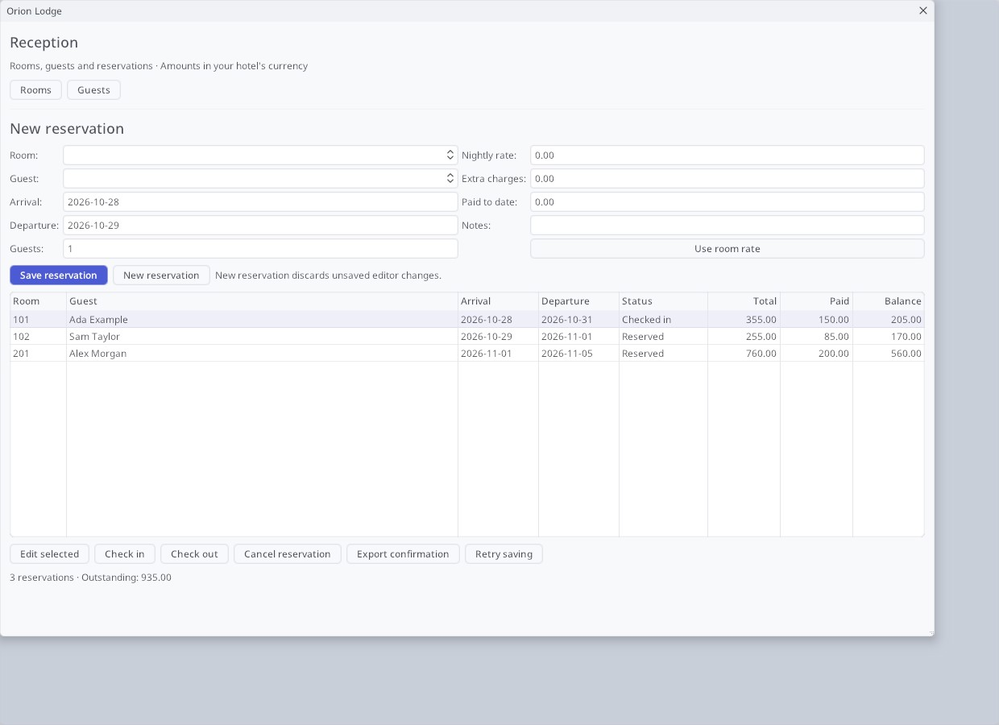

# Orion Lodge

A small hotel's reception desk, built with Orion controls and portable Lua
plugins. Lodge means a place to stay; it sits alongside Ledger as a focused
business application.



[Dark appearance](../../docs/lodge/images/reception-dark.jpg)

## Run

```sh
make share build/bin/lodge
build/bin/lodge
# Or keep a separate hotel database in an existing writable directory:
build/bin/lodge --data /path/to/hotel --lang en
# The same app through the generic launcher:
build/bin/orion-run --app apps/lodge/share/application.orion --data /path/to/hotel
```

Without `--data`, Lodge uses `<settings>/lodge/hotel.xml`. New databases start
empty. For a demo, copy `share/samples/demo.xml` to `hotel.xml` inside a new,
separate data directory, then launch with `--data` pointing there. Add rooms and guests, select them in the reservation editor, choose
dates and use **Use room rate**, then **Save reservation**. Select a reservation
in the table and use **Edit selected** to change dates, room, extras or payments.
**New reservation** discards editor inputs; saved reservations are retained.

Room-night availability uses half-open dates: a departure on 31 October permits
the next arrival on 31 October. Non-cancelled reservations occupy their dates;
capacity and overlapping bookings are checked before changes are written.
A reservation goes from Reserved to Checked in to Checked out, or from Reserved
to Cancelled. Check-out requires a zero balance; cancelled and checked-out
reservations are read-only. Amounts use a single hotel currency with two decimal
places. The nightly rate is copied into the booking, so editing a room's rate
later would not change existing bookings.

The total is nights × nightly rate + extra charges; balance subtracts the
cumulative paid amount. **Export confirmation** writes an escaped, printable
`confirmation.html` in the data directory (replacing the previous export).
Open it in a browser to print. It is a booking confirmation, not a tax invoice.
Reservation actions save immediately; catalog edits save when closing a window. A save failure rolls the action back and stays visible;
**Retry saving** retries any pending database save; closing is blocked if the final save fails.

## Architecture

- `share/schema.orion`: persistent records, defaults, delete rules and computed fields.
- `share/application.orion`: application object graph, DisplayGroup, reception and catalog forms.
- Orion’s shared application host owns the VM, databases, windows and output. No app C host or bindings.
- `share/model.lua`: validates native and Lua writes and supplies computed values.
- `share/reception.lua`: page actions, rendering and user feedback.
- `share/hotel.lua`: hotel-specific availability, capacity and state transitions.
- Shared `calendar`, `money`, `intervals`, `records` and `template` plugins:
  [authoring and usage](../../docs/plugins.md).

This first version provides a reservation list, rather than a timeline. It
supports adding, editing and deleting rooms and guests through codeless forms. Housekeeping,
category-level inventory, per-night rates, multi-room reservations, payment
ledgers, taxes, online distribution, access control and concurrent reception
terminals are follow-up work. Use a single process per hotel XML file. The Lua
plugins are portable; desktop builds use the repository's normal Linux, macOS
and Windows targets. Lodge is not yet added to the iOS packaging allowlist.

## Validation

```sh
make share build/bin/test_plugin_test build/bin/test_lodge_test
build/bin/test_plugin_test
build/bin/test_lodge_test
```

Tests exercise the real datasource and Lua sandbox, rejection of overlapping
and invalid bookings, adjacent stays, capacity, cancellation, settlement,
closed reservations, XML save/reopen, and creation of the reception UI.
