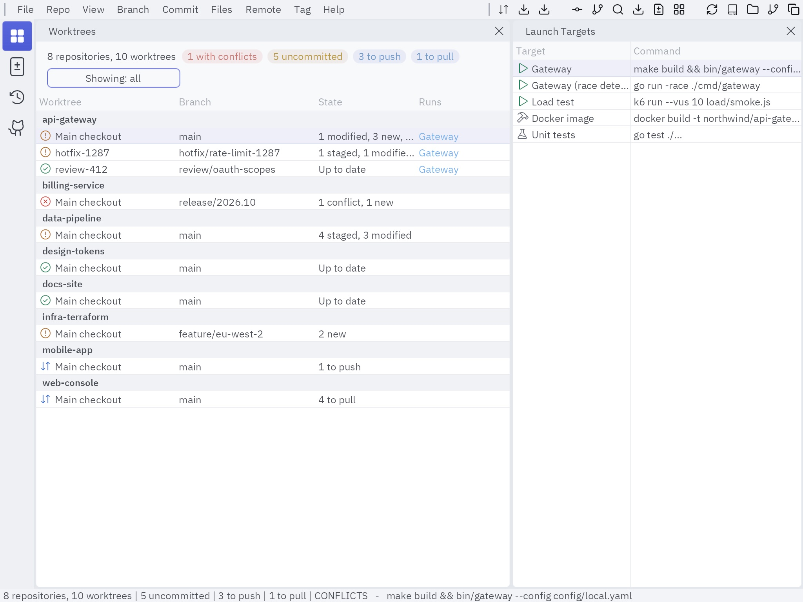
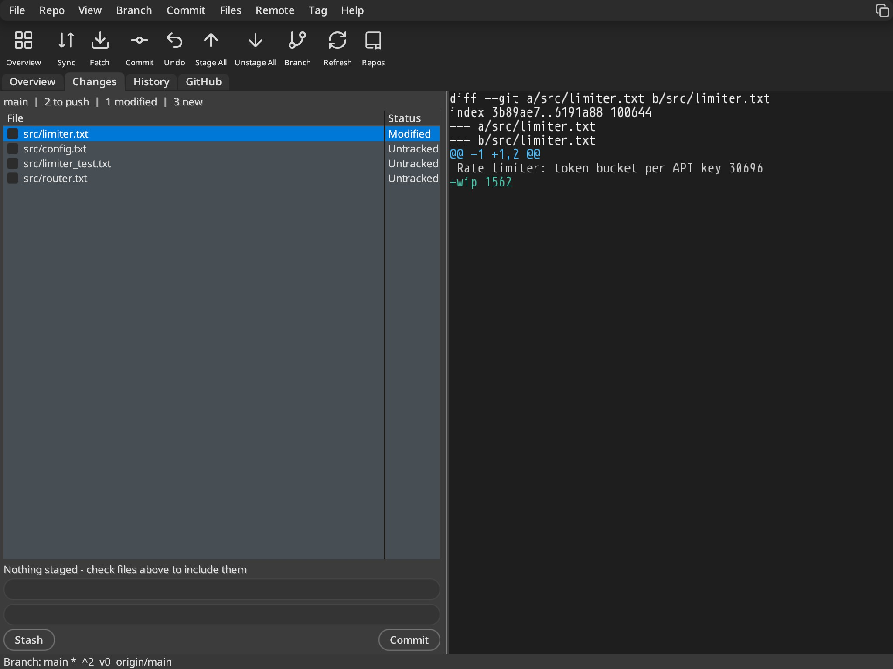

# Git Client

A SmartGit-style repository viewer built with the Orion UI framework.

```bash
orion install gitclient
build/bin/gitclient .
```

## Overview mode

**Overview** (Ctrl+0) is a board of tiles, one per repository and per linked
worktree. Each tile shows only what needs a decision: uncommitted files
(staged / modified / new), unpushed and unpulled commits, conflicts, stashes,
and whether the branch is published. A colour stripe gives the verdict at a
glance — red for conflicts, amber for uncommitted work, blue for needs
push/pull, green for in sync.



| Input | Action |
|---|---|
| Arrow keys | Move between tiles |
| Enter / double-click | Open the tile in Focus mode |
| Ctrl+0 | Toggle Overview and the last Focus page |
| Ctrl+Shift+R | Fetch every repository in the background |
| "Showing" pill | Filter to tiles that need attention |

Pass two or more paths on the command line (or `--overview`) to open a
temporary workspace without saving it:

```bash
apps/gitclient/share/demo/make_workspace.sh /tmp/ws   # eight demo repos + two worktrees
build/bin/gitclient $(cat /tmp/ws/paths.txt)           # Overview
build/bin/gitclient /tmp/ws/work/api-gateway           # Focus
```

## Focus mode

**Focus** is the classic single-repository view: Changes, History, and GitHub
tabs. It opens with a summary line showing the branch, commits to push/pull,
and staged/modified/new file counts, and tells you what Commit will do
("Commit 3 staged files" or "Nothing staged").



The History sidebar is the branch desk: current / default / local /
remote-only rows, last activity, and toolbar actions — **Prune**, **Delete
Merged**, and **Worktrees**. View → All Commits loads `--all`; View → Reflog
loads `git log -g`. Selecting a branch reloads that branch's log.

## Menu tree as the application map

`gitclient.orion` treats the menu tree as the complete map of user-facing Git
capabilities. Each menu item declares one action and may declare its default
keyboard shortcut with `shortcut="..."`. Toolbars and context menus reference
those actions with fully qualified `command="group.action"` values — no
separate command IDs.

If a new user operation cannot be represented by an existing menu item, add
the menu item first, then expose it on other surfaces. This gives menus,
toolbar buttons, context menus, keyboard shortcuts, and tests one shared
action identity.

## Architecture

The application follows a **database-driven** pattern: the model layer defines
data structures and the UI auto-populates from the database. Views contain
minimal code — no manual population loops, no array management, no hardcoded
column setup.

```
Git repo (.git/) ──git CLI──► git_backend.c ──► database_t (in-memory cache)
                                                       │
                                              ┌────────┼────────┐
                                              ▼        ▼        ▼
                                          branches  commits   files
                                          table     table     table
                                              │        │        │
                                              └────────┼────────┘
                                                       ▼
                                              TableViews (auto-populated)
```

Views are bound to database columns in `gitclient.orion`. When you call
`send_message(win, tvRefresh, 0, NULL)`, the tableview fetches records from
the database and renders them automatically.

## Declarative schema

```xml
<databases>
  <database name="db" class="gitclient_db">
    <table name="commits">
      <field name="hash"    type="string" length="41"/>
      <field name="author"  type="string" length="64"/>
      <field name="date"    type="string" length="20"/>
      <field name="subject" type="string" length="256"/>
    </table>
  </database>
</databases>
```

The compiler generates `db_commit_t`, `ID_DB_COMMITS`, `commits_fields[]`,
and so on. Form bindings reference those names directly:

```xml
<form name="history_page" width="800" height="440" role="page">
  <Toolbar>
    <Button command="branch.new" icon="git-fork" text="Branch" />
    <Button command="repo.search" icon="search"   text="Search" />
  </Toolbar>
  <TableView name="log" source="db.commits">
    <Column field="subject" title="Subject" width="0"  />
    <Column field="author"  title="Author"  width="110"/>
    <Column field="date"    title="Date"    width="90" />
  </TableView>
</form>
```

No C code is needed for column setup.

## Adding a new data source

1. Add a table to `gitclient.orion`:

   ```xml
   <table name="tags">
     <field name="name" type="string" length="128"/>
     <field name="hash" type="string" length="41"/>
   </table>
   ```

2. Populate it in `controller.c`:

   ```c
   git_tag_t raw[128];
   int count = git_get_tags(gc->repo, raw, 128);
   for (int i = 0; i < count; i++) {
       db_tag_t rec = {0};
       strncpy(rec.name, raw[i].name, sizeof(rec.name) - 1);
       send_db_message(gc->db, dbInsert, ID_DB_TAGS, &rec);
   }
   ```

3. Add a `<TableView source="db.tags">` to a form.

No view code required. The tableview auto-populates.

## Source files

| File | Purpose |
|---|---|
| `gitclient.orion` | Declarative schema, capability map, shortcuts, toolbars, forms |
| `datasource/gitclient_db.c` | Database procedure — in-memory tables populated from git |
| `datasource/changes_database_proc.c` | Changes-tab adaptor — working-tree files from git status |
| `datasource/github_database_proc.c` | GitHub adaptor — issues and PRs from the gh CLI |
| `controller.c` | Business logic — `gc_load_from_git()`, stage, commit, branch |
| `git_backend.c` | Git CLI wrapper (popen-based) |
| `view_main.c` | Main window proc — event routing only |
| `view_diff.c` | VGA diff viewer (custom rendering) |
| `view_menubar.c` | Command dispatch |
| `dialogs/dlg_*.c` | Dialogs using generated forms |

## Building

```bash
make build/bin/gitclient
```

The build system runs `orionc` to generate
`build/generated/apps/gitclient/gitclient.h` from `gitclient.orion`, then
compiles all sources into one executable.
