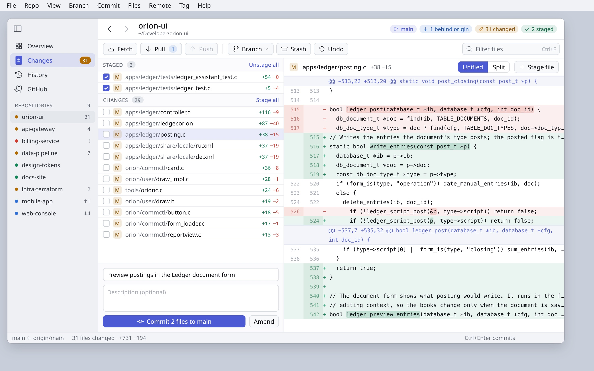
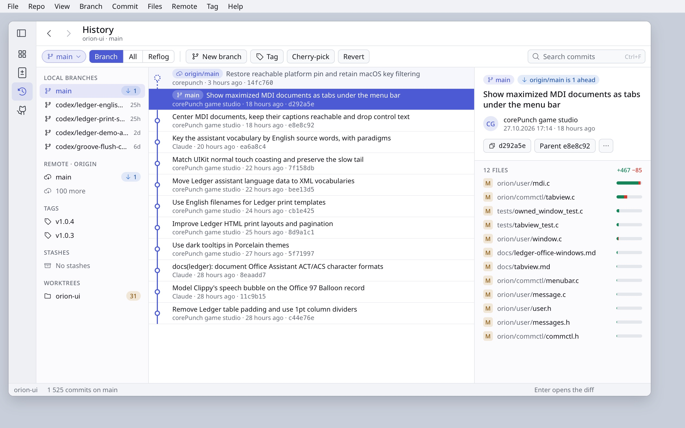
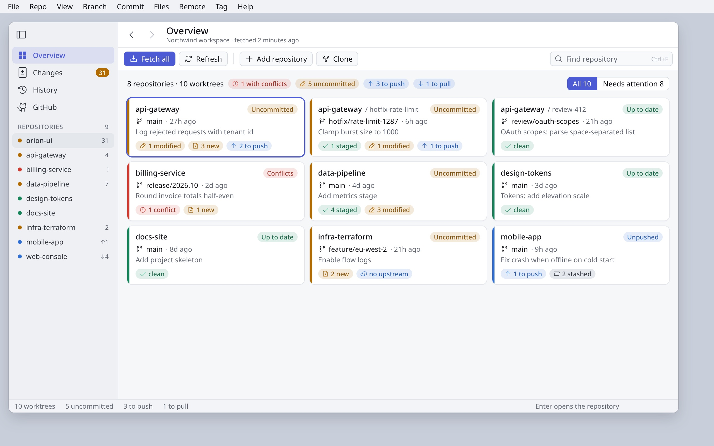
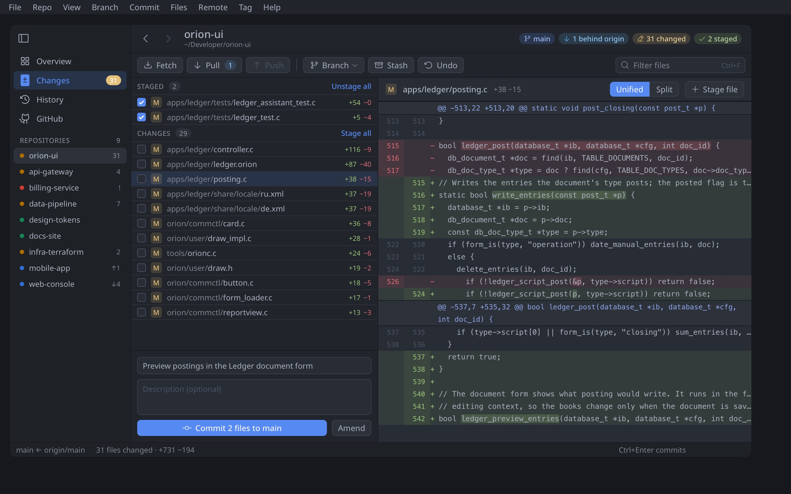

# Gitclient redesign concepts

Four concepts that give Gitclient the same Orion look as Ledger: a section
sidebar, a title row that states where you are, a labelled command bar,
status badges, quiet selection in tables without focus, and the One Dark
palette. Open [index.html](index.html) for the reasoning.

| Concept | Screen |
|---|---|
| 1. Changes: staged and unstaged, a readable diff |  |
| 2. History: branch tree, graph with refs, inspector |  |
| 3. Overview: status badges with icons |  |
| 4. Porcelain Dark in One Dark colours |  |

Baseline: [Changes](images/g0-changes.jpg), [Overview](images/g0-overview.jpg).
Mockup sources are in [mockups/](mockups/).
