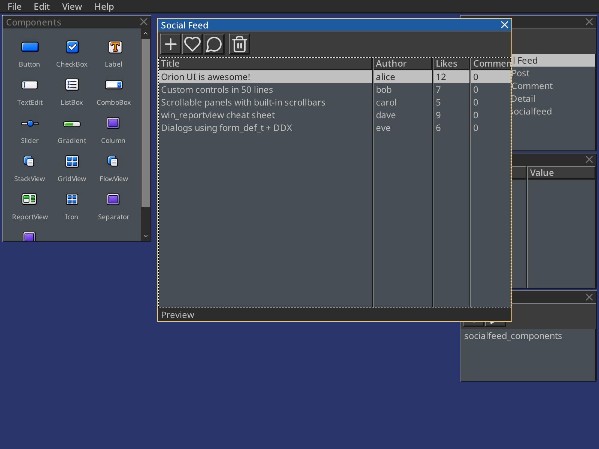

Orion is a standalone C UI framework for desktop applications and tools. It
combines a WinAPI-style message architecture with native Platform backends,
hardware-accelerated rendering, reusable controls, declarative forms,
databases, dialogs, and loadable applications. Lua is optional for apps that
need scripting.

## Start Here

| I want to... | Read |
|---|---|
| Build my first standalone app and GEM | [Getting Started](getting-started) |
| Understand layers, ownership, and message flow | [Architecture](architecture) |
| Create windows and handle lifecycle | [Window System](window-system) |
| Add controls, layouts, menus, and dialogs | [Controls](controls), [Toolbars](toolbars), [Dialogs](dialogs) |
| Bind declarative forms to records | [Database Forms](database-forms) |
| Study complete applications | [Applications](examples) |
| Install the released SDK and apps | [Package Manager](package-manager) |

## Build From Source

```bash
git clone https://github.com/corepunch/orion-ui.git
cd orion-ui
git submodule update --init --recursive
make apps
make test
```

Build one application with `make build/bin/<name>`, or build loadable modules
with `make gems`. Orion requires a C toolchain and Git; its native Platform
layer supplies windowing, input, and rendering.

## How Orion Fits Together

```text
apps/          Applications, declarative resources, components, and app tests
orion/user/    Windows, messages, input routing, drawing, forms, and resources
orion/kernel/  Graphics lifecycle, rendering, HTTP, and runtime services
orion/commctl/ Reusable controls and layout containers
orion/commdlg/ Modal dialogs and common pickers
platform/      Native windows, events, filesystems, processes, and networking
share/         Framework fonts, icons, shaders, and deployable assets
tests/         Framework behavior and integration tests
tools/         Resource compilers, generators, and release utilities
```

Platform events become Orion messages. Window procedures handle those messages,
controls notify their root with `evCommand`, controllers mutate application
state, and invalidated windows draw during `evPaint`. Declarative `.orion`
resources compile into typed forms, menus, toolbars, accelerators, and database
metadata.

[Read the architecture guide →](architecture)

## Applications As Examples

Orion's bundled apps are both usable software and reference implementations.

| Image Editor | Git Client |
|---|---|
| [](examples#image-editor) | [](examples#git-client) |
| MDI documents, canvas rendering, layers, tools, palettes, and animation | Tabs, report views, staging, history, GitHub data, and diff rendering |

Form Editor demonstrates declarative UI authoring and plugins; Social Feed
shows database-bound forms; Task Manager shows MVC and table views; Vibe Office
shows desktop-style custom controls and process-backed state.

[Explore all applications →](examples)

[Download Git Client](gitclient/), [Ledger in Russian](ledger/), or
[Ledger in German](ledger/de/).

## Declarative Database Forms

A field path identifies its database, table, and column:

```xml
<form name="edit_author" width="300">
  <TextEdit field="db.authors.name" />
  <TextEdit field="db.authors.email" />
  <Button value="1" text="OK" />
</form>
```

Register the named database once at startup, then open the self-contained form:

```c
show_db_dialog(&myapp_edit_author_form, "Edit Author", parent, author_id);
```

Orion fetches the record, exchanges values with controls, and inserts or
updates on acceptance. [Read Database Forms →](database-forms)

## Core Guides

- [Messages & Events](messages): commands, notifications, input, and event loop
- [Drawing & Rendering](drawing): paint lifecycle and renderer APIs
- [Scrollbars](scrollbars): built-in and standalone scrollbar contracts
- [Icon System](icons): system icons, SVG assets, and bitmap strips
- [Async HTTP](http): message-driven HTTP/HTTPS requests
- [GEM Plugin System](gems): shared Shell hosting and application lifecycle
- [Presenting An Application](app-presentation): screenshots and app docs
