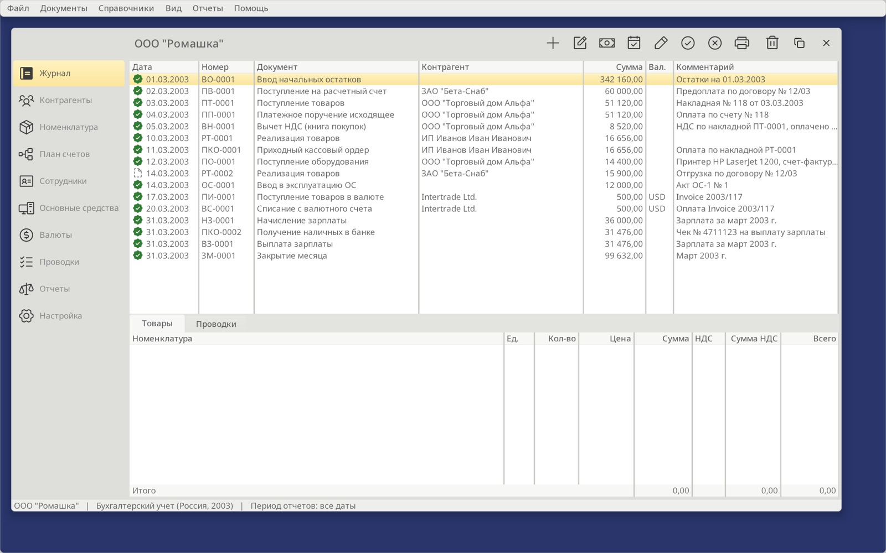
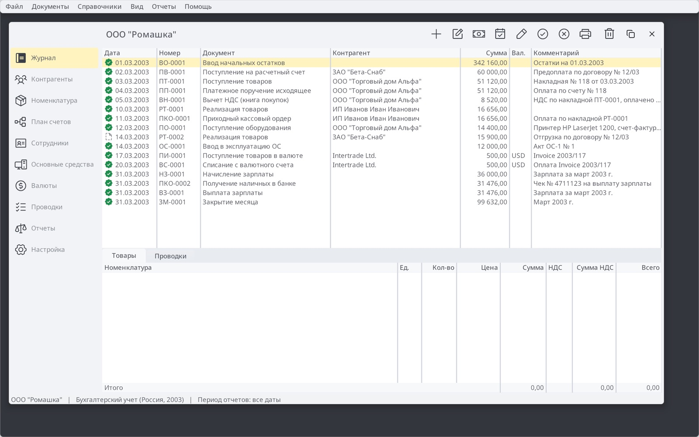
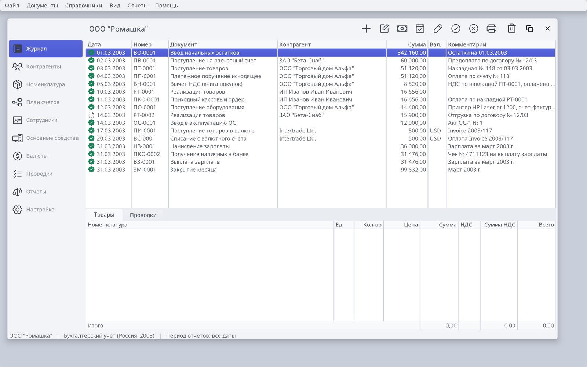
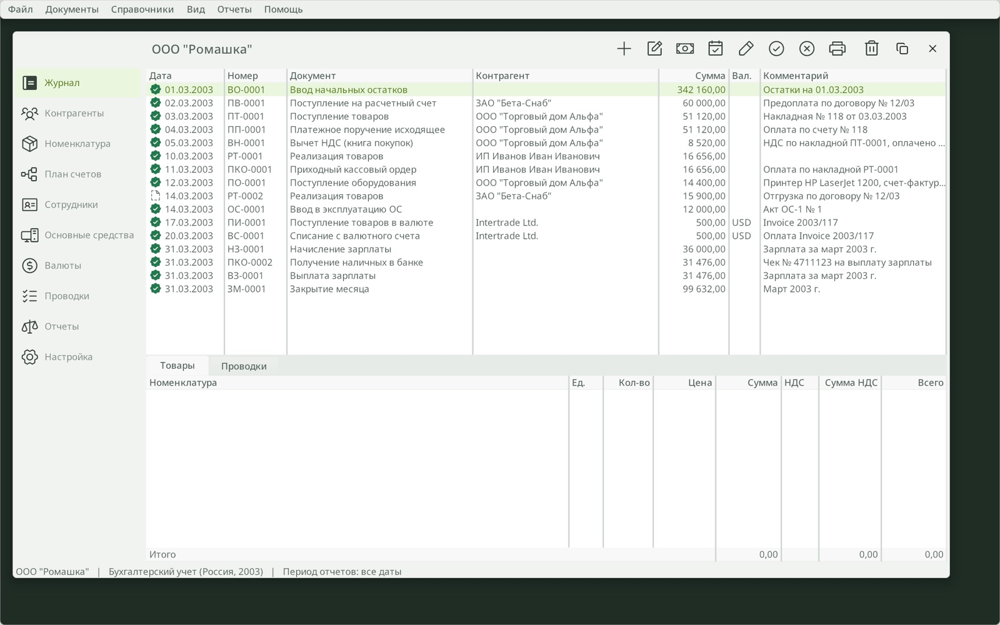
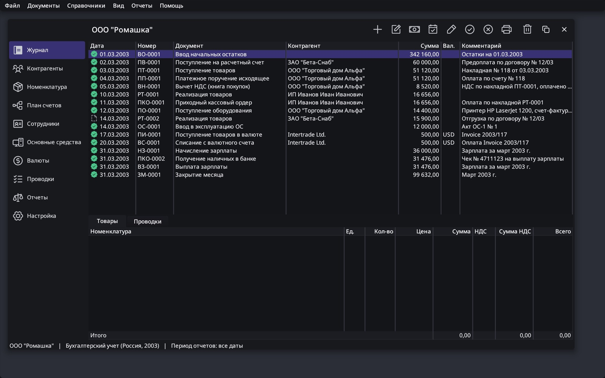

# Ledger chrome and palette concepts

Status: proposal. Four palettes ship as real themes so they can be judged in
the running app (`make build/bin/ledger THEME_ledger=<name>`). One will become
Ledger's default; the others are then removed.

## Why Amber reads as Ubuntu

| Cue | Amber today | Ubuntu (Yaru / GNOME) |
|---|---|---|
| Window and chrome greys | warm `#ECECE9`, `#F7F7F5`, `#DEDEDA` | warm `#FAFAFA` / `#F6F5F4` family |
| Dialog caption | graphite `#3A3E44` bar, white text | dark header bars |
| Desktop | indigo-violet `#29356B` (hard-coded in `init.c`) | aubergine `#2C001E` → `#77216F` |
| Accent | amber-orange selection gradient | orange `#E95420` |

The yellow is the smallest of these cues. The warm greys, the dark caption
and the violet desktop do most of it. Each concept below changes all three:
cool neutral greys, a light caption, and a desktop chosen with the palette.

The desktop colour is now a palette role (`brDesktopBg`, `desktop-bg` in
forms) rather than a literal in `win_desktop`. Existing themes keep the
old colour.

## The concepts

All four use Amber's business drawing: white wells, hairline fields, softly
rounded 3–6 px corners. Only the palettes differ.

| | Palette | Accent and selection | Reads like |
|---|---|---|---|
| A | **Citron** | lemon `#FFD233` default button, flat pale `#FFF3BF` row, dark ink | 1C's yellow on macOS greys: familiar to 1C users, without the Linux feel |
| B | **Porcelain** | indigo `#4C5BD4`, solid indigo row, white text | Finder, banking dashboards |
| C | **Sage** | lime `#A3E07A` button with forest `#163300` ink, pale lime row | money and fintech apps |
| D | **Midnight** | violet `#7B6EF6` on graphite, muted violet row | Linear-style dark mode for long sessions |

These screenshots use the current chrome. The proposed chrome below is shown
in an interactive mockup with each palette.

## The proposed chrome

### Why the title row looks unfinished

The merged title row (`WINDOW_TITLETOOLBAR`) spans the full width over the
ActivityBar. The space above the sidebar is therefore empty band. The title
is pushed past it, so it starts far in. The sidebar and the band share
`brPanelDarker` (the ActivityBar paints `THEME_PART_TOOLBAR`), so the sidebar
cannot have its own colour. Finder does the reverse: the sidebar runs to the
top of the window, its top holds the window controls, and the toolbar starts
at the sidebar's edge.

### Layout

- **The sidebar runs full height** in its own colour (`THEME_PART_SIDEBAR`).
  Its top strip holds the organisation switcher (an avatar and the company
  name, like a workspace switcher; 1C's "Организация") and the
  collapse button.
- **Collapse to a rail.** The button collapses the sidebar to a 56 px icon
  rail, like VS Code's activity bar. The ActivityBar already supports
  icon-only buttons; the collapse button toggles `labels` and the dock width.
- **Window controls.** There are two options, offered as a tweak in the mockup:
  - *Trailing* (default): the controls stay at the right end of the
    title row, as on Windows and in today's Orion.
  - *Leading*: the controls sit in the sidebar's top strip, as in Finder.
    When the sidebar collapses they move to the start of the toolbar.

  This is platform policy, so it belongs in the theme as a metric
  (`window.controls_leading`), not in apps.
- **Title row:** back and forward buttons, then the page title (15 px
  semibold) with a one-line subtitle (organisation, period, posting state).
  The page actions and search follow on the right. The organisation name
  moves into the sidebar, so the title names what is shown.
- **Sections grouped** like 1C's section panel: Учёт, Справочники, Анализ.

### Framework work (no app hacks)

1. **Sidebar tracking separator** (≈ `NSTrackingSeparatorToolbarItem`). A
   `TOOLBAR_ITEM_SIDEBAR_SEPARATOR` (`<sidebar-separator />`) splits the
   merged title toolbar at the left-docked pane's edge. Items before it lay
   out over the sidebar column and paint as `THEME_PART_SIDEBAR`; items after
   it go over the content. The title toolbar already measures that pane to
   place `<title />`, so layout, painting and hit-testing share one geometry.
2. **ActivityBar paints `THEME_PART_SIDEBAR`.** This changes Git Client and
   Terminal too, and they then also get a distinct sidebar colour.
3. **Navigation history.** Orion has no router. `PageHost` owns selection
   (`page_host_select`) and is where history belongs:
   - Each selection, and each activation of a document tab, pushes an
     entry. An entry is a page command, or a document window held by id
     so that destroyed windows are pruned, as `page_host_forget_window`
     prunes pages.
   - Standard `ID_NAV_BACK` / `ID_NAV_FORWARD` commands, with Alt+←/→
     (Cmd+[ / ] on macOS) accelerators and `<back />` / `<forward />`
     toolbar items. The items enable and disable from the history, the
     way MFC's `ON_UPDATE_COMMAND_UI` works.
   - Back and forward navigate; they never re-create pages.

## MDI: documents as tabs

1C 8.3 opens every form in a tab of the main window: journals, documents
and reports. That tab row is MDI. Ledger opens documents as modal dialogs
(`show_db_dialog_opts`), so you can have only one open at a time, cannot
compare documents, and cannot leave one half-done.

The proposal:

- The host gets a **document tab strip** under the title row. The section
  page is the pinned first tab. Documents and reports open as tabs beside
  it, and their caption is the document title ("Реализация товаров РТ-0001
  от 10.03.2003"). This reuses the TabView-owns-windows model from
  [page docking](page-docking.md); it does not add a second MDI system.
- **Hosted editing contexts.** A `db_form_open(host, form, record_id, opts)`
  creates the same form as `show_db_dialog_opts`, docked as a tab. Its
  editing context (insert/edit/cancel, the hook, `saved_id`) is unchanged.
  OK closes the tab, and a modified tab asks before it closes. Modal
  dialogs stay available for small row editors (document lines).
- A tab's form `<Toolbar>` is projected into the title row, the way page
  toolbars are projected today. The document's command bar (Провести и
  закрыть, Записать, Провести, Дт/Кт, Печать, Создать на основании) stays
  in the form, as in 1C.
- Tab activation feeds the navigation history.

## 1C screens compared

| 1C screen | Ledger today | Missing |
|---|---|---|
| **Остатки товаров** (Бухгалтерия 3.0 report) | No warehouses. Quantities exist on document lines and entries, but no stock report. | `Склады` catalog; warehouse on goods documents; a stock register (quantity and amount by warehouse and item); a report with a date, grouping by warehouse, group totals and a Сформировать/Настройки bar; a balance-entry assistant |
| **Начисление зарплаты** | Payroll document: employee, position, amount, withheld, contributions, net; Fill | "Зарплата за" period field; department; days and hours worked; line numbers; separate Записать / Провести / Провести и закрыть; Дт/Кт entries view; Начислить and Удержать kinds; Выплатить (a payment statement based on the document); amounts that drill down |
| **Заказ-наряд** | — | This screen is from **1C:Альфа-Авто**, an auto-service configuration, not Бухгалтерия. It covers customer car, VIN, mileage, works in norm-hours, parts, customer materials and piecework split. It fits a separate Ledger configuration after the core gaps are closed. |
| Shared form chrome | Modal dialogs with OK and Post / Cancel | MDI tabs; back/forward in the form header; favourites; a command bar with the default Провести и закрыть; Создать на основании; per-document Отчеты; attachments |

The mockup's Склад item and Остатки товаров tab preview the stock report
layout. Its figures are illustrative, taken from the demo purchases.

## Order of work after a palette is chosen

1. Make the chosen palette Ledger's default and remove the other concepts.
2. Add the sidebar tracking separator, the full-height ActivityBar, collapse,
   and the window-controls metric.
3. Add navigation history in PageHost, with back/forward commands and items.
4. Add document tabs and hosted `db_form_open`, and move Ledger's documents
   and reports into tabs.
5. Close the 1C gaps: warehouses and the stock report; payroll period,
   timesheet, command bar and Выплатить.
