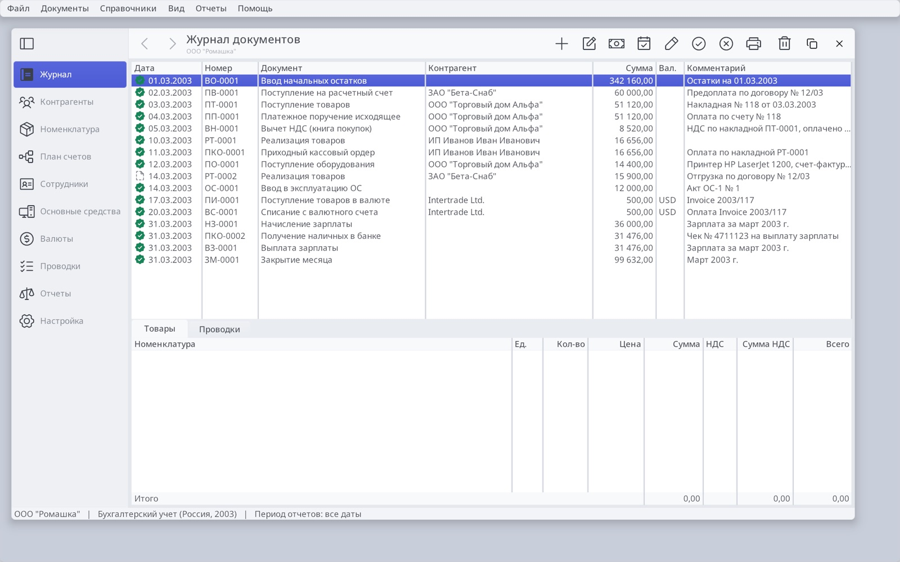
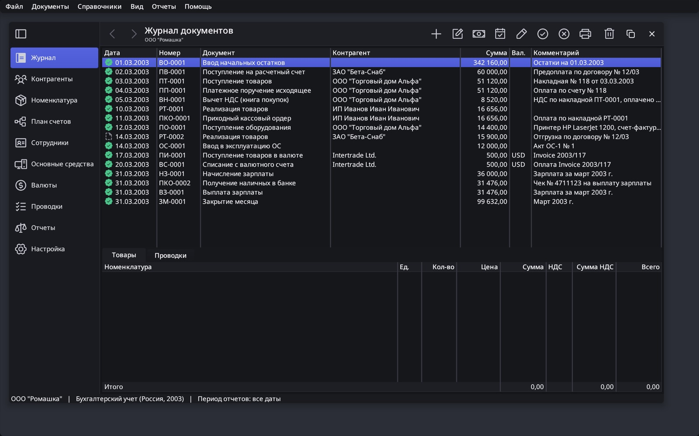

# Ledger chrome

Status: the palette, title row and Office-style MDI documents are implemented.
The 1C-specific gaps below remain.

## Why Amber read as Ubuntu

| Cue | Amber | Ubuntu (Yaru / GNOME) |
|---|---|---|
| Window and chrome greys | warm `#ECECE9`, `#F7F7F5`, `#DEDEDA` | warm `#FAFAFA` / `#F6F5F4` family |
| Dialog caption | graphite `#3A3E44` bar, white text | dark header bars |
| Desktop | indigo-violet `#29356B` | aubergine `#2C001E` → `#77216F` |
| Accent | amber-orange selection gradient | orange `#E95420` |

The yellow was the smallest of these cues. Four palettes changed all of
them (Citron, Porcelain, Sage and Midnight), and **Porcelain** was chosen:
cool white surfaces, white wells, and a solid indigo selection with white
text, after Finder and banking dashboards. **Porcelain Dark** is its dark
counterpart. The desktop colour is a palette role (`brDesktopBg`) instead of a
literal in `win_desktop`.

## Light and dark across Orion

Themes come in pairs: Light ↔ Modern and Porcelain ↔ Porcelain Dark. With the
default `APPEARANCE_SYSTEM`, every Orion app follows the OS appearance at
start-up and when it changes. macOS and Windows post `kEventAppearanceChanged`
for this. See [drawing](drawing.md#light-and-dark-appearance) for the API and
`--appearance light|dark|system`.

## The title row

Before, the merged title row spanned the full width over the ActivityBar,
leaving empty band above the section panel and pushing the title far in. The
sidebar and the band shared one colour. Now, as in Finder and Mail:

- **The sidebar runs full height in its own colour.** The ActivityBar paints
  as `THEME_PART_SIDEBAR` (`TOOLBAR_STYLE_SIDEBAR`). A `<sidebar-separator />`
  in the title row (≈ `NSTrackingSeparatorToolbarItem`) gives the segment
  above the sidebar the same paint, and the toggle button sits there. Layout,
  paint and hit-testing all use the left pane's edge.
- **Collapse to a rail.** The toggle and Ctrl+B call
  `page_host_set_sidebar_collapsed()`, which hides the bar's labels; the title
  row follows the new edge.
- **Back and forward.** PageHost records selections (`page_host_go`,
  `page_host_can_go`); Ledger binds `view.back` and `view.forward` with
  Alt+Left/Right and enables the buttons on `evPageChanged`.
- **Title and subtitle.** The window title names the page; the organisation
  is the subtitle (`set_window_subtitle`, ≈ `NSWindow.subtitle`).
- **Window controls** stay at the trailing end, as on Windows. A Finder-style
  leading placement would be a theme metric, not an app option.

## Documents as MDI windows

Ledger uses the selected Office 97 / Excel 2003 model: several modeless document
windows inside one common frame. The MDI client confines their paint and hit
testing to the document workspace. Window commands cycle, cascade, tile and close
documents. Each editor owns an independent working copy; Save keeps it open and
Cancel discards only its own work. Small detail editors remain modal. Clippy is
an owned tool window above the documents, scoped to the application. See
[the window architecture](ledger-office-windows.md).

## Next: 1C screens

| 1C screen | Ledger today | Missing |
|---|---|---|
| **Остатки товаров** (Бухгалтерия 3.0 report) | No warehouses. Quantities exist on document lines and entries, but no stock report. | `Склады` catalog; warehouse on goods documents; a stock register (quantity and amount by warehouse and item); a report with a date, grouping by warehouse, group totals and a Сформировать/Настройки bar; a balance-entry assistant |
| **Начисление зарплаты** | Payroll document: employee, position, amount, withheld, contributions, net; Fill | "Зарплата за" period field; department; days and hours worked; line numbers; separate Записать / Провести / Провести и закрыть; Дт/Кт entries view; Начислить and Удержать kinds; Выплатить (a payment statement based on the document); amounts that drill down |
| **Заказ-наряд** | — | This screen is from **1C:Альфа-Авто**, an auto-service configuration, not Бухгалтерия. It covers customer car, VIN, mileage, works in norm-hours, parts, customer materials and piecework split. It fits a separate Ledger configuration. |
| Shared form chrome | MDI document editors with OK and Post / Cancel; modal detail dialogs | Favourites; a command bar with the default Провести и закрыть; Создать на основании; per-document Отчеты; attachments |
