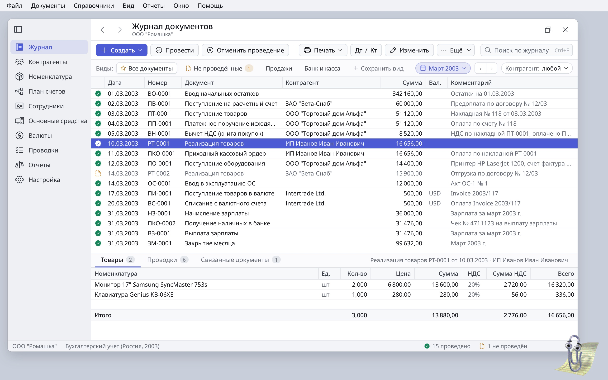
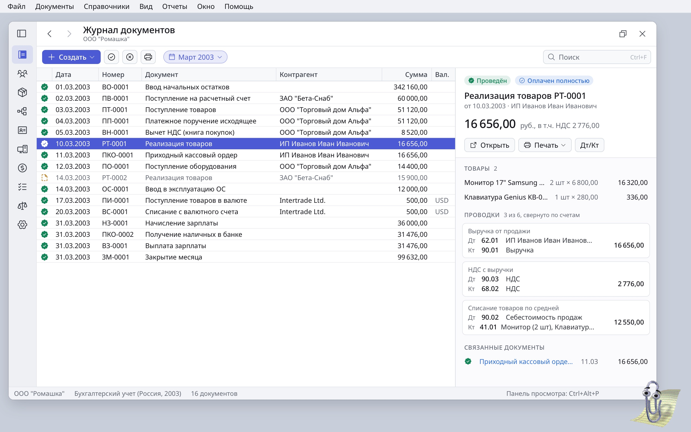
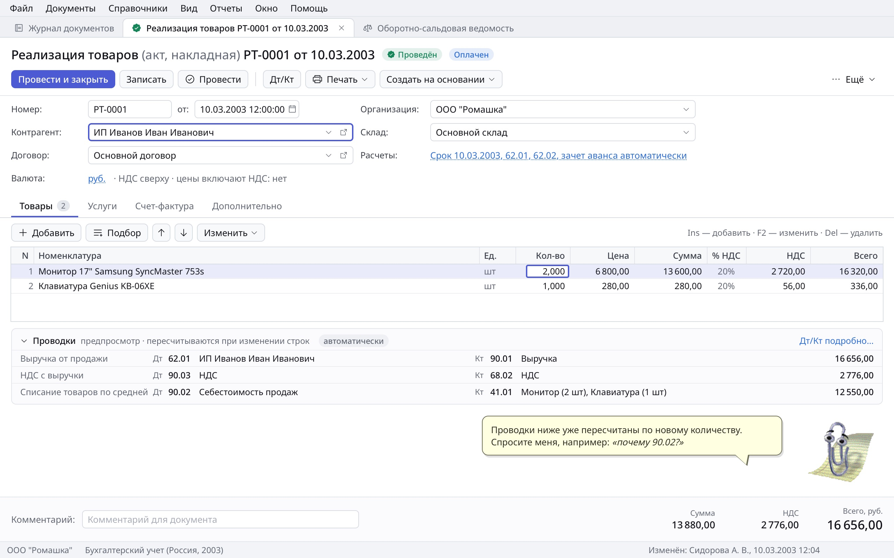
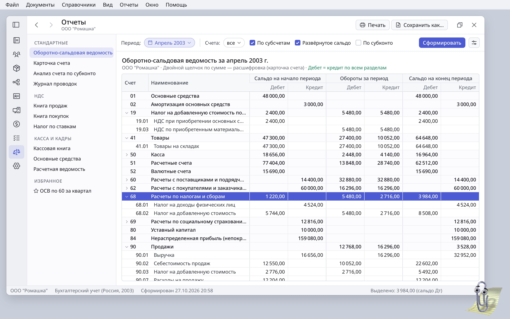
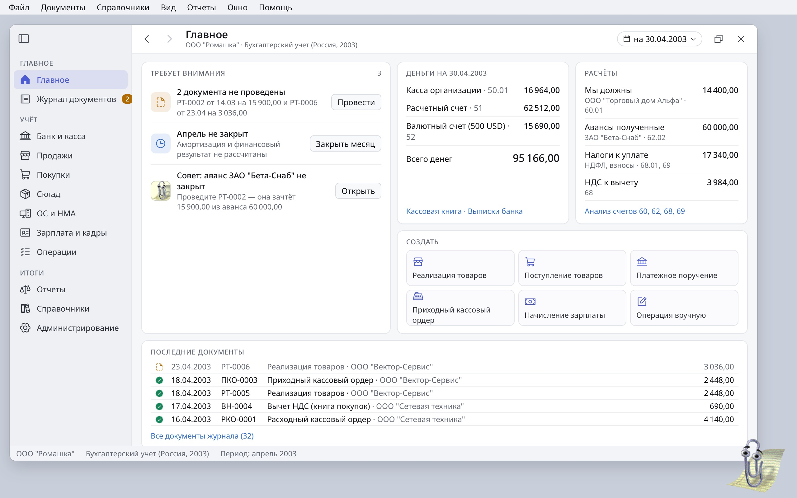
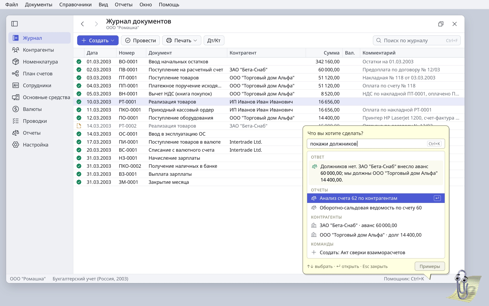
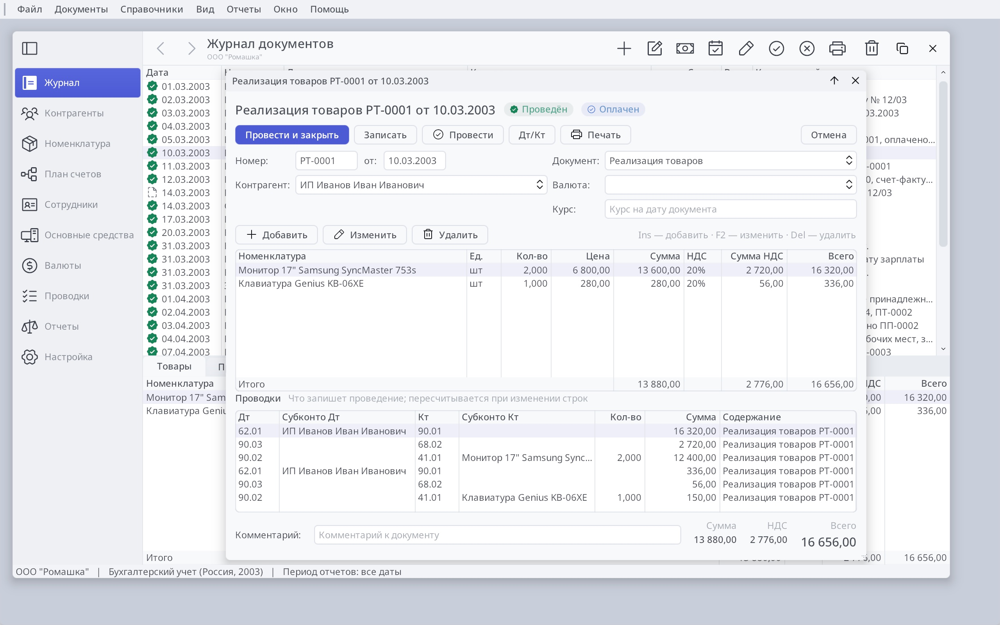
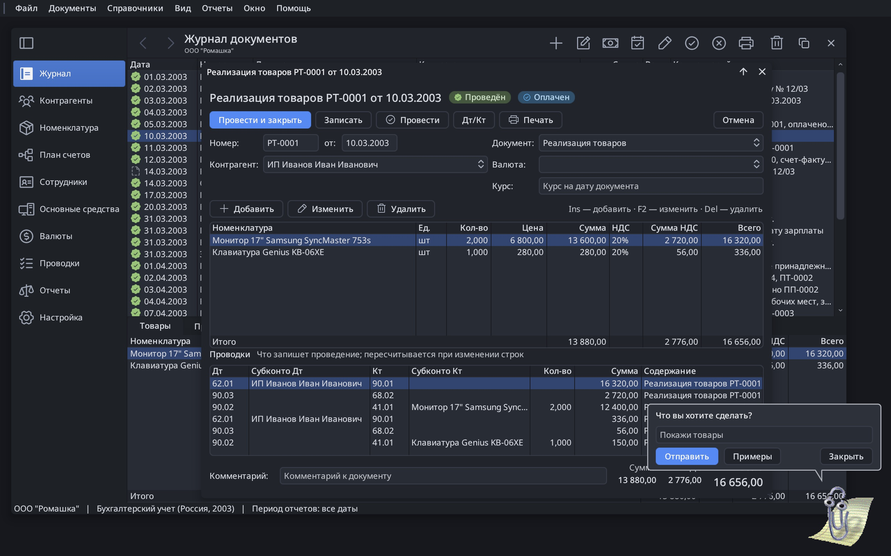
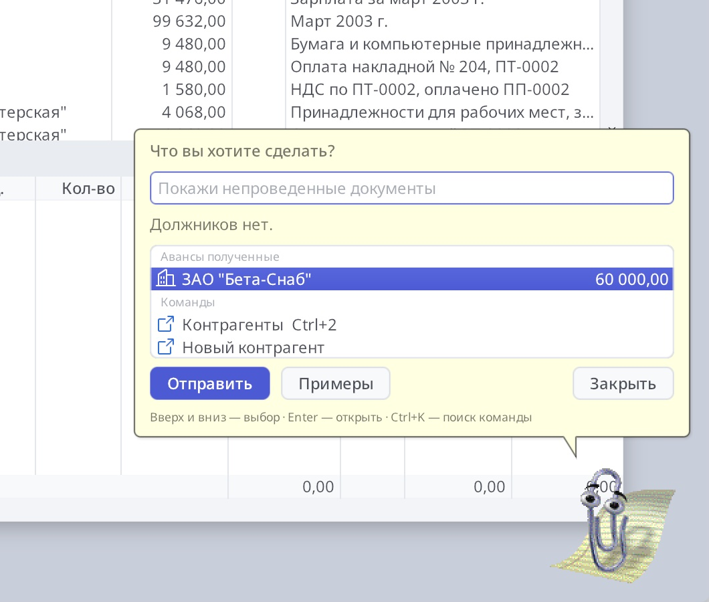
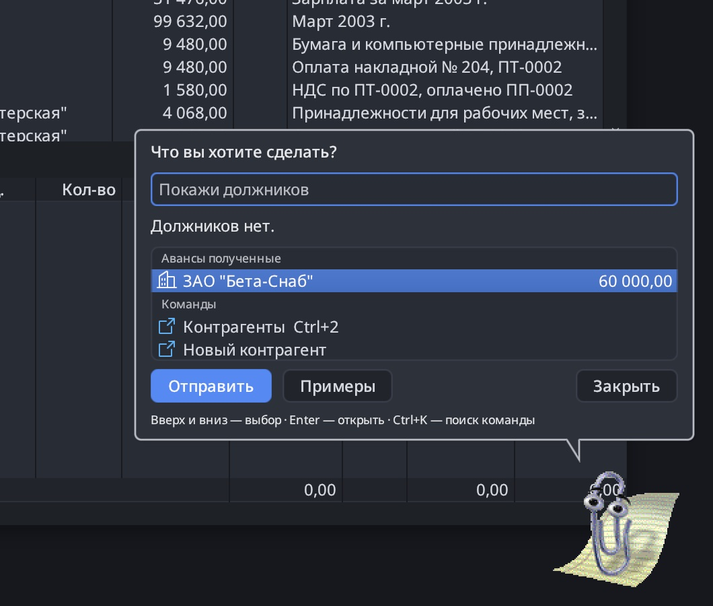

# Ledger redesign concepts

Six concepts for making Ledger friendlier and more modern while keeping the
1C grammar its users rely on: the journal, `Провести`, `Дт/Кт`,
`№ … от …` and `Сформировать`. Open [index.html](index.html) for the full
write-up: the current screens, the problems they show, each concept with its
reasoning and references, and a suggested order.

The mockups are HTML pages drawn with Porcelain's colours, Noto Sans,
Ledger's Phosphor icons and the real ru-2003 demo data (ООО "Ромашка"). The
sources are in [mockups/](mockups/); they load the fonts from `share/fonts`
and Clippy from the assistant add-on, so open them from a checkout.

| Concept | Screen |
|---|---|
| 1. Labelled command bar and saved views |  |
| 2. Preview pane for the selected document |  |
| 3. The document form in 1C grammar, with live entries |  |
| 4. Reports: parameters, Сформировать and a tree |  |
| 5. Главное: a start page and 1C sections |  |
| 6. Clippy as the command search |  |

Baseline: [journal](images/c0-journal.jpg), [document](images/c0-document.jpg),
[trial balance](images/c0-balance.jpg).

## As built

Concept 3 is implemented. The goods document form (`document` in
`ledger.orion`) has:

- a heading with the document's name and status badges ("Проведён",
  "Оплачен");
- Post and Close (Ctrl+Enter), Write, Post, Дт/Кт and Print;
- number and date on one line;
- line commands with icons above the lines;
- the entries posting will write, recomputed in the form's editing context as
  the lines change;
- read-only totals beside the comment.

"Оплачен" comes from `ledger_document_settlement`. It matches the document
first in, first out against the counterparty's payments on its settlement
account.

Concept 6 is implemented too: Clippy's balloon is a command palette (Help,
Find a Command, Ctrl+K). The answer is followed by grouped rows: records,
related commands, suggestions from the books and examples. The arrow keys move
through the rows while typing stays in the field, and Enter opens a row. See
the [assistant guide](../../../apps/ledger/share/addons/assistant/README.md).

 

The framework pieces this needed went into Orion, not into Ledger:

- Labels bound to fields, shown read-only;
- framed tables (`frame="true"`) clipped by a rounded clip in the renderer
  (`set_clip_rounded_rect`);
- Porcelain radii of 6 px for buttons and 5 px for fields;
- Porcelain Dark retuned to Atom's One Dark, with text shadows a theme setting;
- `icon=` and `tooltip=` on form buttons, and buttons that show an icon beside
  their text;
- `draw_status_badge` and the Badge control;
- `font="title"` for Labels;
- a quiet selection for tables without focus (`CTRL_INACTIVE`);
- `placeholders` in add-on page data;
- grouped lists (`group-field`), lists that size to their rows (`fit-rows`),
  a text field that drives a list (`list=`, `edSetList`), and `action=` on
  add-on TableViews.
