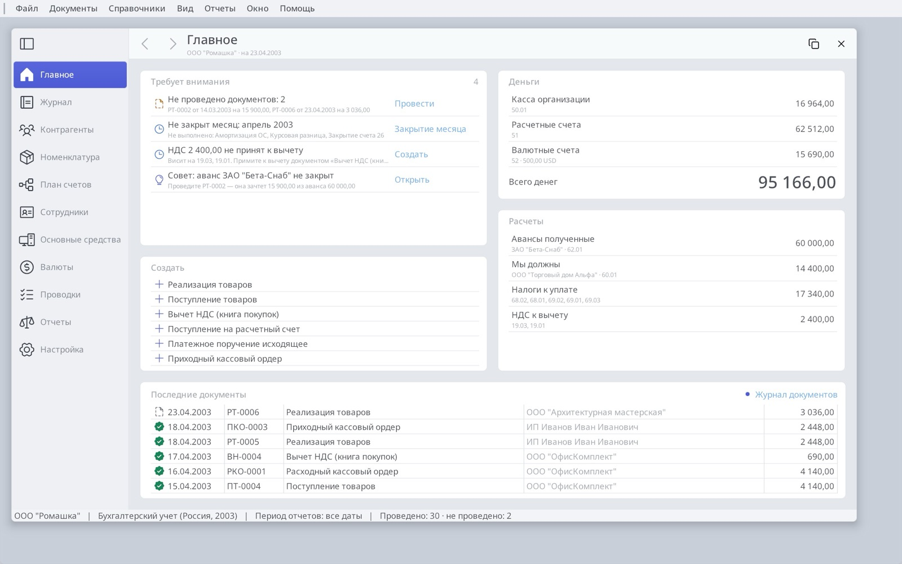
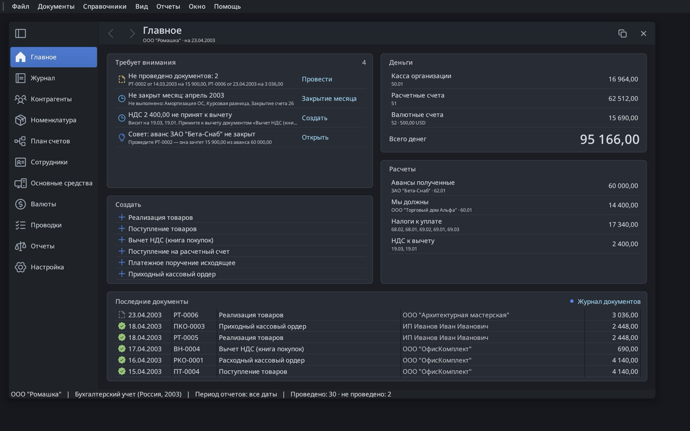
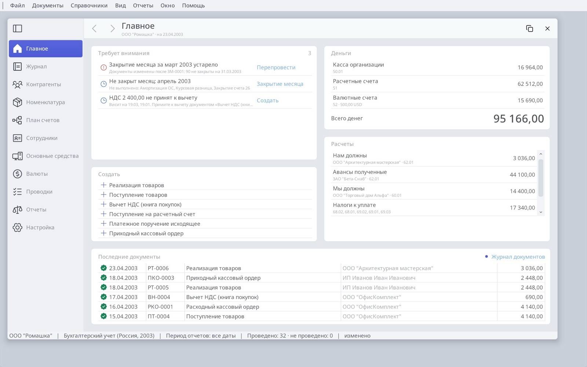
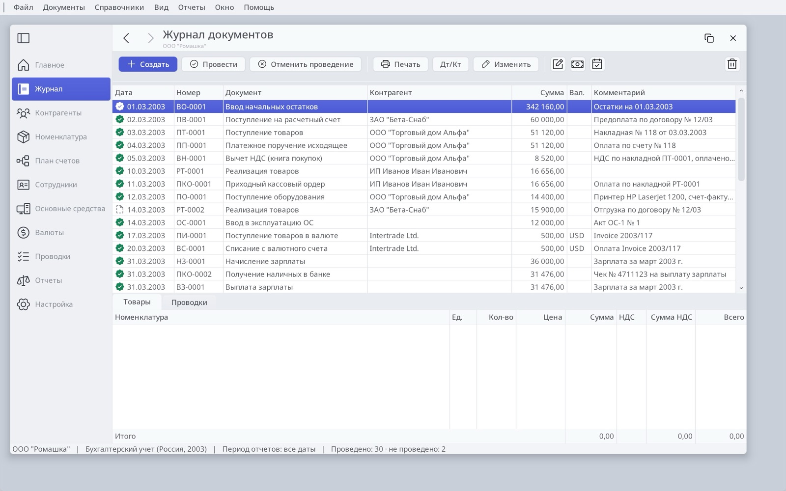
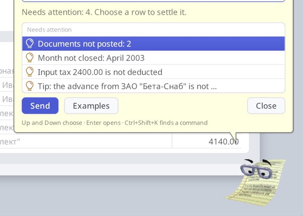

# Ledger redesign concepts

Six concepts for making Ledger friendlier and more modern while keeping the
1C grammar its users rely on: the journal, `Провести`, `Дт/Кт`,
`№ … от …` and `Сформировать`. Open [index.html](index.html) for the full
write-up: the current screens, the problems they show, each concept with its
reasoning and references, and a suggested order.

The mockups are HTML pages drawn with Porcelain's colours, Noto Sans,
Ledger's Phosphor icons and the real ru-2003 demo data (ООО "Ромашка"). The
sources are in [mockups/](mockups/); they load the fonts from `share/fonts`
and Clippy from the assistant add-on, so open them from a checkout.

| Concept | Screen |
|---|---|
| 1. Labelled command bar and saved views |  |
| 2. Preview pane for the selected document |  |
| 3. The document form in 1C grammar, with live entries |  |
| 4. Reports: parameters, Сформировать and a tree |  |
| 5. Главное: a start page and 1C sections |  |
| 6. Clippy as the command search |  |

Baseline: [journal](images/c0-journal.jpg), [document](images/c0-document.jpg),
[trial balance](images/c0-balance.jpg).

## As built

Concept 3 is implemented. The goods document form (`document` in
`ledger.orion`) has:

- a heading with the document's name and status badges ("Проведён",
  "Оплачен");
- Post and Close (Ctrl+Enter), Write, Post, Дт/Кт and Print;
- number and date on one line;
- line commands with icons above the lines;
- the entries posting will write, recomputed in the form's editing context as
  the lines change;
- read-only totals beside the comment.

"Оплачен" comes from `ledger_document_settlement`. It matches the document
first in, first out against the counterparty's payments on its settlement
account.

Concept 6 is implemented too: Clippy's balloon is a command palette (Help,
Find a Command, Ctrl+Shift+K). The answer is followed by grouped rows: records,
related commands, suggestions from the books and examples. The arrow keys move
through the rows while typing stays in the field, and Enter opens a row. See
the [assistant guide](../../../apps/ledger/share/addons/assistant/README.md).

 

Concept 5 is implemented as Главное, the page Ledger opens on (View, Home,
Ctrl+Shift+H). It has five cards:

- **Требует внимания**: the books' own checks, each with the command that
  settles it. A click posts the drafts, closes the month (dated its last day),
  reposts the books, opens the document or creates the deduction. The checks
  are the ones accountants otherwise run by hand or call a 1C programmer for:
  - documents not posted;
  - a finished month not closed;
  - a closing that later documents made stale ("нарушена
    последовательность": the accounts it closes are no longer zero);
  - cash or stock below zero at the end of a day;
  - input tax waiting on 19;
  - a debt and an advance on two subaccounts left unoffset;
  - Clippy's tip about an advance a draft sale would offset.
- **Деньги**: the money accounts and their total in the 24 px display face.
- **Расчеты**: debts both ways, advances, taxes and wages payable, input tax.
- **Создать**: the document types used most.
- **Последние документы**.

The status bar counts posted and unposted documents. The page reads
`ib.home_rows` and `ib.recent_documents`, which `home.c` rebuilds with the
reports. Accounts come from the configuration's document types, so the same
page works for de-2003 and de-2026. The layout puts Создать under the
attention list and the two figure cards one above the other. Orion's stack
layout has no column weights, so this keeps every account name and amount
whole at 1200 px.

After a March draft is posted with March already closed, the page flags the
stale closing and offers Перепровести:

Concept 1's command bar is in place on the journal: Создать (the one filled
button), Провести, Отменить проведение | Печать, Дт/Кт, Изменить, then
Operation, Payroll and Close Month as icon buttons, and Delete at the end.
Дт/Кт (Documents, Show Entries) shows the selected document's entries, and
selecting an operation, payroll or closing shows its entries instead of an
empty Lines tab. The other pages keep their few commands in the title row,
now captioned. Saved views, the period stepper and the journal search are
still to come.

Clippy answers questions about the same books: "проверь учет", "кому мы
должны", "сколько денег", "закрыт ли месяц", "почему красное сальдо", "акт
сверки с Альфой". His suggestions are the attention list, and choosing one
settles it.

Across every screen, the type and density now match the mockups:

- headings are 18 px;
- rows are 21 px under a 24 px header, ruled by hairlines;
- cards are white panels with a hairline.

The framework pieces this needed went into Orion, not into Ledger:

- Labels bound to fields, shown read-only;
- framed tables (`frame="true"`) clipped by a rounded clip in the renderer
  (`set_clip_rounded_rect`);
- Porcelain radii of 6 px for buttons and 5 px for fields;
- Porcelain Dark retuned to Atom's One Dark, with text shadows a theme setting;
- `icon=` and `tooltip=` on form buttons, and buttons that show an icon beside
  their text;
- `draw_status_badge` and the Badge control;
- `font="title"` for Labels;
- a quiet selection for tables without focus (`CTRL_INACTIVE`);
- `placeholders` in add-on page data;
- grouped lists (`group-field`), lists that size to their rows (`fit-rows`),
  a text field that drives a list (`list=`, `edSetList`), and `action=` on
  add-on TableViews;
- `font="display"` (`FONT_DISPLAY`, 24 px) and an 18 px `font="title"`;
- `theme_t.report.row_height`, `header_height` and `row_dividers`;
- stacked rows (`cell-style="stacked"`), link lists (`activate="click"`) and
  column colours (`<Column color=>`);
- card faces and outlines from the theme (`theme_t.card.face`, `outline`),
  and form children that keep their control's own padding;
- fit-rows lists that re-lay out their form when their row count changes.
