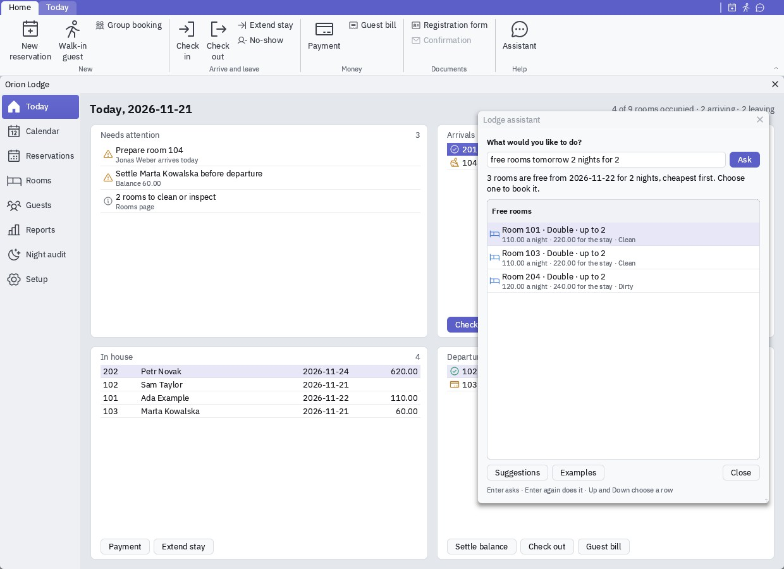

# The Lodge assistant

The assistant answers requests typed in the desk's own words, in English,
German or Russian, and carries them out. Open it from **Home → Assistant**,
the Quick Access Toolbar or **Ctrl+K**; it opens along the right edge of the
main window and stays open while you work.

## How it works

1. **Before anything is typed** it shows *Suggestions*, the day's open tasks
   as rows you can act on (check in a ready arrival, mark a no-show, take a
   balance, mark a room ready), then *Examples*.
2. **Type and press Enter.** The answer appears with the rows that settle it.
3. **Enter again** carries out the request when it has exactly one action
   ("Press Enter again to check in Alex Morgan to room 201."). Nothing changes
   until then.
4. **Choose a row** (double-click, or the arrow keys and Enter) to do or open
   what it says. Rows that only open something (a reservation, the payment
   window, the reservation form filled with a room and dates) never change
   data by themselves.

After an action the assistant shows what it did in green and the remaining
suggestions. Refusals are the same sentences the pages show ("Mark the room
clean before checking in.").

## What it understands

| Request | Example | Result |
|---|---|---|
| Check in / out | `check in Morgan` · `Weber einchecken` · `выселить 102` | The matching arrival or guest in house; Enter again does it |
| Payment | `Taylor paid 50 cash` · `Taylor zahlt 50 bar` | A payment of that amount and method; without an amount, the balance |
| Free rooms | `free rooms friday 2 nights for 2` · `свободные номера завтра` | Rooms free for the stay, cheapest first; a row opens the filled reservation form |
| Book | `book 203 for Grace Miller 24.12 3 nights` | Books the room for that guest, creating the guest if new |
| Lists | `who arrives today` · `who leaves tomorrow` · `in house` | The stays, with check-in or check-out rows where they apply |
| Balances | `who owes` · `кто должен` | Guests with a balance; a row opens the payment window |
| Housekeeping | `dirty rooms` · `mark 104 clean` · `отметь 104 грязный` | Rooms to clean; marks a room |
| Stays | `extend Novak` · `shorten Novak` · `no-show Weber` | One more or one less night; a no-show |
| Figures | `occupancy this month` · `Auslastung letzten Monat` | Occupancy, revenue and ADR for the period, with the full figures |
| Commands | `walk-in` · `close the day` · `calendar` · `export` | Opens the window or page, or exports CSV |
| Anything else | `Novak` · `+49 89` · `#12` | A search over guests, rooms, phone numbers and reservation numbers |

Dates can be `today`, `tomorrow`, a weekday, `24.12`, `24 December` or
`2026-12-24` (and their German and Russian forms); counts can be `3 nights`,
`2 guests`, `for 2`, `2 Nächte`, `на 2`. Amounts are never read as dates in a
payment.

## Design choices

- **A palette, not a chatbot.** Every answer is a short sentence and a list
  of concrete rows, so the user always sees what would happen and chooses.
  There is no free-form conversation to get lost in.
- **Confirmation by repetition.** Enter again is the confirmation; there are
  no extra dialogs, and nothing changes on the first Enter.
- **The same rules as the pages.** The assistant calls the same hotel rules
  (`hotel.lua`) as the buttons, in one transaction, and saves; it cannot do
  anything the user could not do by hand.
- **Local and private.** It runs inside Lodge, with no network and no model
  service; guest data never leaves the computer.
- **Localized examples are tested.** Each language's examples are requests
  the assistant understands in that language (`test_assistant_languages`).

## For developers

The understanding is `apps/lodge/share/assistant_engine.lua`: `Engine.answer`
turns text into `{reply, rows}`, `Engine.perform(action, arg)` does a row, and
`Engine.suggestions()` builds the start list. The window is the `assistant`
form and `assistant.lua`. Vocabulary lives in the `intents` table; add a
phrase there and a case to `apps/lodge/tests/assistant_spec.lua`.
