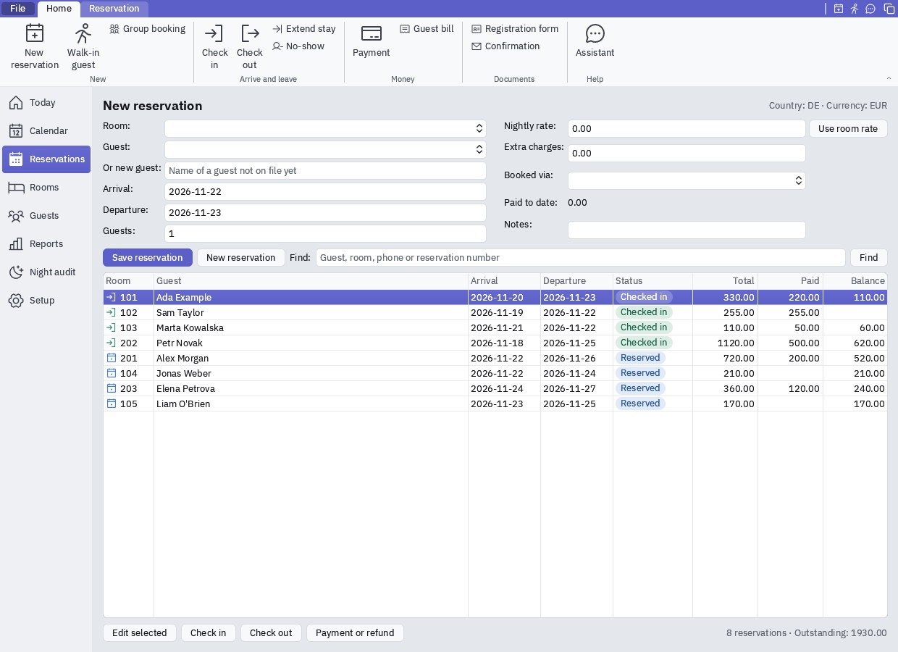

# Lodge ribbon design

Lodge's ribbon is declared in
[`apps/lodge/share/application.orion`](../../apps/lodge/share/application.orion)
and built at run time by the declarative host (see
[Ribbon → Declarative applications](../ribbon.md#declarative-applications)).
It uses the same technique as Git Client and Ledger, after the Windows Ribbon
framework: every command is declared once in `<menus>` with its label,
shortcut and the script action it runs, and the ribbon only places commands
(`command="desk.check_in"`). The menus are the File application menu and the
operating system's menu bar where there is one. This page records why it
looks the way it does.

## Principles

1. **One control per screen function.** Pages are switched only in the
   sidebar; the ribbon has no page buttons. Commands may repeat a page's own
   button beside its data (AGENTS.md), but a command appears once in the ribbon.
2. **Home is the desk.** The commands a receptionist uses every hour, in the
   order of a stay: *New*, *Arrive and leave*, *Money*, *Documents*, *Help*.
   They act on the page that shows (Today or Reservations) and grey out on
   pages that cannot run them, so the ribbon never offers a command that would
   fail.
3. **A page's own commands are its contextual tab**, named after the page's
   job (Today, Calendar, Reservation, Housekeeping, Reports, Night audit,
   Setup), and opened when the page is chosen.
4. **Large buttons for the one or two commands a group exists for**; small
   ones for their variants. No group has more than five commands.
5. **Two-step commands stay two-step** (*Preview cancellation* → *Confirm
   cancellation*); the confirm command is disabled until a preview exists.
6. **Every daily command has a shortcut**, and the tooltip names it.

## Tabs

| Tab | Shows | Groups and commands |
|---|---|---|
| Home | Always | **New**: New reservation, Walk-in guest, Group booking · **Arrive and leave**: Check in, Check out, Extend stay, No-show · **Money**: Payment, Guest bill · **Documents**: Registration form, Confirmation · **Help**: Assistant |
| Today | Today | **Selected guest**: Settle balance, Open reservation · **Print**: Front desk list · **View**: Refresh |
| Calendar | Calendar | **Dates**: Previous week, Today, Next week · **Book**: Book selected room, Show free rooms |
| Reservation | Reservations | **Editor**: Save reservation, Edit selected, Use room rate, Find next · **Stay**: Shorten stay, Nightly prices · **Cancel**: Preview cancellation, Confirm cancellation · **Group**: statement, settlement and cancellation (preview and confirm) |
| Housekeeping | Rooms | **Cleaning status**: Mark clean, Mark dirty, Needs inspection · **Print**: Cleaning list · **View**: Refresh rooms |
| Reports | Reports | **Period**: This month, Last month · **Export**: Export report, Export data as CSV |
| Night audit | Night audit | **Close**: Close today, Overdue stays |
| Setup | Setup | **Hotel**: Save hotel details, Add sample hotel · **Data**: Export all data |

The Guests page has no tab: its record commands (Add, Edit, Delete) act on
its table directly.

## File menu

New reservation, Walk-in guest, Group booking; Export all data, Add sample
hotel; Exit. The other menus (Front desk, Calendar, Reservation,
Housekeeping, Reports, Night audit, Setup, Help) hold every command once and
appear in the operating system's menu bar where it has one.

## Quick Access Toolbar

New reservation, Walk-in guest and Assistant: the three things a desk starts
from any page, beside the tabs even when the ribbon is folded.

## Shortcuts

| Shortcut | Command | Shortcut | Command |
|---|---|---|---|
| Ctrl+N | New reservation | Ctrl+S | Save reservation |
| Ctrl+Shift+N | Walk-in guest | F3 | Find next |
| Ctrl+I | Check in | F5 | Refresh (Today) |
| Ctrl+O | Check out | Alt+Left / Alt+Right | Previous / next week (Calendar) |
| Ctrl+E | Extend stay | Ctrl+K | Assistant |
| Ctrl+M | Payment | Ctrl+B | Guest bill |

Shortcuts are declared on the menu items. The host rejects a ribbon whose
shortcut is used twice, so the table cannot drift into conflicts.

## Icons

Phosphor regular weight, unmodified, as listed in
[`apps/lodge/share/icons/SOURCES.md`](../../apps/lodge/share/icons/SOURCES.md).
