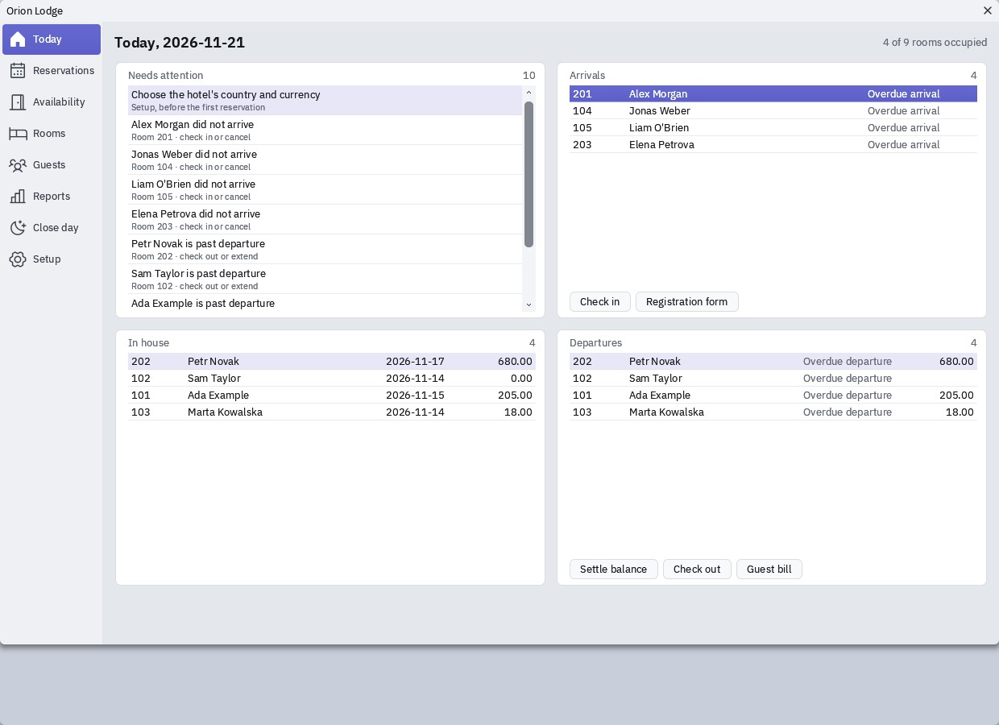
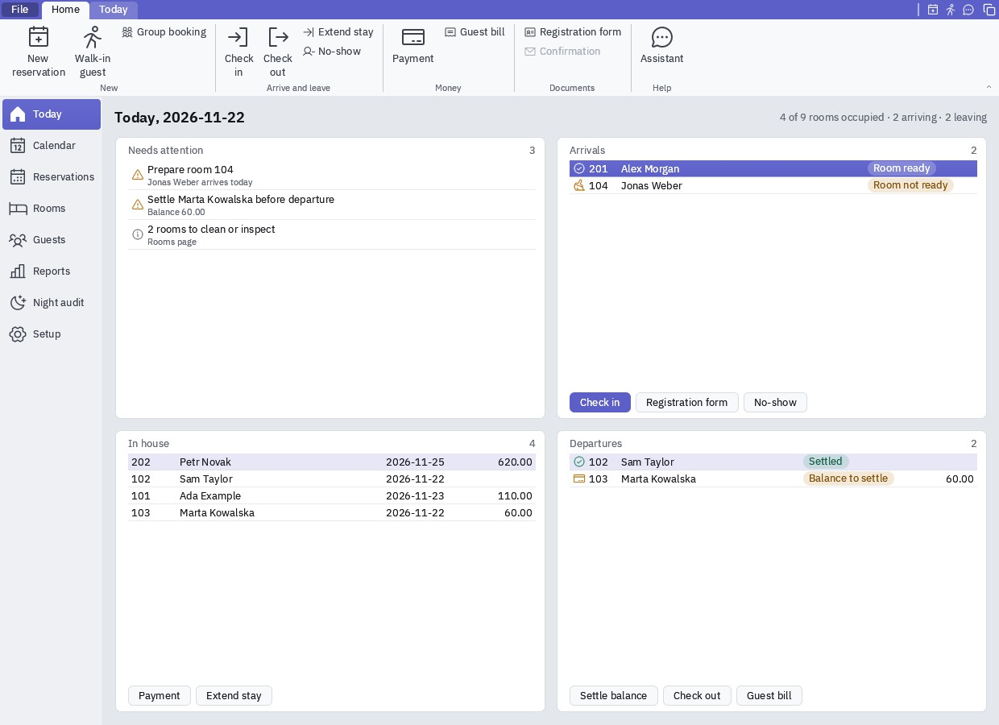
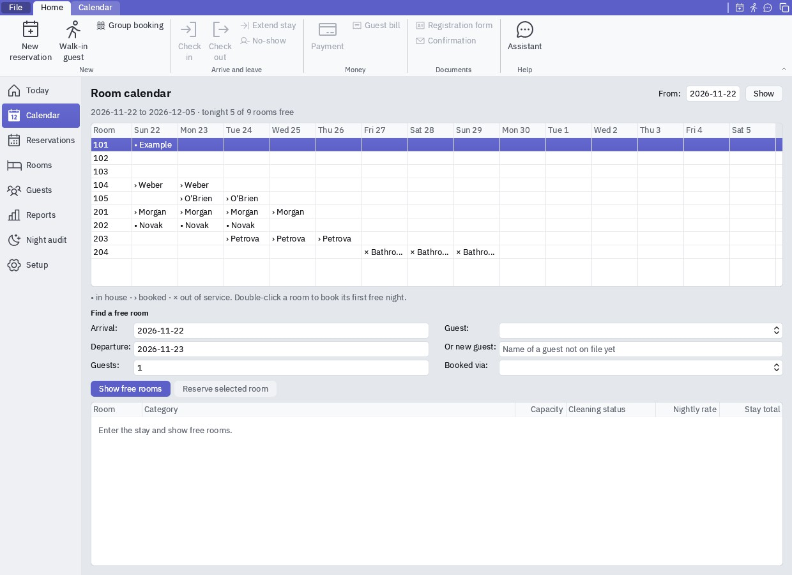
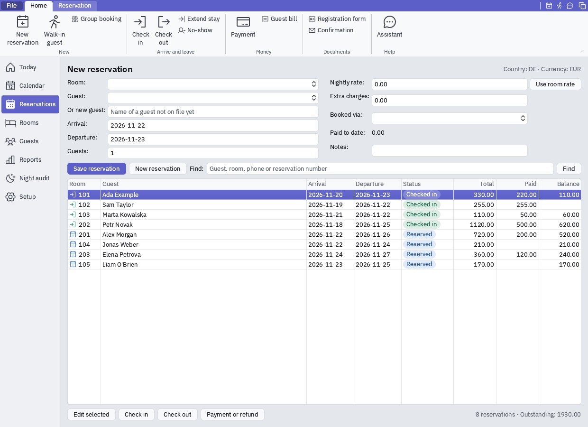
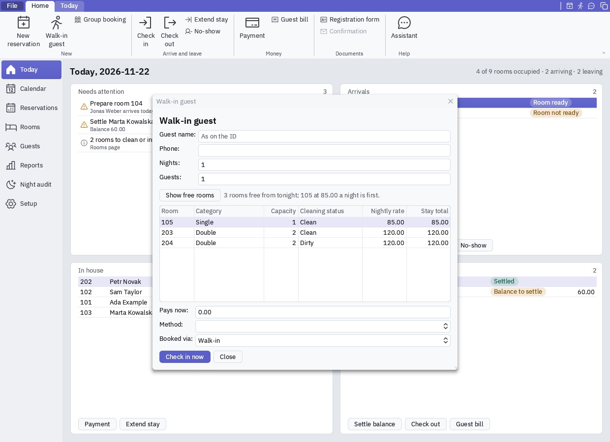
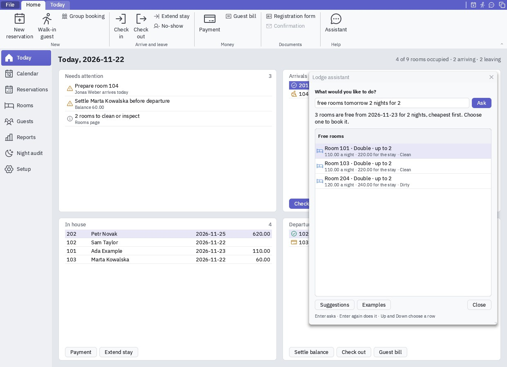
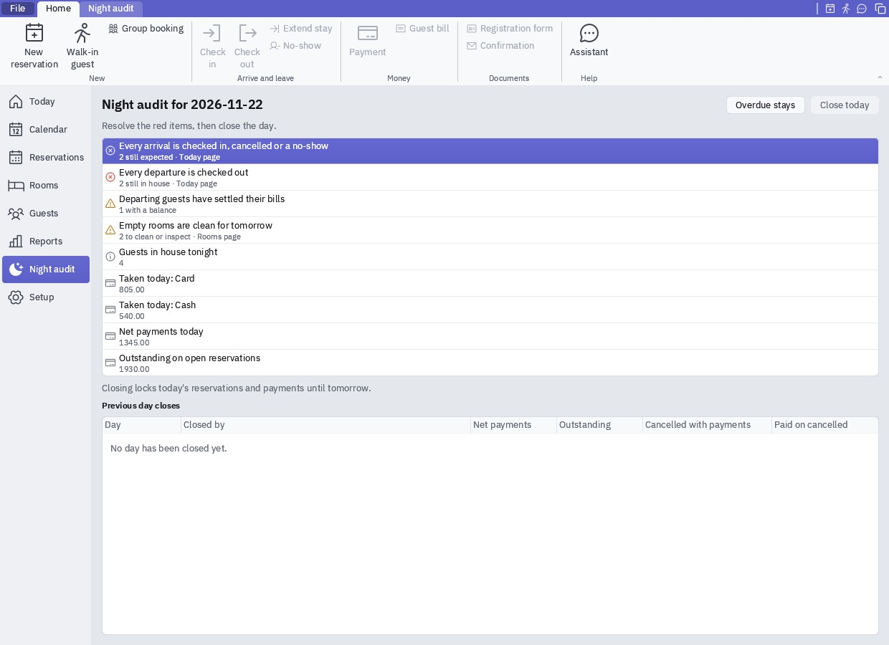
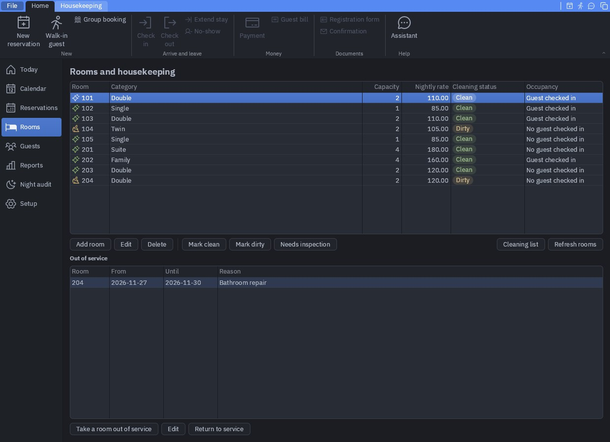

# Lodge UX audit and redesign report

November 2026. An audit of Lodge as it stood (a working prototype) against
the [complaints research](research-hotel-software-complaints.md), the
[personas](personas.md) and the
[orion-ui-design](../../.agents/skills/orion-ui-design/SKILL.md) principles,
and what the redesign changed. The [user stories](user-stories.md) hold the
acceptance criteria.

| Before | After |
|---|---|
|  |  |

## Findings and what changed

| # | Finding (before) | Severity | Change | Principle |
|---|---|---|---|---|
| 1 | The Reservations page carried 21 buttons in six rows, including preview/confirm pairs for cancellations and groups, under the editor and the table. New staff could not tell everyday commands from rare ones. | High | A **ribbon**: everyday commands on **Home**, each page's own commands on its contextual tab. The page keeps 8 buttons beside the data they act on. | Hierarchy; progressive disclosure |
| 2 | No keyboard shortcuts for any desk command. | High | Shortcuts for every daily command, shown in the ribbon's tooltips (see [ribbon design](ribbon-design.md#shortcuts)). | Efficiency of use |
| 3 | A walk-in took about 14 actions across three pages and two windows: create the guest on Guests, go to Reservations, choose room, guest and dates, copy the rate, save, select it, check in, open the payment window, record. | High | **Walk-in guest** window: name, nights, a ready room, *Check in now* — five actions, one transaction. | Fewer clicks (research theme 14) |
| 4 | A booking for a new guest required leaving the editor to create the guest first. | High | *Or new guest* field in the editor and in the free-room search; an existing guest with that name is reused. | Match the task |
| 5 | No room overview: availability was a search result, not a picture of the house. | High | **Room calendar** page: rooms × 14 nights with dates in the column titles, in-house/booked/out-of-service marks, week navigation, double-click to book. | Recognition over recall (theme 1) |
| 6 | The night audit was five sentences of figures and a Close button that failed with a message when something was open. | Medium | A **checklist** with ok/warning/error icons, money by method, and *Close today* disabled until no red item is left. | Visibility of system status (theme 12) |
| 7 | Overdue arrivals could only be checked in or cancelled through a preview/confirm pair on another page. | Medium | **No-show** on Today and in the assistant: one action, noted on the stay. | Error recovery |
| 8 | Extending a stay meant loading it into the editor, changing the date and saving. | Medium | **Extend stay** (Ctrl+E) on Today and Reservations, **Shorten stay** on Reservations. | Efficiency |
| 9 | Statuses were plain text ("Room not ready", "Overdue departure"). | Medium | Status **badges** and row **icons** whose tone follows the state (ready, not ready, overdue, settled, balance to settle); states are matched untranslated, so the icons work in every language. | Glanceability |
| 10 | Empty lists were blank. | Medium | Every list says why it is empty and what fills it ("No reservations yet. Fill in the editor above and save."). | Help users recover |
| 11 | Documents carried no hotel name or address. | Medium | **Hotel details** in Setup head every document; registration shows the check-out time. | Professional output (theme 7) |
| 12 | Data could leave Lodge only as HTML printouts. | Medium | **CSV export** of reservations, guests and payments, with stable column names and formula-safe quoting. | No lock-in (theme 10) |
| 13 | A new hotel started empty; there was no way to try Lodge except copying a demo file whose dates were fixed in the past (everything showed as overdue). | Medium | **Add sample hotel** in Setup creates rooms, guests and stays dated around today. | Learnability |
| 14 | Help meant the README. | Medium | The **assistant**: plain-language requests in English, German and Russian, the day's suggestions, examples, and Enter-again to act. See [assistant](assistant.md). | Help and documentation (theme 4) |
| 15 | Notices and errors used the same plain text. | Low | Success notices in the success colour, errors in the error colour; both collapse when empty, so pages do not reserve blank lines. | Feedback |
| 16 | Secondary windows (payment, prices, groups) opened at the screen's top-left corner. | Low | Windows open centred over the main window; the assistant along its right edge; opening the assistant again brings it forward. | Spatial consistency |
| 17 | Shutting the application down freed hosted pages before the host window that still messaged them (a use-after-free found with AddressSanitizer; the Lodge test crashed with "corrupted size vs. prev_size"). | Critical | Each page's window is destroyed before its page is closed (fixed on `main` in parallel; the Lodge suite now passes under AddressSanitizer). | Reliability |

## Task cost, before and after

Counted as clicks, key presses of a command or shortcut, and fields typed,
from the start page.

| Task | Before | After |
|---|---|---|
| Check in a ready arrival | 2 (select, Check in) | 2 (select, Ctrl+I), or 2 in the assistant ("check in Morgan", Enter, Enter) |
| Walk-in, one night, paid in cash | ~14 over 3 pages, 2 windows | 5 in one window |
| Book a room for a new guest | ~10 over 2 pages | 6 on one page |
| Find who is in room 104 next week | Not possible at a glance | 1 (Calendar) |
| Mark a no-show | 4 over 2 pages (select on Reservations, preview, confirm) | 2 on Today |
| Close the day | 2 when everything is settled; a refusal message otherwise | 1 page shows what blocks it; 1 click to close |
| Give the accountant the month | Print the period report | 1 click (Export data as CSV) |

## Known issues

- Calendar cells are text marks (•, ›, ×); a stay cannot be dragged yet.
- The shared-company view (`lodge --remote`) keeps its previous layout and has no ribbon.
- Seasonal rate plans, CSV import, dated backups and a cash-drawer count are listed under [Next](user-stories.md#next).

## Screens

| | |
|---|---|
|  |  |
|  |  |
|  |  |
