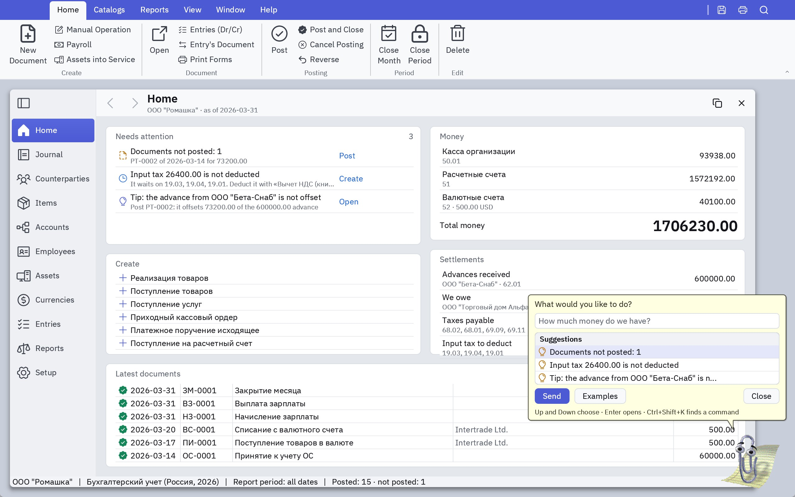
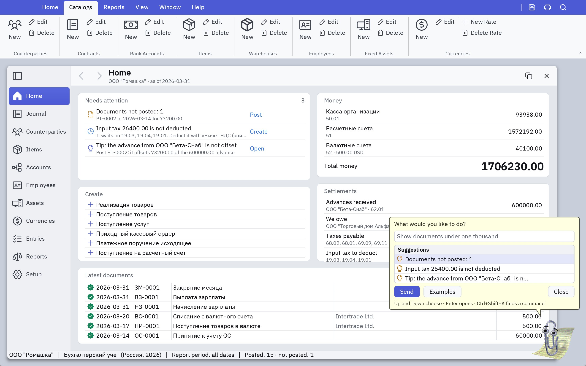
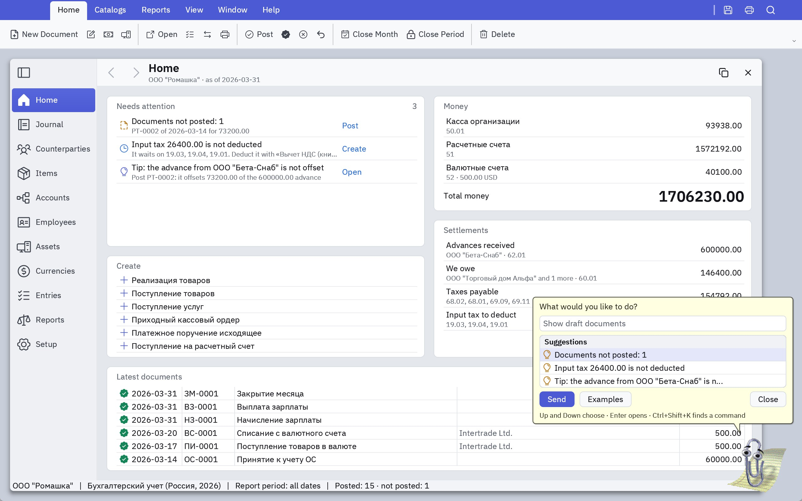
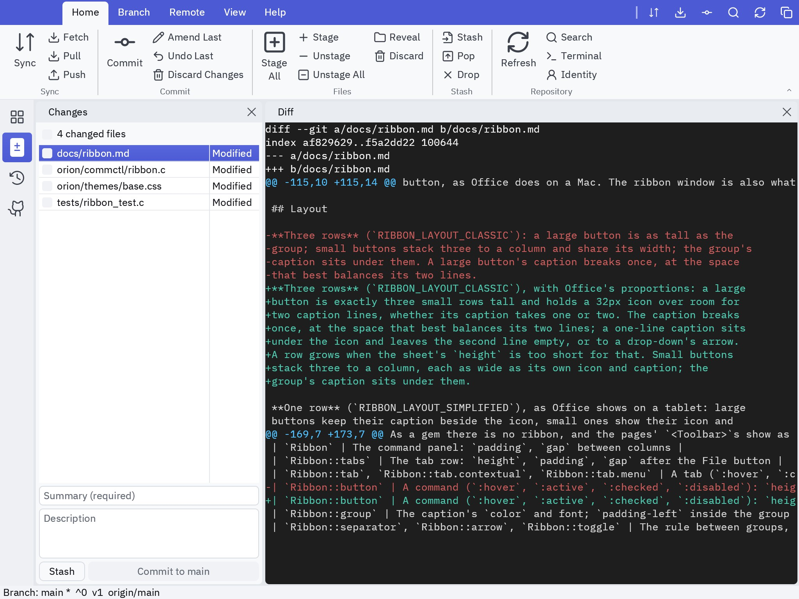
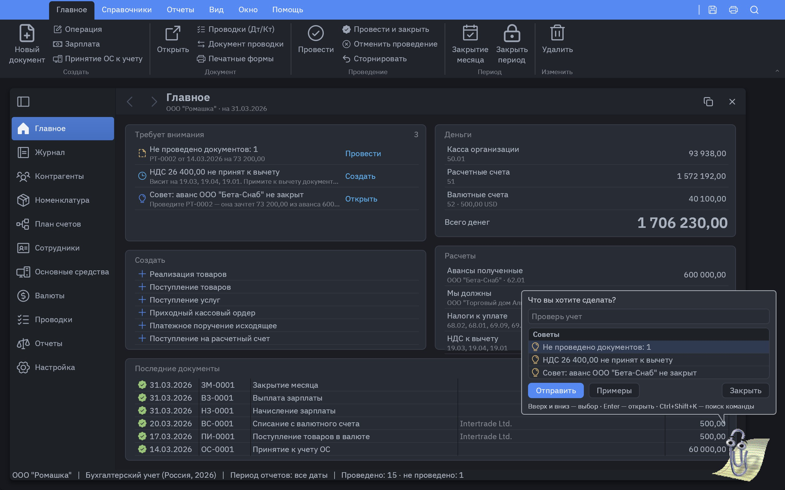
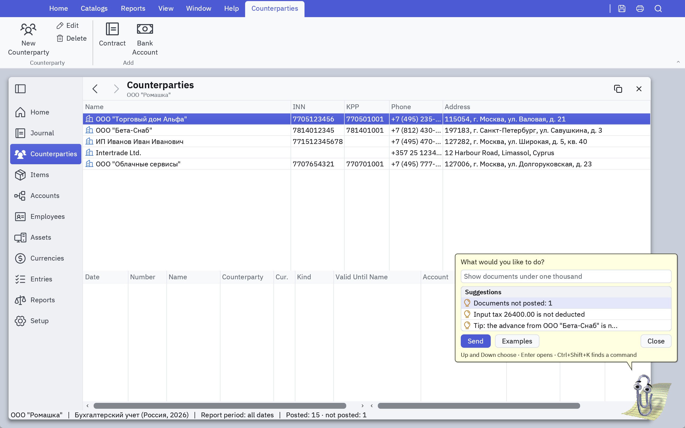

# Ribbon

A ribbon is an application's command surface in place of a menu bar and a
toolbar band, after the Windows Ribbon framework (UIRibbon) and Office: tabs
in the menu row, and under them the active tab's commands in captioned groups.



| | |
|---|---|
|  |  |
|  |  |

## What replaces what

| Before | With a ribbon |
|---|---|
| Menu bar | The ribbon's tabs. Orion draws no menu bar of its own. |
| Menus | Still declared in `<menus>`: they are the registry of commands, labels and shortcuts. They show in the **operating system's** menu bar where it has one (macOS). |
| Application toolbar band | The tabs' groups. |
| Compact toolbar beside the menus | The **Quick Access Toolbar**, in the same place beside the tabs. |
| Window toolbars (`<Toolbar>` in a form) | Unchanged: they belong to their window. A page's toolbar can become a contextual tab. |
| The OS title bar | On macOS it hides behind the content; the tab row stands in for it, clear of the window's buttons, and drags the window. |

Where the OS has no menu bar of its own, the ribbon shows an
application-menu button (**File**) before the tabs, and `orionc` names every
menu command the ribbon leaves unreachable:

```text
orionc: warning: command 'edit.lost' is not reachable from the ribbon
```

A gem is hosted by a shell that owns the menu row, so it keeps contributing
its menus (and its `<toolbar>`) there; the ribbon is for the standalone
application.

## Markup

`<ribbon>` sits under `<orion>`, beside `<menus>`. Its elements follow the
Windows Ribbon framework's:

| UIRibbon | `.orion` | |
|---|---|---|
| `Application.Commands` | `<menus>` | Commands are declared once; the ribbon only places them (`command="menu.item"`) |
| `Ribbon.ApplicationMenu` | `<ApplicationMenu menu="file" />` | The menu behind the File button; `label=` overrides the menu's |
| `Ribbon.QuickAccessToolbar` | `<QuickAccessToolbar>` | Toolbar items, as in a compact `<toolbar>` |
| `Tab`, `Group` | `<Tab label>`, `<Group label>` | At most 16 groups in a tab |
| `Ribbon.ContextualTabs` | `<Tab label context="name">` | Shows while the application says its context is active: see [Contextual tabs](#contextual-tabs) |
| `Button` | `<Button command icon text tooltip size>` | `size="large"`: icon over caption, as tall as the group. Without `text` it takes the command's menu label |
| `ToggleButton` | `<Button toggle="true" checked-icon>` | Checks itself on each click |
| `DropDownButton` | `<DropDown menu="view" text icon>` | Opens a declared menu |
| `SizeDefinition`, `ScalingPolicy` | automatic | See [Layout](#layout) |
| | `<Separator />` | Ends a column of small buttons with a rule |

```xml
<ribbon>
  <ApplicationMenu menu="file" />
  <QuickAccessToolbar>
    <Button command="file.save" icon="floppy-disk" tooltip="Save (Ctrl+S)" />
  </QuickAccessToolbar>
  <Tab label="Home">
    <Group label="Posting">
      <Button command="doc.post" icon="ledger-post" text="Post" size="large" />
      <Button command="doc.post_close" icon="ledger-doc-posted" text="Post and Close" />
      <Button command="doc.unpost" icon="ledger-unpost" text="Cancel Posting" />
      <Button command="doc.reverse" icon="undo" text="Reverse" />
    </Group>
  </Tab>
</ribbon>
```

`orionc` emits `<prefix>_ribbon`, a `ribbon_def_t`. `layout="simplified"` on
`<ribbon>` starts in the single row. Tab, group and button texts are in the
string catalog like any other `.orion` text.

## Creating it

```c
chrome = create_ribbon_chrome("Ledger Chrome", ledger_ribbon_proc, &ledger_ribbon,
                              ledger_quick_access_proc, hinstance);
ribbon = app_chrome_ribbon(chrome);
send_message(ribbon, kMenuBarMessageSetAccelerators, 0, accel);          // shortcut hints
send_message(ribbon, kMenuBarMessageSetMenus, kLedgerMenuCount, (void *)kLedgerMenus);
```

The ribbon's procedure wraps `win_ribbon`, as a menu bar's wraps
`win_menubar`, and every route to a command ends in the same handler:

```c
result_t ledger_ribbon_proc(window_t *win, uint32_t msg, uint32_t wparam, void *lparam) {
  if (msg == evCommand && (HIWORD(wparam) == btnClicked ||                    // a ribbon button
                           HIWORD(wparam) == kMenuBarNotificationItemClick || // File or a drop-down
                           HIWORD(wparam) == kAcceleratorNotification)) {     // a shortcut, or the OS menu
    ledger_command(LOWORD(wparam));
    return true;
  }
  return win_ribbon(win, msg, wparam, lparam);
}
```

`kMenuBarMessageSetMenus` hands the whole menu to the operating system's menu
bar (`ui_set_native_menu`). Where that succeeds the ribbon drops its File
button, as Office does on a Mac. The ribbon window is also what
`GEM_STANDALONE_MAIN` takes as its menu window.

| Message | |
|---|---|
| `rbSetRibbon` | `lparam` = `const ribbon_def_t *` (borrowed static data) |
| `rbGetActiveTab`, `rbSetActiveTab` | The tab that shows |
| `rbGetState`, `rbSetState` | A command's `TBSTATE_CHECKED` / `TBSTATE_DISABLED`, by ident. A command placed on several tabs has one state |
| `rbGetLayout`, `rbSetLayout` | `RIBBON_LAYOUT_CLASSIC` or `RIBBON_LAYOUT_SIMPLIFIED` |
| `rbGetMinimized`, `rbSetMinimized` | Only the tab row shows |
| `rbGetContexts`, `rbSetContexts` | The contexts whose tabs show |
| `rbGetItemRect`, `rbGetTabRect` | Geometry, for tests and remote control |

## Layout

**Three rows** (`RIBBON_LAYOUT_CLASSIC`), with Office's proportions: a large
button is exactly three small rows tall and holds a 32px icon over room for
two caption lines, whether its caption takes one or two. The caption breaks
once, at the space that best balances its two lines; a one-line caption sits
under the icon and leaves the second line empty, or to a drop-down's arrow.
A row grows when the sheet's `height` is too short for that. Small buttons
stack three to a column, each as wide as its own icon and caption; the
group's caption sits under them.

**One row** (`RIBBON_LAYOUT_SIMPLIFIED`), as Office shows on a tablet: large
buttons keep their caption beside the icon, small ones show their icon and
name themselves in the tooltip; rules separate the groups.

The switch at the panel's trailing end changes between them. A double click on
a tab folds the ribbon to its tab row; choosing a tab unfolds it. The
application's workspace follows the ribbon's height, and a window whose
caption a taller ribbon would cover moves down.

When the window is too narrow the groups shrink, from the last one back:
first small buttons drop their captions, then large buttons become small.

Only a bare icon has a tooltip: the item's `tooltip`, or its text, with the
command's shortcut appended from the accelerator table. A button that shows
its caption has none.

## Contextual tabs

A tab with `context=` holds the commands of what is open or selected, and
shows only then. `orionc` gives each context a bit,
`<PREFIX>_RIBBON_CONTEXT_<NAME>`, and the application says which are active:

```c
// evPageChanged in Ledger: the open page's commands are its tab
send_message(ribbon, rbSetContexts, LEDGER_RIBBON_CONTEXT_COUNTERPARTIES, (void *)(uintptr_t)1);
```

A nonzero `lparam` also opens the first tab this reveals. When a context
leaves while its tab is open, the tab the user came from returns.



Ledger's pages used to add their buttons to the window's title row. With a
ribbon those are contextual tabs, and the host is told not to show its pages'
toolbars:

```c
if (ribbon) set_host_page_toolbars(win, false);   // before page_host_init
```

As a gem there is no ribbon, and the pages' `<Toolbar>`s show as before.

## Styling

| Selector | |
|---|---|
| `Ribbon` | The command panel: `padding`, `gap` between columns |
| `Ribbon::tabs` | The tab row: `height`, `padding`, `gap` after the File button. It wears the accent colour, as Office's does |
| `Ribbon::tab`, `Ribbon::tab.contextual`, `Ribbon::tab.menu` | A tab (`:hover`, `:checked`: the open tab takes the panel's background), a contextual one, and the File button |
| `MenuBar.ribbon`, `Toolbar.ribbon::grip` | The Quick Access Toolbar in the tab row: its background, icon `color` and grip. The chrome gives that toolbar the class `ribbon` |
| `Ribbon::button` | A command (`:hover`, `:active`, `:checked`, `:disabled`): `height` of a row, `--single-height` of the single row, `min-width` of a large button, `--icon-size`, `--large-icon-size`, and a large button's `padding-top` and `--caption-gap` between icon and caption |
| `Ribbon::group` | The caption's `color` and font; `padding-left` inside the group |
| `Ribbon::separator`, `Ribbon::arrow`, `Ribbon::toggle` | The rule between groups, a drop-down's arrow, the layout switch |

## Not yet

Galleries, key tips (Alt, then letters), a Windows backstage
view, and customising the Quick Access Toolbar at run time.
