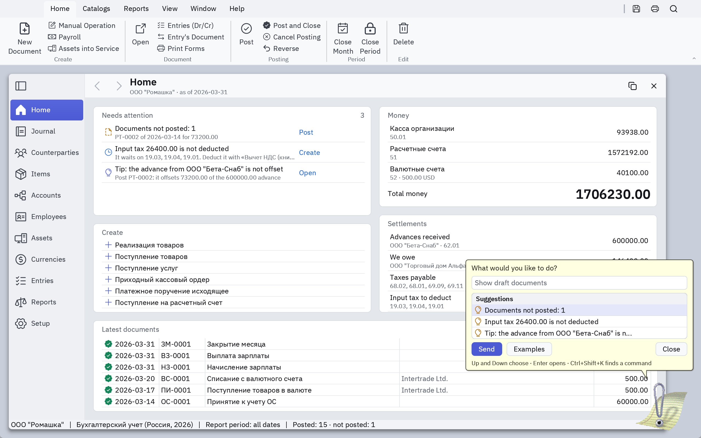
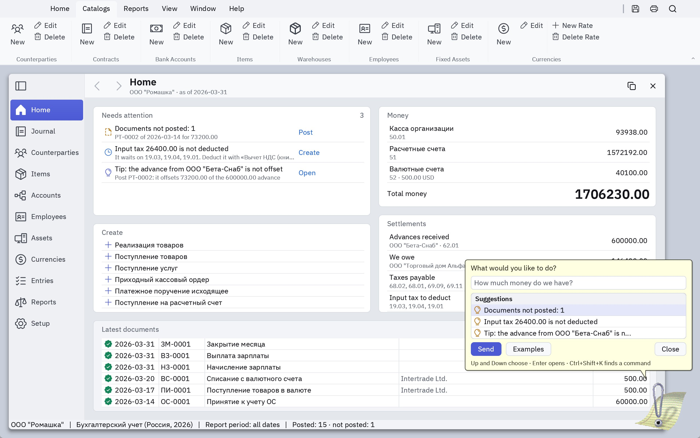
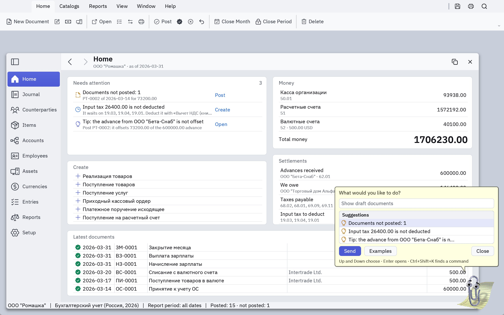
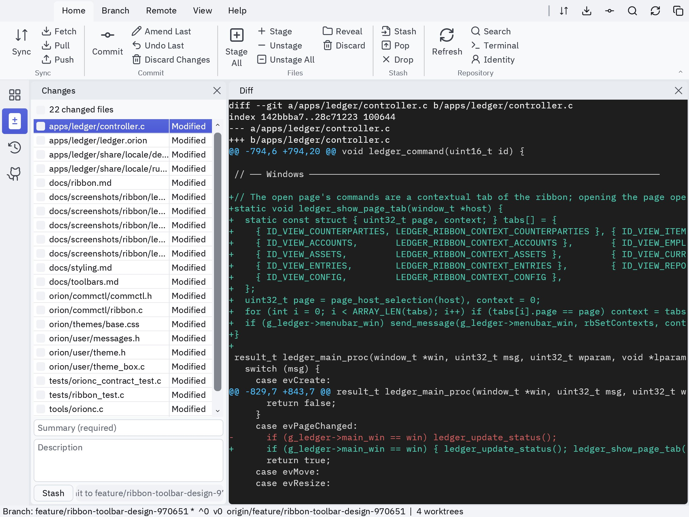
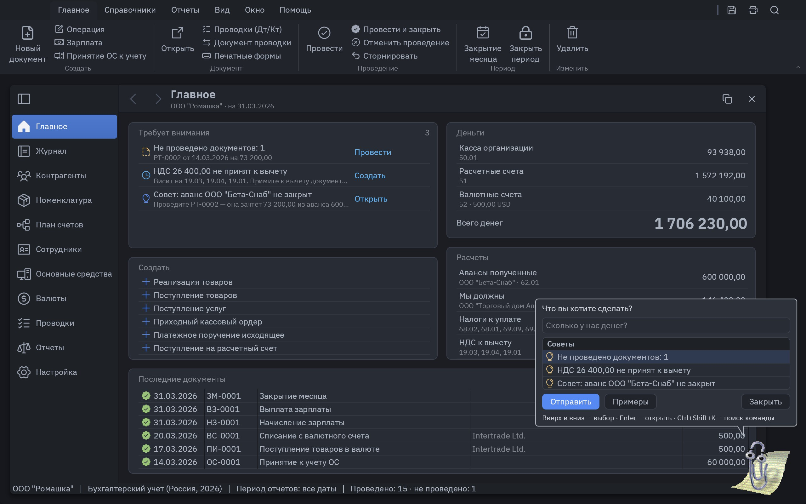
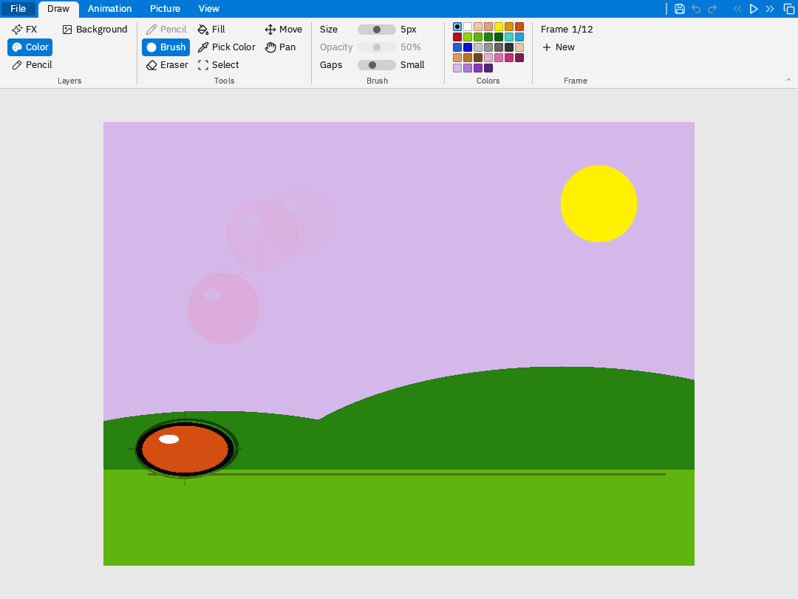
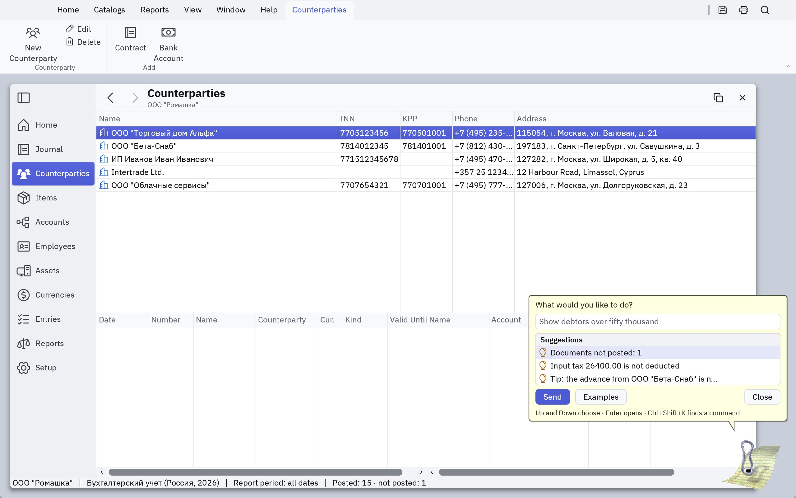

# Ribbon

A ribbon is an application's command surface in place of a menu bar and a
toolbar band, after the Windows Ribbon framework (UIRibbon) and Office: tabs
in the menu row, and under them the active tab's commands in captioned groups.



| | |
|---|---|
|  |  |
|  |  |

## What replaces what

| Before | With a ribbon |
|---|---|
| Menu bar | The ribbon's tabs. Orion draws no menu bar of its own. |
| Menus | Still declared in `<menus>`: they are the registry of commands, labels and shortcuts. They show in the **operating system's** menu bar where it has one (macOS). |
| Application toolbar band | The tabs' groups. |
| Compact toolbar beside the menus | The **Quick Access Toolbar**, in the same place beside the tabs. |
| Window toolbars (`<Toolbar>` in a form) | Unchanged: they belong to their window. A page's toolbar can become a contextual tab. |
| The OS title bar | On macOS it hides behind the content; the tab row stands in for it, clear of the window's buttons, and drags the window. |

Where the OS has no menu bar of its own, the ribbon shows an
application-menu button (**File**) before the tabs, and `orionc` names every
menu command the ribbon leaves unreachable:

```text
orionc: warning: command 'edit.lost' is not reachable from the ribbon
```

A gem is hosted by a shell that owns the menu row, so it keeps contributing
its menus (and its `<toolbar>`) there; the ribbon is for the standalone
application. Ledger, Git Client and Pencil Test use one.

## Markup

`<ribbon>` sits under `<orion>`, beside `<menus>`. Its elements follow the
Windows Ribbon framework's:

| UIRibbon | `.orion` | |
|---|---|---|
| `Application.Commands` | `<menus>` | Commands are declared once; the ribbon only places them (`command="menu.item"`) |
| `Ribbon.ApplicationMenu` | `<ApplicationMenu menu="file" />` | The menu behind the File button; `label=` overrides the menu's |
| `Ribbon.QuickAccessToolbar` | `<QuickAccessToolbar>` | Toolbar items, as in a compact `<toolbar>` |
| `Tab`, `Group` | `<Tab label>`, `<Group label>` | At most 16 groups in a tab |
| `Ribbon.ContextualTabs` | `<Tab label context="name">` | Shows while the application says its context is active: see [Contextual tabs](#contextual-tabs) |
| `Button` | `<Button command icon text tooltip size>` | `size="large"`: icon over caption, as tall as the group. Without `text` it takes the command's menu label |
| `ToggleButton` | `<Button toggle="true" checked-icon>` | Checks itself on each click |
| `DropDownButton` | `<DropDown menu="view" text icon>` | Opens a declared menu |
| `SizeDefinition`, `ScalingPolicy` | automatic | See [Layout](#layout) |
| | `<Separator />` | Ends a column of small buttons with a rule |
| `Spinner`, `ComboBox` and the like | `<Slider name text value width flags>` | Hosts a `Slider`: see [Hosted controls](#hosted-controls) |
| | `<Control name class width size title flags>` | Hosts a control of any window class; `title` is its window title (a `SegmentedControl`'s segments) |
| | `<Label name text value>` | A readout the application writes, with no control |

`if="..."` on a `<Button>`, `<DropDown>` or hosted item keeps it out of the
builds where the condition is false, as on a menu item. `if=` on `<ribbon>`
itself compiles the whole ribbon for one build of several (Pencil Test, of the
three Image Editor builds); `orionc` then cannot know which commands that build
has, and does not list unreachable ones.

```xml
<ribbon>
  <ApplicationMenu menu="file" />
  <QuickAccessToolbar>
    <Button command="file.save" icon="floppy-disk" tooltip="Save (Ctrl+S)" />
  </QuickAccessToolbar>
  <Tab label="Home">
    <Group label="Posting">
      <Button command="doc.post" icon="ledger-post" text="Post" size="large" />
      <Button command="doc.post_close" icon="ledger-doc-posted" text="Post and Close" />
      <Button command="doc.unpost" icon="ledger-unpost" text="Cancel Posting" />
      <Button command="doc.reverse" icon="undo" text="Reverse" />
    </Group>
  </Tab>
</ribbon>
```

`orionc` emits `<prefix>_ribbon`, a `ribbon_def_t`. `layout="simplified"` on
`<ribbon>` starts in the single row. Tab, group and button texts are in the
string catalog like any other `.orion` text.

## Creating it

```c
chrome = create_ribbon_chrome("Ledger Chrome", ledger_ribbon_proc, &ledger_ribbon,
                              ledger_quick_access_proc, hinstance);
ribbon = app_chrome_ribbon(chrome);
send_message(ribbon, kMenuBarMessageSetAccelerators, 0, accel);          // shortcut hints
send_message(ribbon, kMenuBarMessageSetMenus, kLedgerMenuCount, (void *)kLedgerMenus);
```

The ribbon's procedure wraps `win_ribbon`, as a menu bar's wraps
`win_menubar`, and every route to a command ends in the same handler:

```c
result_t ledger_ribbon_proc(window_t *win, uint32_t msg, uint32_t wparam, void *lparam) {
  if (msg == evCommand && (HIWORD(wparam) == btnClicked ||                    // a ribbon button
                           HIWORD(wparam) == kMenuBarNotificationItemClick || // File or a drop-down
                           HIWORD(wparam) == kAcceleratorNotification)) {     // a shortcut, or the OS menu
    ledger_command(LOWORD(wparam));
    return true;
  }
  return win_ribbon(win, msg, wparam, lparam);
}
```

`kMenuBarMessageSetMenus` hands the whole menu to the operating system's menu
bar (`ui_set_native_menu`). Where that succeeds the ribbon drops its File
button, as Office does on a Mac. The ribbon window is also what
`GEM_STANDALONE_MAIN` takes as its menu window.

| Message | |
|---|---|
| `rbSetRibbon` | `lparam` = `const ribbon_def_t *` (borrowed static data) |
| `rbGetActiveTab`, `rbSetActiveTab` | The tab that shows |
| `rbGetState`, `rbSetState` | A command's `TBSTATE_CHECKED` / `TBSTATE_DISABLED`, by ident. A command placed on several tabs has one state |
| `rbGetBadge`, `rbSetBadge` | A command's count badge, by ident. Zero hides it. The button includes the badge in its width in every layout |
| `rbGetLayout`, `rbSetLayout` | `RIBBON_LAYOUT_CLASSIC` or `RIBBON_LAYOUT_SIMPLIFIED` |
| `rbGetMinimized`, `rbSetMinimized` | Only the tab row shows |
| `rbGetContexts`, `rbSetContexts` | The contexts whose tabs show |
| `rbGetItemRect`, `rbGetTabRect` | Geometry, for tests and remote control |
| `rbGetControl` | The window a hosted item created, by ident |
| `rbSetValue` | The readout after a hosted control, by ident (the text is copied) |
| `rbUpdateLayout` | A hosted control now measures differently: lay the tab out again |

## Layout

**Three rows** (`RIBBON_LAYOUT_CLASSIC`), with Office's proportions: a large
button is exactly three small rows tall and holds a 32px icon over room for
two caption lines, whether its caption takes one or two. The caption breaks
once, at the space that best balances its two lines; a one-line caption sits
under the icon and leaves the second line empty, or to a drop-down's arrow.
A row grows when the sheet's `height` is too short for that. Small buttons
stack three to a column, each as wide as its own icon and caption; the
group's caption sits under them.

**One row** (`RIBBON_LAYOUT_SIMPLIFIED`), as Office shows on a tablet: large
buttons keep their caption beside the icon, small ones show their icon and
name themselves in the tooltip; rules separate the groups. The row is a little
taller than one of the three rows (`--single-height`), not a toolbar band: the
single row is the layout for giving the content its room.

The switch at the panel's trailing end changes between them. A double click on
a tab folds the ribbon to its tab row; choosing a tab unfolds it. The
application's workspace follows the ribbon's height, and a window whose
caption a taller ribbon would cover moves down.

When the window is too narrow the groups shrink, from the last one back:
first small buttons drop their captions, then large buttons become small.

Only a bare icon has a tooltip: the item's `tooltip`, or its text, with the
command's shortcut appended from the accelerator table. A button that shows
its caption has none.

## Hosted controls

A group can hold an ordinary control between its buttons: a slider, a palette,
anything with a window class. The ribbon creates it as its own child, with the
item's ident as its id, places it in the item's cell, and hides it with its tab
and when the ribbon folds. Its notifications arrive at the ribbon's procedure
like any child's:

```xml
<Group label="Brush">
  <Slider name="size" text="Size" value="00px" width="56" flags="SLIDER_TROUGH" />
  <Slider name="opacity" text="Opacity" value="100%" width="56" flags="SLIDER_TROUGH" />
</Group>
<Group label="Colors">
  <Control name="colors" class="SwatchGrid" size="large" />
</Group>
<Group label="Frame">
  <Label name="frame" text="Frame" value="000/000" />
</Group>
```

```c
// in the ribbon's procedure
if (msg == evCommand && HIWORD(wparam) == sliderValueChanged && LOWORD(wparam) == ID_RIBBON_SIZE) { ... }
// when the value changes
send_message(ribbon, rbSetValue, ID_RIBBON_SIZE, "5px");
window_t *grid = (window_t *)send_message(ribbon, rbGetControl, ID_RIBBON_COLORS, NULL);
```



- The item's ID is `ID_RIBBON_<NAME>`, from `name=`.
- A cell reads caption, control, readout. `text` is the caption. `value` is the
  widest readout the item will show; it reserves that room, so the control
  does not move when the number changes. `rbSetValue` replaces the text.
- Controls stacked in a column share the widest caption, so their left and
  right edges line up.
- `width` is the control's width. Without it the control is asked what it needs
  for the cell's height (`evMeasure`): a `SwatchGrid` takes more columns in one
  row than in three. Send `rbUpdateLayout` when that answer changes.
- `size="large"` offers the control the group's rows and drops caption and
  readout; the group's caption names it.
- A control of declared width in a row is `--control-height` tall in both
  layouts. One that measures itself is as tall as it says, up to what it was
  offered, in the middle of its cell.
- A choice of one among a few is a hosted `SegmentedControl`, not a row of
  toggle buttons: it is one control with radio behaviour. Offered three rows,
  one with named icons stands each icon over its label; in the single row it
  is a row of icons.

```xml
<Control name="layer" class="SegmentedControl" size="large" title="FX|Color|Pencil|Background" flags="WINDOW_NOFOCUS | CONTROL_SIZE_LARGE" />
```
- `rbSetState` with `TBSTATE_DISABLED` disables the hosted window and greys its
  caption and readout.

When the window is too narrow, a group that shrinks a step drops its controls'
readouts (a `<Label>` drops its caption instead). After the buttons have shrunk
too, the controls that measure themselves are asked to make do with less: a
palette narrows and pages its colours. A control of declared width keeps it.

## Contextual tabs

A tab with `context=` holds the commands of what is open or selected, and
shows only then. `orionc` gives each context a bit,
`<PREFIX>_RIBBON_CONTEXT_<NAME>`, and the application says which are active:

```c
// evPageChanged in Ledger: the open page's commands are its tab
send_message(ribbon, rbSetContexts, LEDGER_RIBBON_CONTEXT_COUNTERPARTIES, (void *)(uintptr_t)1);
```

A nonzero `lparam` also opens the first tab this reveals. When a context
leaves while its tab is open, the tab the user came from returns.



Ledger's pages used to add their buttons to the window's title row. With a
ribbon those are contextual tabs, and the host is told not to show its pages'
toolbars:

```c
if (ribbon) set_host_page_toolbars(win, false);   // before page_host_init
```

As a gem there is no ribbon, and the pages' `<Toolbar>`s show as before.

## Declarative applications

An application run by the Lua host (`application.orion`, no C) writes the same
`<menus>` and `<ribbon>` markup, read the same way: `form_library_ribbon()`
builds the `ribbon_def_t` at run time and the host creates the chrome, the File
button, the Quick Access Toolbar and the shortcuts, as `create_ribbon_chrome()`
does for a compiled application. The one difference is where a command is
handled. A compiled application switches on the command id in C; a declarative
one names the script action on the menu `<item>` that declares the command:

```xml
<menus>
  <menu name="file" label="File">
    <item name="new" label="New reservation" shortcut="Ctrl+N" action="new_booking" page="reception" />
    <item name="exit" label="Exit" target="orion.application" action="quit" />
  </menu>
  <menu name="desk" label="Front desk">
    <item name="check_in" label="Check in" shortcut="Ctrl+I" action="check_in" />
  </menu>
  <menu name="reservation" label="Reservation">
    <item name="save" label="Save reservation" shortcut="Ctrl+S" action="reserve" />
  </menu>
</menus>
<ribbon>
  <ApplicationMenu menu="file" />
  <QuickAccessToolbar>
    <Button command="file.new" icon="lodge-new-reservation" />
  </QuickAccessToolbar>
  <Tab label="Home">
    <Group label="Arrive and leave">
      <Button command="desk.check_in" icon="lodge-check-in" size="large" />
    </Group>
  </Tab>
  <Tab label="Reservation" context="reception">
    <Group label="Editor">
      <Button command="reservation.save" icon="lodge-save" size="large" />
    </Group>
  </Tab>
</ribbon>
```

| Windows Ribbon | Compiled (`orionc`) | Declarative (Lua host) |
|---|---|---|
| `Application.Commands`, a command's `LabelTitle` and key | `<menus>`: `<item name label shortcut>` | The same, plus the script binding below |
| `IUICommandHandler::Execute` | The application's ribbon procedure, by command id | `action=` on the `<item>`: run on the selected page with its input values, as its own button would; `page=` selects that page first; `target="orion.application" action= argument=` runs an application action (`open`, `quit`) |
| `Ribbon.ApplicationMenu` | `<ApplicationMenu menu="file" />` | The same |
| `Ribbon.QuickAccessToolbar` | `<QuickAccessToolbar><Button command icon>` | The same |
| `Tab`, `Group`, `Button`, `DropDownButton` | `<Tab>`, `<Group>`, `<Button command size icon>`, `<DropDown menu>` | The same; a button without `text` takes its command's label, less a menu ellipsis |
| `Ribbon.ContextualTabs` | `<Tab context="name">`, set with `rbSetContexts` | `<Tab context="form">`: the host sets it while that `role="page"` form is selected |
| `IUIFramework::InvalidateUICommand` (enabled state) | `rbSetState` from the application | The host greys out a command whose page has no such action, or whose last `data()` turned it off: `disabled = {control = true}` for a control that runs the action, `commands = {action = false}` for one only the ribbon offers |

The menus also go to the operating system's menu bar where it has one
(`kMenuBarMessageSetMenus`), the shortcuts to the accelerator table
(`accel_parse()` reads `Ctrl+N`, `Ctrl+Shift+K`, `F5`, `Alt+Left`), and the
main window is maximized into the workspace under the ribbon. The loader
refuses what `orionc` refuses — a button without a declared `command=`, an
action written on a ribbon button, an unknown or repeated shortcut, a command
declared twice — reports it on stderr and leaves the ribbon out; it warns, as
`orionc` does, about a command that is on no tab and in no menu the ribbon
opens. As a gem the shell owns the menu row, so the ribbon is not created.
[Lodge](../apps/lodge/README.md) is the example.

## Styling

| Selector | |
|---|---|
| `Ribbon` | The command panel: `padding`, `gap` between columns |
| `Ribbon::tabs` | The tab row: `height`, `padding`, `gap` after the File button. It wears the accent colour, as Office's does |
| `Ribbon::tab`, `Ribbon::tab.contextual`, `Ribbon::tab.menu` | A tab (`:hover`, `:checked`: the open tab takes the panel's background), a contextual one, and the File button |
| `MenuBar.ribbon`, `Toolbar.ribbon::grip` | The Quick Access Toolbar in the tab row: its background, icon `color` and grip. The chrome gives that toolbar the class `ribbon` |
| `Ribbon::button` | A command (`:hover`, `:active`, `:checked`, `:disabled`): `height` of a row, `--single-height` of the single row, `min-width` of a large button, `--icon-size`, `--large-icon-size`, a large button's `padding-top` and `--caption-gap` between icon and caption, and `--control-height` of a hosted control in a row |
| `Ribbon::group` | The caption's `color` and font; `padding-left` inside the group |
| `Ribbon::separator`, `Ribbon::arrow`, `Ribbon::toggle` | The rule between groups, a drop-down's arrow, the layout switch |

## Not yet

Galleries, key tips (Alt, then letters), a Windows backstage
view, and customising the Quick Access Toolbar at run time.
