# Pencil Test validation — 26 October 2026

The selection foreground fix makes selected toolbar icons and text use the theme foreground policy, including Pencil Test layer labels. In the light theme this is white on blue. Disabled controls keep their disabled color; other themes retain their own foreground palette.

## After the fix

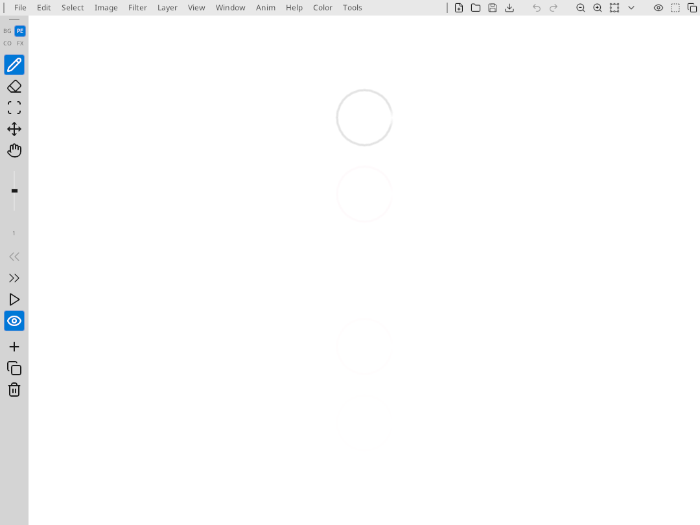

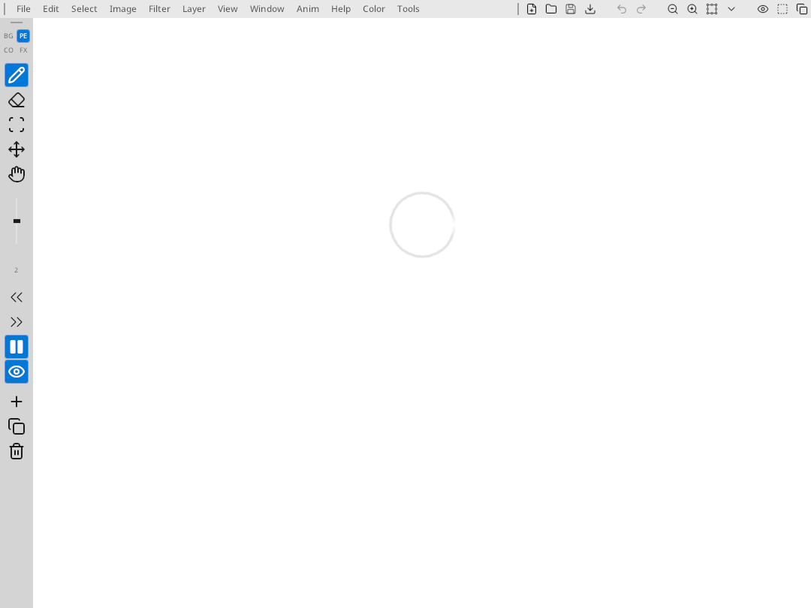

## Initial validation captures

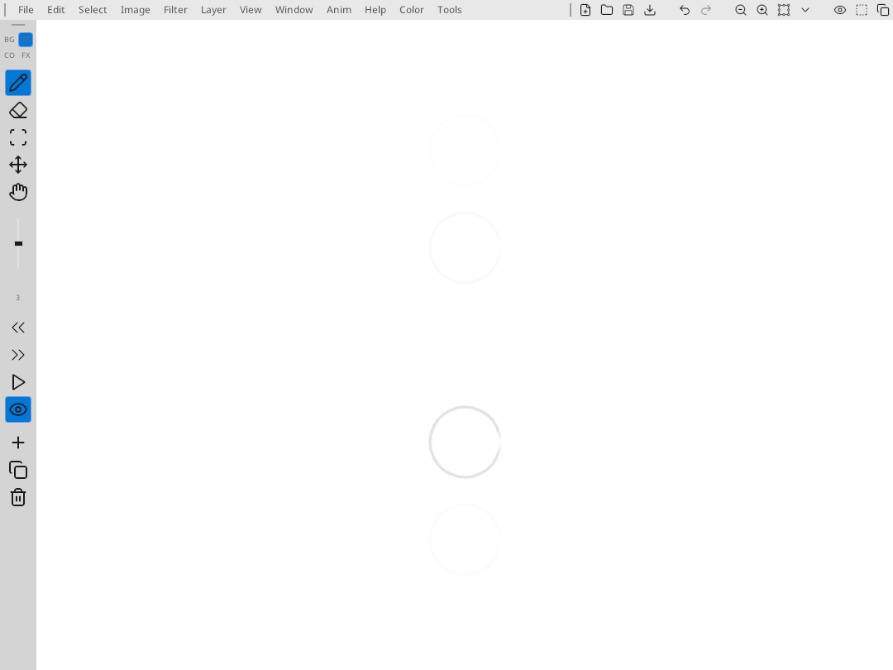


These are real Linux app captures at 1080×810 using Xvfb and Mesa software OpenGL. They are not physical iPad captures.

## Results

- Initial checks: iPad layout 10/10, rendering/frame interaction 4/4, RLE/persistence 5/5.
- After the foreground fix: theme 8/8, toolbar 38/38, iPad layout 10/10.
- Six bouncing-ball frames were drawn using scripted calls to the existing pencil and frame commands.
- All six pencil planes were byte-identical after native project save/reload.
- The unmodified app reopened the saved project in a fresh process.
- Onion skin is visible while editing and hidden during playback.
- Build and `git diff --check` passed.

Physical iPad input, palm rejection, perceived latency, a five-minute device session, iPad lifecycle persistence, and release packaging remain unverified.

## Reproduce

```sh
make -j4 penciltest build/bin/test_theme_test build/bin/test_toolbar_wrap_test \
  build/bin/test_penciltest_layout_test build/bin/test_penciltest_render_test \
  build/bin/test_penciltest_rle_test
build/bin/test_theme_test
build/bin/test_toolbar_wrap_test
build/bin/test_penciltest_layout_test
build/bin/test_penciltest_render_test
build/bin/test_penciltest_rle_test
gzip -dc docs/validation/penciltest/bouncing-ball.ptf.gz > /tmp/bouncing-ball.ptf
build/bin/penciltest /tmp/bouncing-ball.ptf --screenshot /tmp/penciltest-reopened.png
```

`capture-harness.patch` is temporary instrumentation used to create the fixture and initial screenshots. It is preserved for reproducibility, not applied to the production app. Adapt its output path to your machine before applying it. Build and run with `PENCILTEST_SMOKE=1` (and optionally `PENCILTEST_PLAY=1`), then revert the instrumentation and rebuild. The initial captures and instrumentation used base commit `e2af4a5113e48f34797d5f07ce250fd6337f2d50`.

## Compact layered theme

The charcoal header, lighter drawing-tool surface and rounded blue selections retain the original compact chrome footprint: 24 px header and 44 px tool rail in these Linux captures. There is no decorative inset around the canvas. The larger 36 px header and 52 px rail from the intermediate preview were discarded to preserve drawing space.

Opening a document now fits again after scrollbars disappear, using the final viewport rather than leaving the former scrollbar strips as empty gutters. Image aspect ratio and pixel data are preserved.

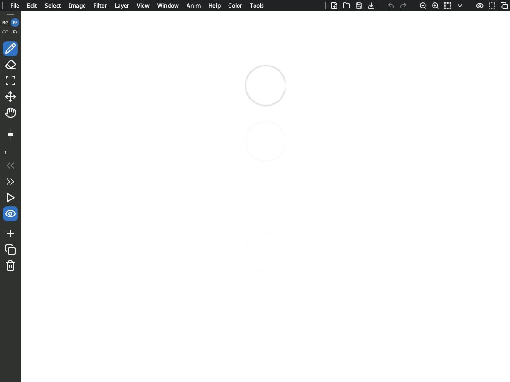


Validation: 151/151 checks passed (theme 8, toolbar 38, iPad layout 10, rendering 4, image-editor integration 91). The large-image opening check also asserts that the fitted image reaches at least one viewport dimension, preventing a gutter on both axes after scrollbar removal. All four canvas viewport corners in the captured bouncing-ball project are white paper pixels. Physical iPad input remains unverified.

## Layer icons and readouts

The rail is one column wide with 28 px buttons and 3 px of padding on each side in these captures. The 24 px header and rail meet the canvas viewport at its edges.


- **Layers** use Phosphor sparkle, palette, pencil and image icons, front to back. Hover shows each layer's name and purpose.
- **The editing cutoff is visible.** The selected layer has a filled icon. Icons above it are muted and can still be clicked.
- **Sliders have readouts**: "5px" over size and "50%" over opacity.
- **The frame counter reads "3/12"** instead of "3", with the speed ("12fps") under it. A click on either opens its dialog: the exposure sheet, Animation Speed.
- **The header loses two menus**, Filter and Color, and Image loses Levels. None of them did anything in Pencil Test. This leaves more of the 24 px row for the compact toolbar before it has to wrap into a band of its own.

The floating color palette, drawing tools and frame controls remain available in the same places.

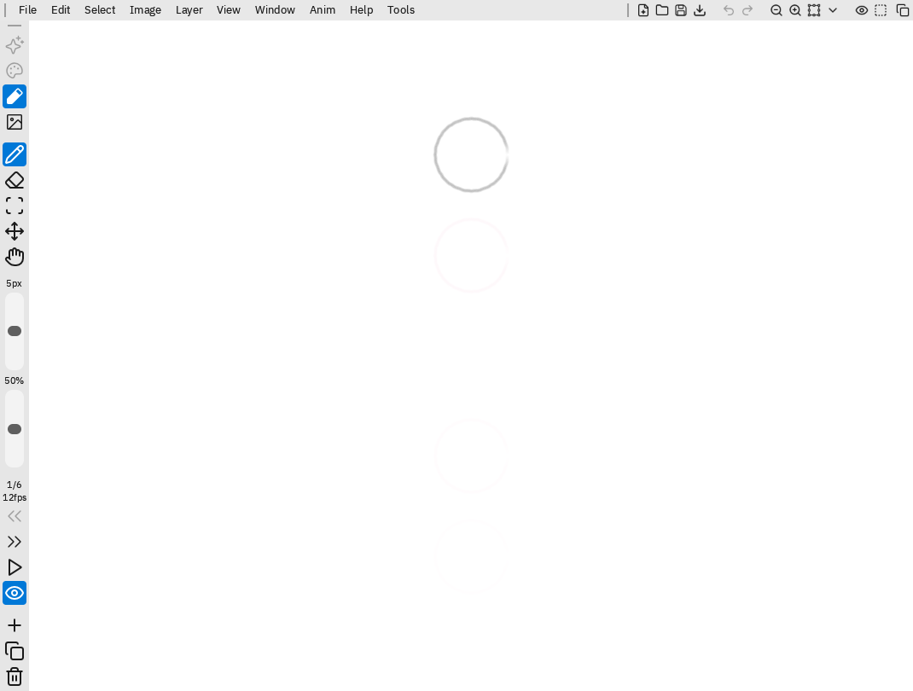

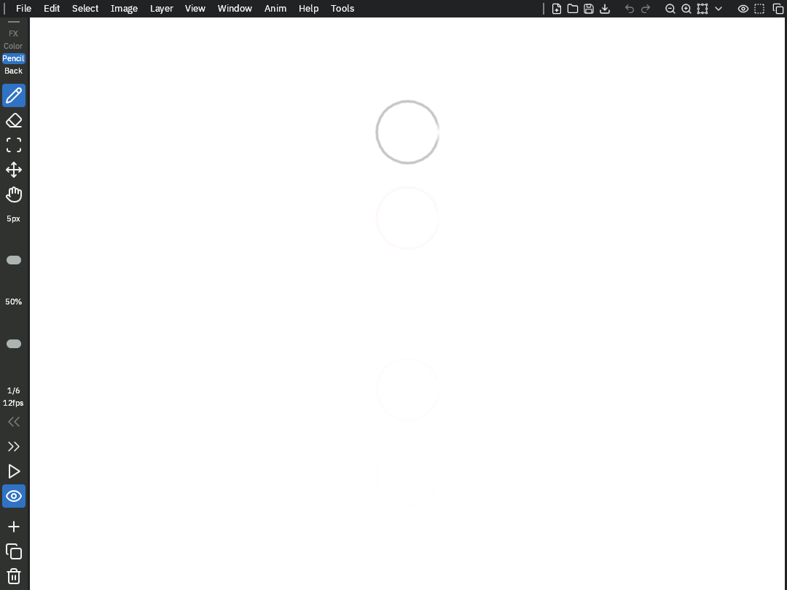

`ladder-light.png` and `ladder-dark.png` show `bouncing-ball.ptf` at 1070 × 810. The viewport matches the drawing's aspect ratio. The comparison crops each rail at its actual edge before scaling it up, excluding any fitted canvas margin.

Validation: Pencil Test layout 11/11, layers 6/6, rendering 4/4, toolbar 42/42, generator contract 20/20. The iPad layout test checks equal left and right padding on every layer. Physical iPad input remains unverified.

## Ribbon

Pencil Test as its own application now has a ribbon and nothing else: no tool
strip, no floating colour strip, no options strip. The drawing reaches both
sides and the bottom of the window.

| One row (default) | Three rows |
|---|---|
| 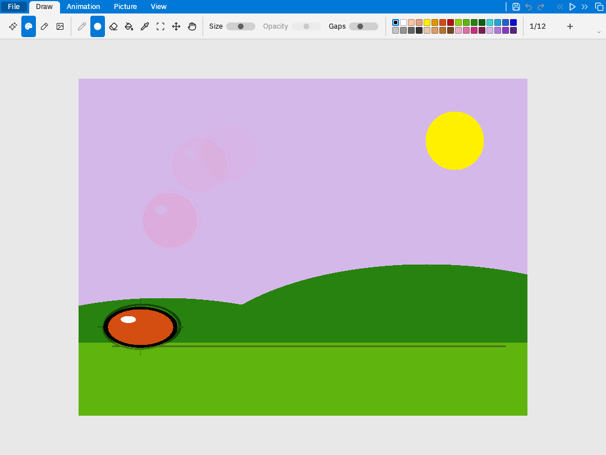 | 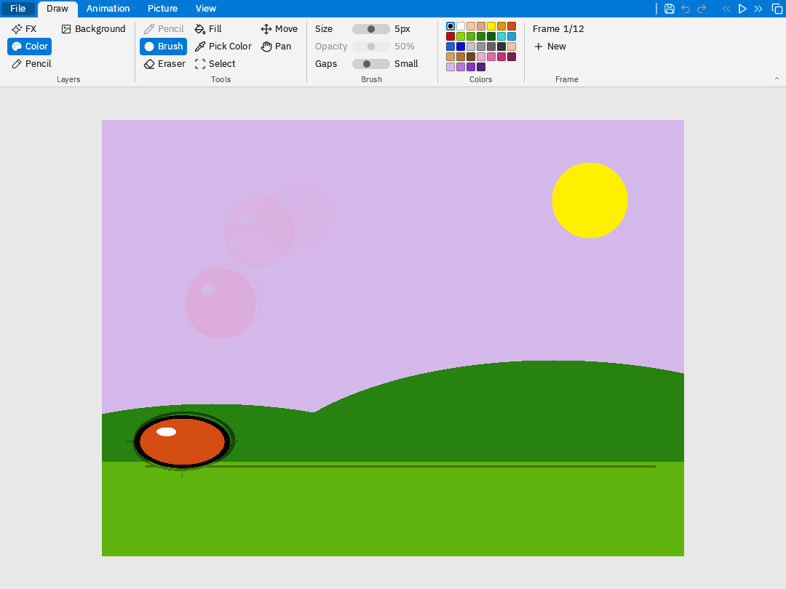 |
| **Folded** | **Animation tab** |
| 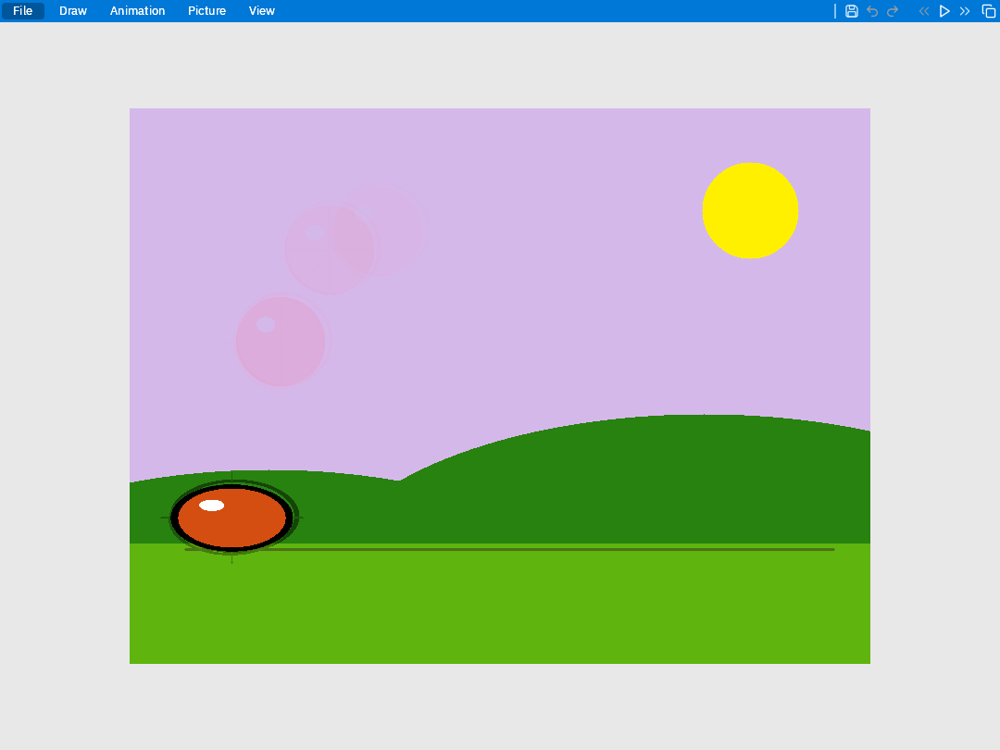 | 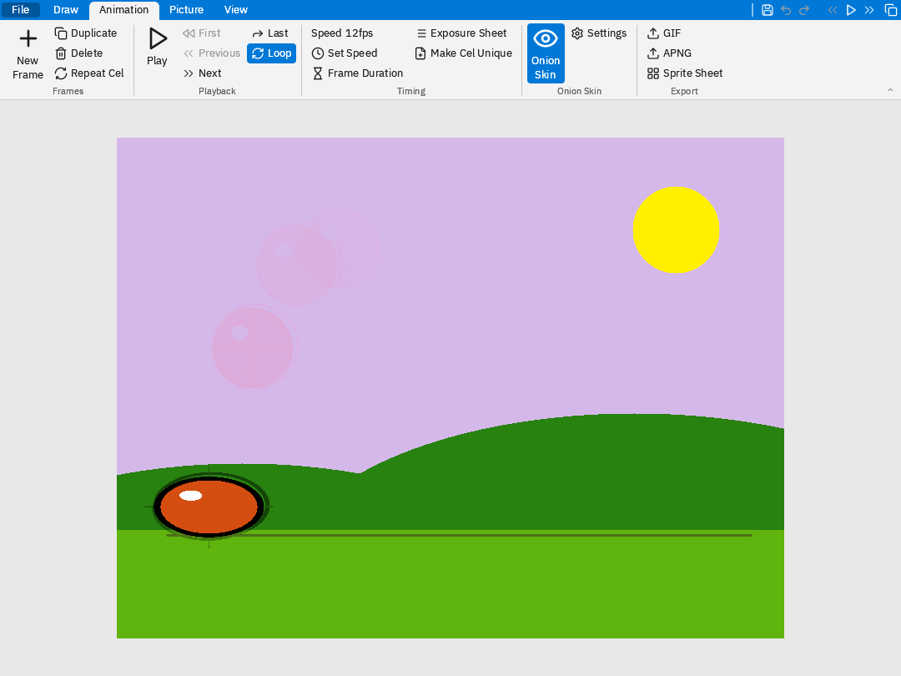 |

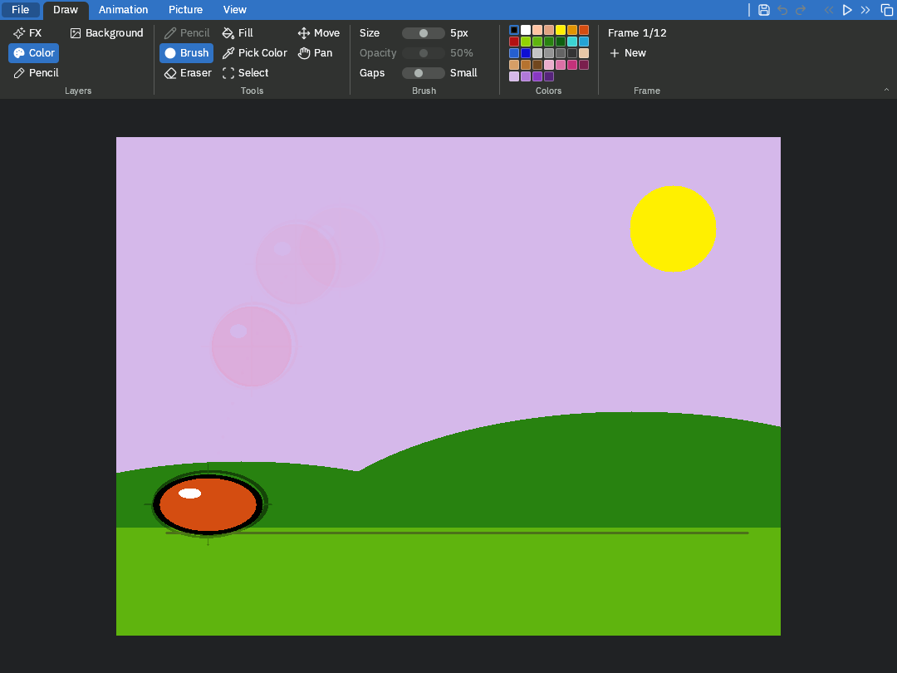

Drawing area in the same 1080×810 window:

| Layout | Chrome | Drawing area |
|---|---|---|
| Tool strip (before) | 24 px row, one-column strip at the left | 786 high, less the strip's width |
| Ribbon, one row | 59 px | 1080×751 |
| Ribbon, three rows | 120 px | 1080×690 |
| Ribbon, folded | 24 px | 1080×786 |

The four layers are one radio group: a segmented control with the layer icons,
which stands each icon over its name when the ribbon has three rows.

At 1080 px the one-row Draw tab shows every control; the sliders give up their
readouts ("5px", "50%", "Small") to fit, and three rows show them.

Captures: `build/bin/penciltest FILE --screenshot OUT.png` under Xvfb at
1080×810, with the Color layer of the bouncing-ball project active. The
three-row, folded, Animation and dark captures needed the layout, the fold and
the tab set at startup (`rbSetLayout`, `rbSetMinimized`, `rbSetActiveTab`); that
was a temporary hook in `create_pencil_ribbon`, not part of the tree.

Checks: `test_ribbon_test` 8/8 (hosted controls), `test_swatchgrid_test` 2/2,
`test_segmented_test` 7/7 (named icons, tall form), `test_orionc_contract_test` 21/21,
`test_penciltest_ribbon_test` 4/4.
