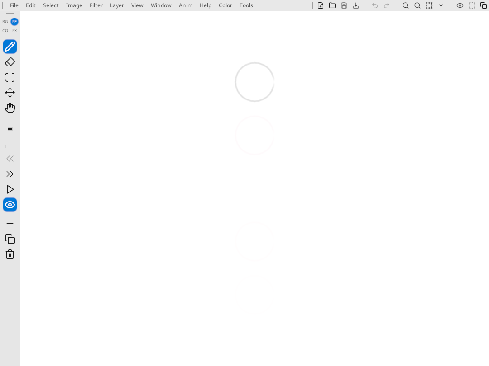
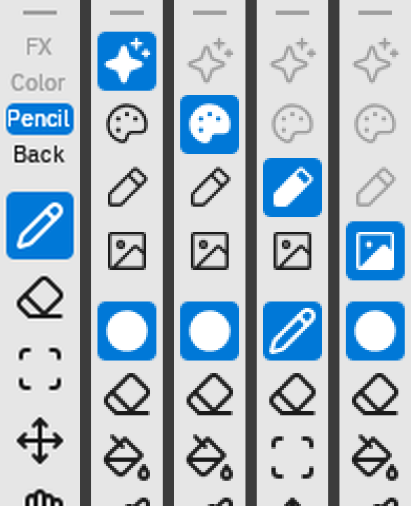

# Pencil Test validation — 26 October 2026

The selection foreground fix makes selected toolbar icons and text use the theme foreground policy, including Pencil Test layer labels. In the light theme this is white on blue. Disabled controls keep their disabled color; other themes retain their own foreground palette.

## After the fix


## Initial validation captures


These are real Linux app captures at 1080×810 using Xvfb and Mesa software OpenGL. They are not physical iPad captures.

## Results

- Initial checks: iPad layout 10/10, rendering/frame interaction 4/4, RLE/persistence 5/5.
- After the foreground fix: theme 8/8, toolbar 38/38, iPad layout 10/10.
- Six bouncing-ball frames were drawn using scripted calls to the existing pencil and frame commands.
- All six pencil planes were byte-identical after native project save/reload.
- The unmodified app reopened the saved project in a fresh process.
- Onion skin is visible while editing and hidden during playback.
- Build and `git diff --check` passed.

Physical iPad input, palm rejection, perceived latency, a five-minute device session, iPad lifecycle persistence, and release packaging remain unverified.

## Reproduce

```sh
make -j4 penciltest build/bin/test_theme_test build/bin/test_toolbar_wrap_test \
  build/bin/test_penciltest_layout_test build/bin/test_penciltest_render_test \
  build/bin/test_penciltest_rle_test
build/bin/test_theme_test
build/bin/test_toolbar_wrap_test
build/bin/test_penciltest_layout_test
build/bin/test_penciltest_render_test
build/bin/test_penciltest_rle_test
gzip -dc docs/validation/penciltest/bouncing-ball.ptf.gz > /tmp/bouncing-ball.ptf
build/bin/penciltest /tmp/bouncing-ball.ptf --screenshot /tmp/penciltest-reopened.png
```

`capture-harness.patch` is temporary instrumentation used to create the fixture and initial screenshots. It is preserved for reproducibility, not applied to the production app. Adapt its output path to your machine before applying it. Build and run with `PENCILTEST_SMOKE=1` (and optionally `PENCILTEST_PLAY=1`), then revert the instrumentation and rebuild. The initial captures and instrumentation used base commit `e2af4a5113e48f34797d5f07ce250fd6337f2d50`.

## Compact layered theme

The charcoal header, lighter drawing-tool surface and rounded blue selections retain the original compact chrome footprint: 24 px header and 44 px tool rail in these Linux captures. There is no decorative inset around the canvas. The larger 36 px header and 52 px rail from the intermediate preview were discarded to preserve drawing space.

Opening a document now fits again after scrollbars disappear, using the final viewport rather than leaving the former scrollbar strips as empty gutters. Image aspect ratio and pixel data are preserved.




Validation: 151/151 checks passed (theme 8, toolbar 38, iPad layout 10, rendering 4, image-editor integration 91). The large-image opening check also asserts that the fitted image reaches at least one viewport dimension, preventing a gutter on both axes after scrollbar removal. All four canvas viewport corners in the captured bouncing-ball project are white paper pixels. Physical iPad input remains unverified.

## Layer ladder and readouts

The rail keeps its width and the header its height; the canvas still reaches every workspace edge. Inside that footprint the rail now says what it holds.



- **Layers** were four two-letter codes in a 2×2 block that did not match the stack. They are now a ladder of four slim rungs, a cell wide and half a cell tall, that spell the layers out front to back: FX, Color, Pencil, Back. The ladder is two buttons tall and no wider than a button.
- **The editing cutoff is visible.** The canvas shows the stack up to the working layer. The rungs above it are now grey, so a layer that is not being drawn is not a mystery.
- **Sliders have readouts**: "5px" over size and "50%" over opacity.
- **The frame counter reads "3/12"** instead of "3", with the speed ("12fps") under it. A click on either opens its dialog: the exposure sheet, Animation Speed.
- **The header loses two menus**, Filter and Color, and Image loses Levels. None of them did anything in Pencil Test. This leaves more of the 24 px row for the compact toolbar before it has to wrap into a band of its own.

No previews, panels or strips were added. The floating color toolbar, the tools and the frame buttons are unchanged.


`ladder-light.png` and `ladder-dark.png` are `bouncing-ball.ptf` opened with `--screenshot` (and `--appearance dark`). The close-up is the same capture at three times its size, beside the previous rail and two projects saved on other layers.

Validation: Pencil Test layout 11/11, layers 6/6, rendering 4/4, toolbar 42/42, generator contract 20/20. Physical iPad input remains unverified; a slim rung is 32×15 logical pixels in these captures, wider than the 15×15 cells it replaces.
