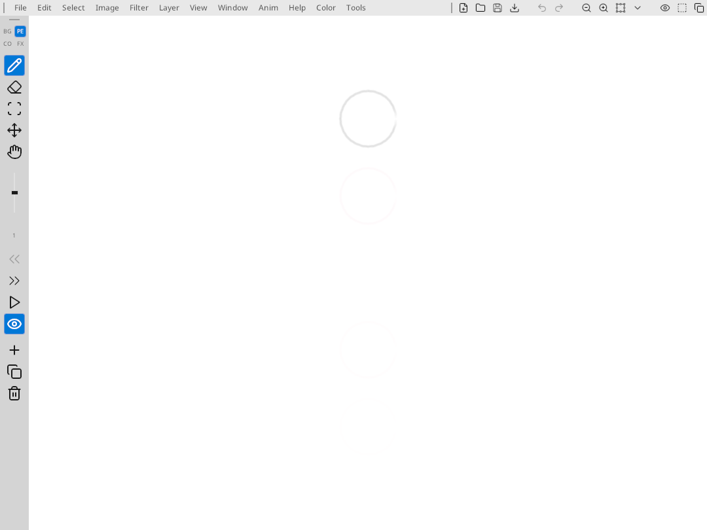
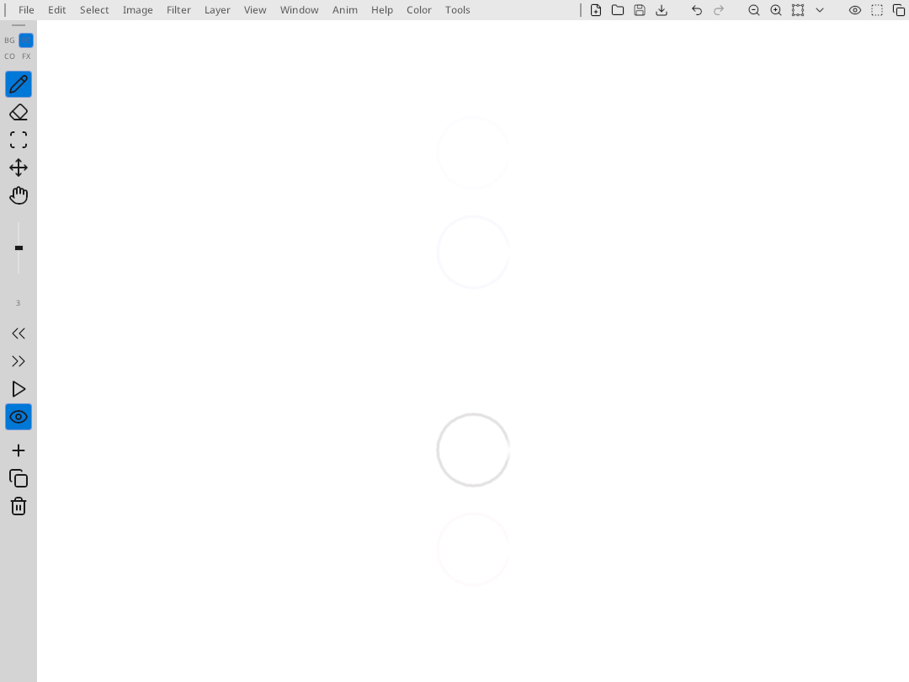
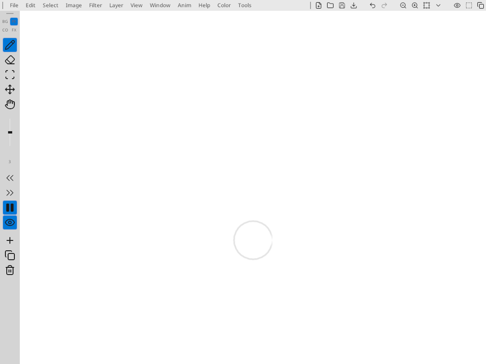
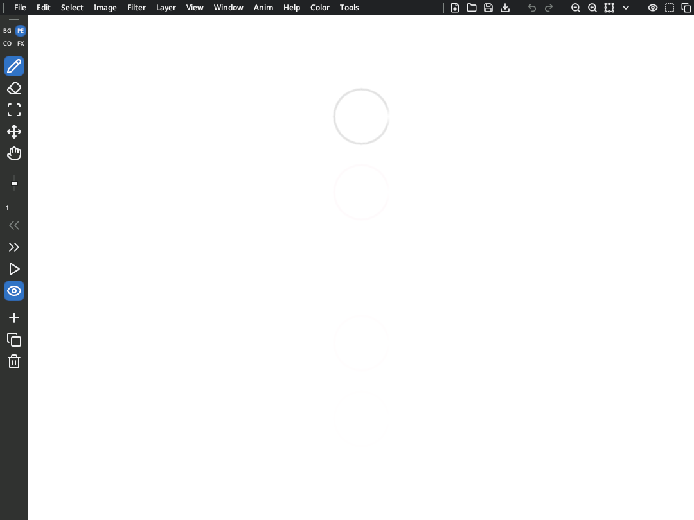
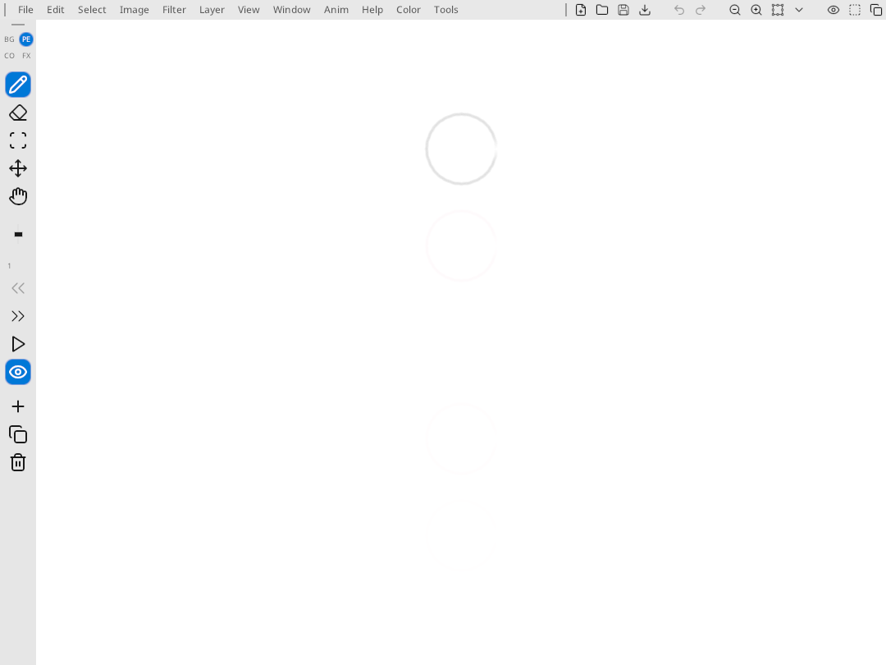

# Pencil Test validation — 26 October 2026

The selection foreground fix makes selected toolbar icons and text use the theme foreground policy, including Pencil Test layer labels. In the light theme this is white on blue. Disabled controls keep their disabled color; other themes retain their own foreground palette.

## After the fix




## Initial validation captures






These are real Linux app captures at 1080×810 using Xvfb and Mesa software OpenGL. They are not physical iPad captures.

## Results

- Initial checks: iPad layout 10/10, rendering/frame interaction 4/4, RLE/persistence 5/5.
- After the foreground fix: theme 8/8, toolbar 38/38, iPad layout 10/10.
- Six bouncing-ball frames were drawn using scripted calls to the existing pencil and frame commands.
- All six pencil planes were byte-identical after native project save/reload.
- The unmodified app reopened the saved project in a fresh process.
- Onion skin is visible while editing and hidden during playback.
- Build and `git diff --check` passed.

Physical iPad input, palm rejection, perceived latency, a five-minute device session, iPad lifecycle persistence, and release packaging remain unverified.

## Reproduce

```sh
make -j4 penciltest build/bin/test_theme_test build/bin/test_toolbar_wrap_test \
  build/bin/test_penciltest_layout_test build/bin/test_penciltest_render_test \
  build/bin/test_penciltest_rle_test
build/bin/test_theme_test
build/bin/test_toolbar_wrap_test
build/bin/test_penciltest_layout_test
build/bin/test_penciltest_render_test
build/bin/test_penciltest_rle_test
gzip -dc docs/validation/penciltest/bouncing-ball.ptf.gz > /tmp/bouncing-ball.ptf
build/bin/penciltest /tmp/bouncing-ball.ptf --screenshot /tmp/penciltest-reopened.png
```

`capture-harness.patch` is temporary instrumentation used to create the fixture and initial screenshots. It is preserved for reproducibility, not applied to the production app. Adapt its output path to your machine before applying it. Build and run with `PENCILTEST_SMOKE=1` (and optionally `PENCILTEST_PLAY=1`), then revert the instrumentation and rebuild. The initial captures and instrumentation used base commit `e2af4a5113e48f34797d5f07ce250fd6337f2d50`.

## Compact layered theme

The charcoal header, lighter drawing-tool surface and rounded blue selections retain the original compact chrome footprint: 24 px header and 44 px tool rail in these Linux captures. There is no decorative inset around the canvas. The larger 36 px header and 52 px rail from the intermediate preview were discarded to preserve drawing space.

Opening a document now fits again after scrollbars disappear, using the final viewport rather than leaving the former scrollbar strips as empty gutters. Image aspect ratio and pixel data are preserved.





Validation: 151/151 checks passed (theme 8, toolbar 38, iPad layout 10, rendering 4, image-editor integration 91). The large-image opening check also asserts that the fitted image reaches at least one viewport dimension, preventing a gutter on both axes after scrollbar removal. All four canvas viewport corners in the captured bouncing-ball project are white paper pixels. Physical iPad input remains unverified.
